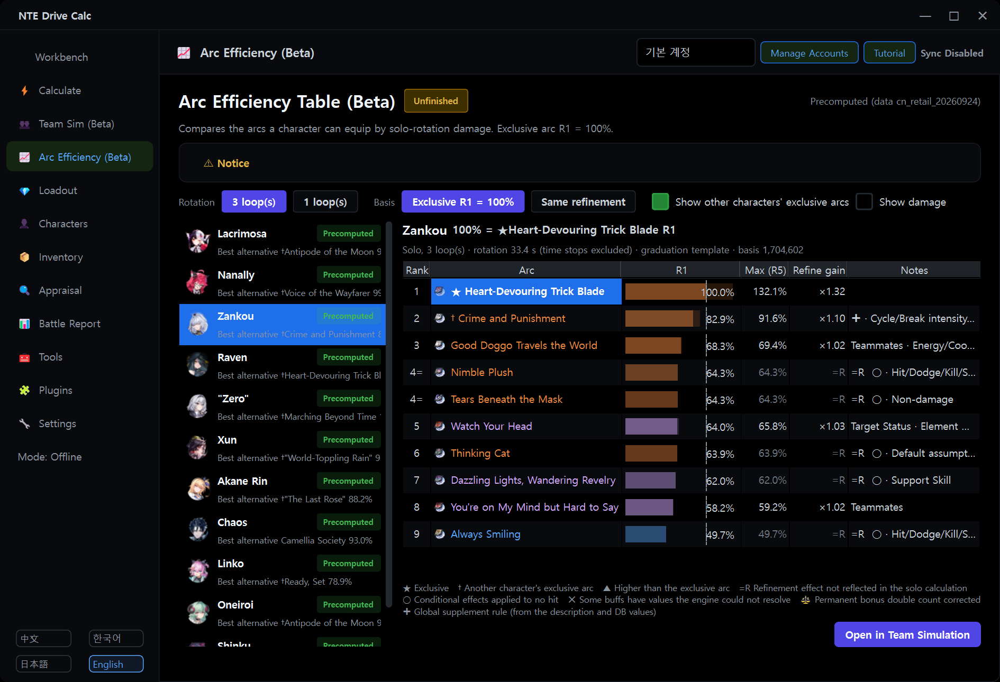
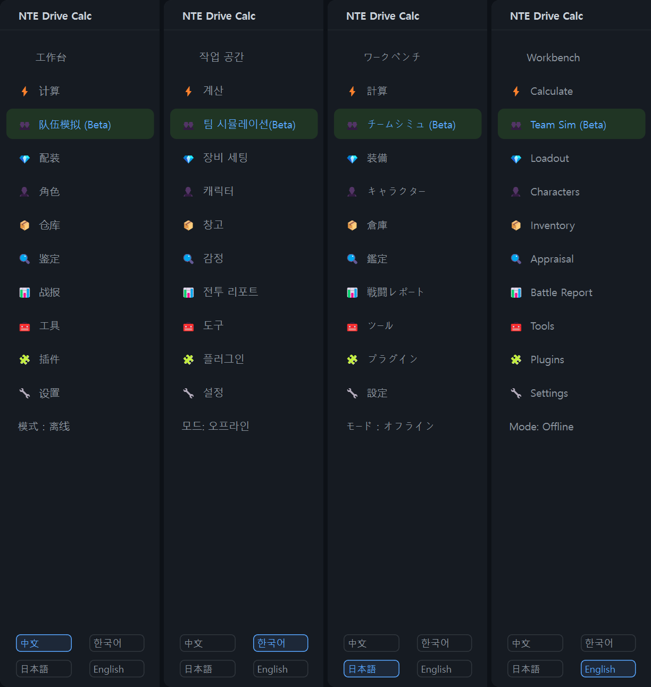
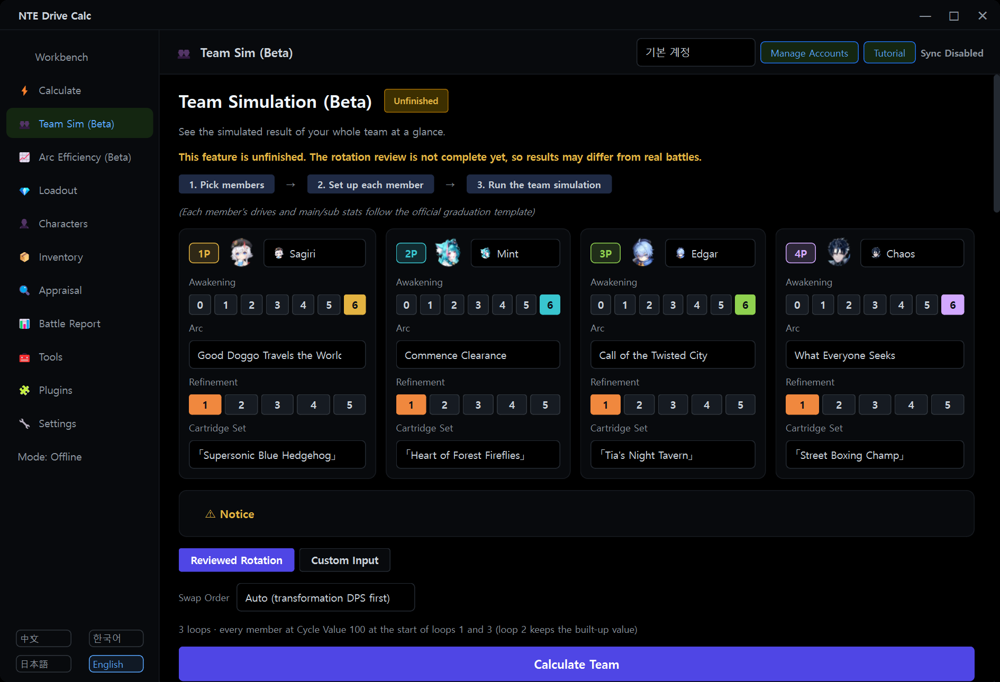

# NTE Drive Calc Global

**v2.3.5 fixes native inventory sync for Elyms.** Update in-app from v2.3.4. On v2.3.3 or earlier, [run the v2.3.5 installer](https://github.com/LuinDe/NTE-Drive-Calc-Global/releases/download/v2.3.5/NTE_Drive_Calc_2.3.5_Multilingual_Setup.exe) once to switch signing keys.

[한국어](README.md) | **English** | [日本語](README.ja.md) | [中文](README.zh.md)

> [!IMPORTANT]
> **This is not the original program. It is an unofficial build made by modifying the original.**
>
> **Original (official) project: [NTE Drive Calc — hxwd94666/NTE-Drive-Calculator](https://github.com/hxwd94666/NTE-Drive-Calculator)**
> <https://github.com/hxwd94666/NTE-Drive-Calculator>
>
> - NTE Drive Calc Global is a **derivative build: [LuinDe](https://github.com/LuinDe) modified the source code of the official NTE Drive Calc 2.3.1**, which was created by [hxwd94666](https://github.com/hxwd94666) and the NTE Drive Calc contributors.
> - **It is not an official release.** The original author did not make, review or support this build.
> - Please report problems with this build in **[this repository's Issues](../../issues)**, not in the original repository. Do not contact the original author about it.
> - If you want the official version, get it from the original link above.
> - Thank you to the original author and contributors for creating the program and publishing its source under AGPL-3.0. The core features of this build (Drive calculation, scanning, sync, battle report, cultivation history and the rest) are theirs. The parts listed under "What was changed from the original" below, such as Team Simulation and the Arc Efficiency table, were added or changed in this build; errors in them are not the original author's.

## What this repository is

[NTE Drive Calc](https://github.com/hxwd94666/NTE-Drive-Calculator) (异环驱动计算器) is a Windows calculator for Drive and Cartridge progression in the game Neverness to Everness (NTE / 异环). It reads your inventory, appraises items, calculates loadouts for your characters and equips them in the game automatically. For the full feature description, see the [original README](https://github.com/hxwd94666/NTE-Drive-Calculator#readme).

**NTE Drive Calc Global** is an unofficial modified build based on the official 2.3.1 that

- lets you use the interface in **Korean / English / Japanese / Chinese**,
- adds a few features such as **Team Simulation (Beta)**, the **Arc Efficiency Table (Beta)**, the **awakening efficiency table (Beta)** and **Puka Boot Camp**, and
- has **in-app updates that come only from this repository's releases**, separate from the original.

This repository holds the modified source code (`src/`) and the build tools. The installer is available from [Releases](../../releases). The current version is **Global 2.3.2**. Global's version number is now independent of the original's; Global 2.3.2 is based on the official 2.3.1.



## What is new in 2.3.2

A summary for users of the previous release (2.3.1-global.1). Details and known limits of each release are in [RELEASE_NOTES.md](RELEASE_NOTES.md).

- **If you use 2.3.1-global.1 or 2.3.1-global.2, install this version once by hand.** 2.3.1-global.1 has no updater, and 2.3.1-global.2 (published briefly on 2026-10-19) does not recognise the new version format. From this version on, new versions arrive inside the program.
- **Global's version number is now independent of the original's.** Global 2.3.2 is based on the official 2.3.1 and contains everything of 2.3.1-global.2.
- **New: in-app updates (Global only)** — only this repository's releases are checked, and only releases carrying the maintainer's valid signature are installed. The original's update function is removed (see [Updates](#updates) below).
- **Team Simulation: ultimate energy, Esper-Cycle gauge, cooldowns and a swap rule** — all 24 characters build up energy and gauge per hit and their cooldowns apply; a skill still on cooldown for 0.3 s or more hands over to the next character (item 2 below).
- **New: free awakening choice and the awakening efficiency table** — awakening effects can be chosen in any order, and a table shows the DPS change of each effect (item 3 below).
- **Akane Rin is calculated with the CN-release data** (item 5 below).
- **New: Puka Boot Camp** — the account-wide progression of game version 1.4 in panels, marginal gains, Team Simulation and battle reports (item 6 below).
- **New: RTSS (RivaTuner) compatibility notice** — before the Loader starts, it tells you about an RTSS setting that can make the game crash at start (item 10 below).
- The "Workbench" header of the home page now shows **Akane Rin** instead of Raven.
- **Fixes**: Chinese skill names in the Japanese Custom Input palette tooltips, the Japanese name of Chiz (小吱), long character names cut off in the team cards.
- Team Simulation and the efficiency tables give different numbers than 2.3.1-global.1 for the same team (cooldown waits and swaps, awakening rules, Akane Rin's data).

<details>
<summary>What was new in 2.3.1-global.1 (Global 2.3.0 → based on the official 2.3.1)</summary>

- **Based on the official 2.3.1**: everything the original added in 2.3.1 (cultivation history, the plugin-based in-game components and more) is included.
- **New: Arc Efficiency Table (Beta)** — for every character with an exclusive arc, the arcs it can equip are rated in % of the exclusive arc (item 4 below).
- **Team Simulation arc corrections**: the chosen arc now reaches the character's stats, always-on arc bonuses are no longer counted twice, and the conditional effects of "Crime and Punishment" and "Antipode of the Moon" are calculated (item 2 below).
- **Game-folder protection** rebuilt for the new 2.3.1 component layout (`d3d12.dll` + `plugins\NTE_Plugin*.dll`) (item 9 below).
- **Translations**: about 700 strings new in 2.3.1 are translated into the three languages. The Korean text follows the wording of the Korean patch for 2.3.1. 288 older game descriptions are now translated into English and Japanese as well.
- **Fixes**: in 9 translated messages two values could appear in each other's place; `&` in English buttons and tabs was taken as a keyboard shortcut marker (now "and"); some English and Japanese terms.

</details>

## What was changed from the original

A detailed, file-level list is in [CHANGES.md](CHANGES.md).

### 1. Four languages

- The interface language can be **中文 (the original text) / 한국어 / 日本語 / English**. Click the **language buttons at the bottom left** of the program: the language changes immediately while the program is running (no restart), and your choice is saved.
- About 10,100 interface strings are translated per language. Names of characters, sets, Arcs, skills and monsters, effect descriptions and battle report texts are shown translated as well.
- Korean uses the official names of the Korean game client. English and Japanese follow each language's client where the terms could be confirmed; names that could not be confirmed (for example content not yet released in that language) may be provisional translations or left in the original text.
- Since 2.3.2 the Korean interface calls awakening (觉醒) "돌파"; English and Japanese keep "Awakening" / 「覚醒」.
- The search boxes of the game database (characters, equipment, Arcs, monsters) accept Korean text and Korean initial consonants (Chinese search works as before).
- The installer is in four languages too.



### 2. Team Simulation (Beta) — new feature

> [!WARNING]
> **This feature is unfinished.** The program shows the same warning: *"This feature is unfinished. The rotation review is not complete yet, so results may differ from real battles."*
> It is meant for a rough comparison of team strength and does not guarantee real combat results.

- Pick four members and it calculates the team's total damage, DPS and each member's contribution. You can choose Awakening, Arc, Refinement and Cartridge Set per member; Drives and main/sub stats follow the official graduation template (it does not use the equipment in your own inventory).
- **Reviewed Rotation**: rotations for 24 characters are built in, and the team runs 3 loops.
- **Esper Cycle reactions are always computed.** When swapping to an adjacent-element member, Blossom, Hex, Scorch, Nova, Stain and Remora, plus Charge and Discord, are handled (Remora, Charge and Discord are shown as effects without damage).
- **Attacks in transformation / form states** are included (Zankou, Raven, Shinku, Hathor, Akane Rin, Yi and others).
- You can choose the **Swap Order**: Auto (transformation DPS first) / Auto (most reactions) / Team slot order.
- **Explanation panel**: below the result it shows the rotation used, the swap order and why it was chosen, a table of Cycle reactions, the rotation per member, the energy / gauge / cooldown events, and the assumptions and limits.
- **Custom Input mode**: write a rotation as text and calculate it. It has options for the Cycle Value, cooldowns, buffs and numbers, and rotations can be saved under a name and loaded again. For the notation, see [Usage](#usage) below.
- **Arc corrections** (since 2.3.1; the same calculation as the Arc Efficiency table):
  - Changing a member's arc or refinement changes the character's stats accordingly (in 2.3.0 the stats of the template's arc stayed).
  - An always-on arc bonus that was counted both in the stats and by the battle engine is counted once.
  - The conditional effects of "Crime and Punishment" and "Antipode of the Moon", whose values the battle engine cannot work out, are calculated from their description and the game-data values (shown as **Global supplement rule**; time stops are not counted in their durations).

#### Ultimate energy, Esper-Cycle gauge and cooldowns (2.3.2)

- For all 24 characters, **ultimate energy and the Esper-Cycle gauge build up per hit** from the game data, and **skill cooldowns** apply. Cooldowns come from the game data and community sources (prydwen.gg, GameWith); the cooldown clock is combat time without time stops. The explanation panel shows the source and confidence of every value.
- Missing values are never guessed: cooldowns that could not be confirmed are not checked, and where no gauge data exists the old rule (gauge 100 at the start of loops 1 and 3) is used instead; the explanation says so.
- You can pick the **Resource model** (remembered per account): Game data + community cooldowns (default) / Game data / Old rule (no energy or cooldown check, gauge refilled at loops 1 and 3 = the 2.3.1-global.1 calculation).
- **Swap rule**: in a team, when the next skill's cooldown still has **0.3 s or more** left, or the ultimate lacks energy, the character does not wait and hands over to the next one. With **less than 0.3 s** left it waits and uses the skill. When no member is ready, the team waits for the one that is ready first. The explanation lists every swap and wait.
- The solo efficiency tables (Arc / Awakening) wait for cooldowns, because there is nobody to swap to.
- Custom Input has the check modes No check / Warn only (default) / Insert wait / Strict. "Strict" uses the same swap rule as the reviewed rotations.
- Most reviewed teams give the same result. Fast teams with tight cooldowns (for example with Oneiroi) may swap more and deal less total damage.

### 3. Free awakening choice and the awakening efficiency table — new in 2.3.2

- In the game, awakening effects can be taken in any order (for example ③ → ⑤ → ①). The member cards of Team Simulation now toggle each of the six effects ("Awakening n/6"), and the resonances turn on at 3 and 6 awakenings whatever the chosen effects. "Awakening N = effects 1..N" is no longer assumed.
- Saved teams and cycles open as before (a saved count alone is read as effects 1..N).
- Of the 24 characters' 192 awakening effects, **129 are computed**. The others are marked, never shown as 0 %:
  - **Unmeasured** (34): the hits or resources the effect acts on are not on the calculator's time axis yet, or its values or timing are in neither the game data nor the descriptions, so it has to be measured in game.
  - **Not computable** (29): effects with no damage (healing, shields, movement …) or effects that need a break, a kill, being hit or several targets, so they do not show in the damage to one stationary dummy.
  - Effects whose condition the simulator cannot reproduce use an expected value and are marked "expected". Lacrimosa ③ settles the remaining damage over time at once and removes that stack.
- A **Character Awakening Efficiency (Beta)** table sits under the Arc Efficiency table (collapsed at first). Per character it shows the DPS change of adding one effect (to awakening 0) and of removing one from all six, Resonance 3 / 6 and all six, for 1 and 3 loops. The values are precomputed and recomputed on your PC when the data or the calculation do not match.

### 4. Arc Efficiency Table (Beta) — new feature

> [!WARNING]
> **This feature is unfinished.** The table compares arcs with each other; it is not an in-game result.

- Open **Arc Efficiency (Beta)** in the left menu and pick a character: the arcs that character can equip are compared by the **damage of the character's solo rotation**. **Exclusive arc at refinement 1 = 100 %.**
- Columns: rank, arc, **R1 %**, **max refinement %**, refinement gain, notes (`=R` refinement effect not reflected in the solo calculation, `○` conditional effects applied to no hit, `✚` Global supplement rule, and others). "Show damage" adds the damage values.
- You can switch between **3 loops (default) / 1 loop** and the basis **Exclusive R1 = 100 % / Same refinement**.
- **View at Puka Boot Camp max (Lv.20)**: the graduation template uses Puka Boot Camp level 0 (default, the same results as before) or 20 (remembered per account; both are precomputed).
- **Other characters' exclusive arcs** that the calculator's same-type rule lets the character equip are listed with a **†** (not verified in game). Untick "Show other characters' exclusive arcs" to hide them.
- **Only characters with an exclusive arc** (11 at present) are in the table; regular characters without an exclusive arc are not included. A new character with an exclusive arc in the game data appears automatically.
- The results are precomputed, so the page opens at once. When the game data or the calculation no longer match them, they are recomputed on your PC (the character you are viewing first; it can be cancelled).
- **Open in Team Simulation** opens Team Simulation with that character wearing the selected arc.
- How it is calculated: the character alone, the official graduation template with only the arc and its refinement swapped, the reviewed rotation, a Lv80 training dummy, the same engine, arc corrections and cooldown rules as Team Simulation (solo, so it waits). Arc effects that depend on support skills, teammates, team makeup, cycle intensity or break intensity count as 0. The assumptions are listed under "Notice" on the page and in [RELEASE_NOTES.md](RELEASE_NOTES.md).

### 5. Akane Rin: CN-release data (2.3.2)

- The bundled game data (2026-09-24) holds Akane Rin's pre-release values. After the CN release (2026-10-15), **only values on which at least two independent sources agree** replace them at run time. The game-data file itself is not changed, and the replacement is active only while the calculator's game data is exactly that 9-24 data.
- Replaced: release status, awakening effects ①–⑥, Resonance 3 / 6, "Sparkling Star Fervor" (ATK +20 % for 20 s after each first-stage ultimate), when the second stage of the ultimate can be used, the exclusive arc "Antipode of the Moon" (Skill damage +28 % at R1, no stacks) and more — 46 fields.
- Sources: the official CN notices (yh.wanmei.com, 10-14 / 10-15 / 10-16), screenshots of the CN release client (forum.gamer.com.tw), TapTap guides, Japanese guides that state they describe the Chinese version (kamigame, AppMedia, GameWith), LDShop for the arc text only.
- **Not verified** (the game-data value stays and the pages mark it): Lv80 base stats, skill multipliers, basic-attack conduction base values, the Cadenza Combo duration, five mechanics only one source describes, the exclusive arc's R1 crit rate and Lakshana bonus (sources disagree: 16 % vs 15 % / 20 %) and its other R2–R5 values. **Her E / Q cooldowns and ultimate energy are unknown.**
- The battle report's analysis component (part of the original program, not modified) still computes with the pre-release data; records that contain Akane Rin show a one-line note.

### 6. Puka Boot Camp — new in 2.3.2

- **Puka Boot Camp**, the account-wide progression of game version 1.4 (Lv 0–20, applies to deployed characters), is part of the calculation. Enter the level on the **Furniture Bonus card of the character page** (default 0): ATK, DEF, HP, CRIT Rate, CRIT DMG, cycle intensity and break intensity are added to character panels, marginal gains, Team Simulation and newly recorded battle reports (+28 / +30 / +420 / +2.5 pp / +5 pp / +12 / +12 at Lv 20).
- A battle report freezes the level when recording starts. Reports recorded before this feature count as Lv 0; nothing is applied retroactively (the card says so).
- **All Boot Camp stats** (on by default): recomputed modified copies and marginal comparisons include the whole bonus. A "Manual Marginal Adjustment" row then appears and the quantification status may read "Partial". Turned off, only the ATK and CRIT DMG parts are included.
- **View at Puka Boot Camp max (Lv.20)** switches the graduation template of the Arc / Awakening Efficiency tables and of the graduation rate between Lv 0 and Lv 20.
- The level table was built by cross-checking public sources (the official 1.4 notice, community tables). The break-intensity total (12) and whether ATK, DEF and HP are flat bonuses were not verified in game.

### 7. In-app updates (Global only) — new in 2.3.2

The original's update function (checking the original's releases and Mirror酱, downloading the official installer, the update dialogs) is removed and replaced by **an updater that only checks this repository's releases**. Global is now developed and updated independently of the original. See [Updates](#updates) below.

### 8. Battle Report: Compare with My Characters — new feature

In an imported battle report, the characters you also own are replaced with your own build and current equipment, the same battle is recalculated, and the result is compared with the original. It is read-only: no saved data is changed.

### 9. Protection for other programs' files in the game folder

The official 2.3.1 deploys `d3d12.dll` (the host) and `plugins\NTE_Plugin*.dll` into the game folder and cleans up the older `NTE_Capture.dll` and `dwmapi.dll`. This build replaces or deletes those files **only when they are confirmed (by SHA-256) to be this program's own files**. A file that cannot be confirmed (for example ReShade installed as `d3d12.dll`, or another mod's `dwmapi.dll` such as UE4SS) is neither overwritten nor deleted. In that case deployment stops with a message, and a clean-up leaves that file in place and tells you.

### 10. RTSS (RivaTuner) compatibility notice — new in 2.3.2

- On the author's PC, RTSS (RivaTuner Statistics Server, installed with MSI Afterburner) running with its default hooking made the game crash right at start together with the 2.3.1 in-game component (D3D12 error `80004004 (E_ABORT)`).
- This build **only reads** the RTSS settings. When it sees that risk, **Start native Loader** shows the fix (add an HTGame.exe profile in RTSS and turn on Setup → General → "Use Microsoft Detours API hooking"), and the environment check lists it under **Detection Details**. RTSS settings are never changed. In the reminder you can check again, continue or cancel, or turn the reminder off for the account.
- When auto sync starts the Loader, no window appears; it is listed under "Detection Details" only. The full steps are in the [guide's RTSS section](docs/COEXIST_RESHADE_DLSS.en.md#using-with-rtss-rivatunermsi-afterburner).

### 11. Calculation fix

The Python reference formula of the battle report replay still used a copy ratio of 0.30 for the Hex (覆纹) follow-up when Linko's passive is active; it is now 0.33 (20% + 13%), the value the original's documentation gives for its analysis component. This Python formula runs when a replay is calculated without the analysis component. Battle report figures calculated by the bundled analysis component (not modified) are not affected. Team Simulation does not use this formula for Hex: it has its own, newly written formula, which uses the same ratio (0.33).

### 12. Other changes

- Fixes against problems caused by translation: code that compares texts accepts both the original and the translated text (normal-attack detection in battle reports, plugin status badges, sync guidance and others). The **cultivation history** of 2.3.1 saves in every language, and a saved record opens in any language (records saved by the official 2.3.1 open too).
- Korean and Japanese fonts take priority; button and label widths follow the translated text; a hint on the cultivation page wraps so the page fits the default window; translated stat names are recognised in the manual input of the Appraisal page.
- The seven "Tutorial" images are replaced by Korean versions (these images are Korean whichever language you choose).
- An installer that installs the whole program. The title at the top left reads "NTE Drive Calc Global".

### What was not changed

- The executable is the official 2.3.1 executable with only the `src.*` Python modules replaced (the original's two update modules are left out). All other components (nte-core, the analysis component, the in-game components and loader, the OCR model, the game's static database, the ViGEmBus driver and so on) are the same as in the official 2.3.1 distribution.
- **The battle report's analysis component (`nte-analysis-core`) is not modified.** Recorded battles are analysed as in the original; the Team Simulation cooldown and awakening rules and the Akane Rin data do not apply to battle reports.
- The logic of everything that interacts with the game, such as scanning (OCR), sync and automatic equipping, is unchanged except for items 9 and 10 above (the RTSS check only reads) and the text-matching adjustments that translation made necessary (section 7 of [CHANGES.md](CHANGES.md)). Those files did receive the string wrapping (`_L()`) needed for translation, and this build was not fully re-verified against the live game (see "What was checked" in [RELEASE_NOTES.md](RELEASE_NOTES.md)).

## Download and install

1. Download `NTE_Drive_Calc_2.3.5_Multilingual_Setup.exe` from [Releases](../../releases). It contains the whole program, so you do not need to install the official version first.
2. Close NTE Drive Calc if it is running.
3. Run the installer and click "Yes" in the User Account Control (UAC) prompt.
   - The file is not code-signed, so the **"Windows protected your PC" (SmartScreen)** window may appear. Click "More info" → "Run anyway". Before running it you can check the file with the [SHA-256](#verifying-the-files-sha-256) values or the [signature](#verifying-the-signature-yourself) below.
4. Choose the setup language (the language of your Windows is preselected if it is one of the four; otherwise English).
5. Read the notice and click "Next" to finish. The additional tasks (desktop shortcut, ViGEmBus virtual gamepad driver) are the same options as in the official installer.

After a first installation the program starts in the language you chose for setup. If you had already set a language, that setting is kept.

### If NTE Drive Calc is already installed

- It installs to the **same location** as the official version (default: `C:\Program Files\NTE Drive Calc`) and under the **same program entry**. Just install it over Global 2.3.1 (2.3.1-global.1), the official 2.3.1 (or an earlier official version), a 2.3.1 install with the [Korean patch](https://github.com/LuinDe/NTE-Drive-Calc-KO), or the earlier multilingual build (Global 2.3.0). You do not need to uninstall first.
- **User data is kept.** Accounts, settings, Drive and inventory data, battle report records, cultivation history, logs, saved rotations and the efficiency-table cache stay. User files in the `accounts`, `config`, `data`, `logs`, `migration` and `scanned_images` folders are neither deleted nor changed (like the official installer, it only rewrites the default file `config\stats.json` and the static-database backup `migration\game_static.previous.sqlite3`).
- Backup files made by the Korean patch (`NTE_Drive_Calc.original.exe` and others) are not removed.
- Installed over Global 2.3.0, a few files that 2.3.1 no longer uses (such as `_internal\NTE_Capture.dll`) stay in the program folder. An official 2.3.0 → 2.3.1 upgrade leaves the same files; they do no harm.
- After installation the Windows "Installed apps" list shows "NTE Drive Calc 2.3.2 Multilingual Edition (Global)" with version 2.3.2 (when installed in English).

## Updates

### In-app updates (Global only)

From 2.3.2 on, new Global versions can be installed from inside the program.

- **Updates come only from the releases of this repository (LuinDe/NTE-Drive-Calc-Global).** Global is developed and updated independently of the original and has its own version numbers, independent of the original's: `v<major>.<minor>.<patch>` (for example `v2.3.2`). No version request goes to the original's servers, and no in-app path installs the official build. New official versions of the original are not announced.
- When: at most once a day at start-up, and when you click **[Check for Updates] on the "Software Update" card in Settings**. The card shows the Global version, the original version it is based on (2.3.1, for information) and the fingerprint of the release-signing key.
- When a new version exists, its version and notes are shown with **[Update Now] [Later] [Skip This Version]**. [Update Now] downloads and verifies the installer; then click [Install and Restart Now] or install when you quit. The program closes and the installer runs in the same folder with administrator rights, without the setup wizard (only its progress window shows); user data stays. With [Install and Restart Now] the program starts again afterwards.
- Downloads are kept in `<install folder>\updates\` and cleaned up after the installation.

### What is verified (signature)

- Only this repository's published releases are considered (drafts and prereleases are ignored). The version must be newer than the running one, and only the fixed file names and this repository's download addresses are used.
- Every release carries a **manifest** (`NTE_Drive_Calc_<version>_release.json`) and its **signature** (`.sig`). The manifest names the tag, the version, the installer's file name, size and SHA-256, the SHA-256 of the executable it installs and the digest of the release notes. It is signed with the maintainer's release-signing key (Ed25519, OpenSSH `ssh-keygen -Y sign`); the program has the public key built in.
- Releases without a valid signature are **never announced**. The downloaded installer runs only when its size and SHA-256 match both the signed manifest and GitHub's values. When the release notes differ from the signed ones, a "could not verify" note is shown instead of them.
- Release-signing key (public) fingerprint: `SHA256:P5tE1mAUxx8UvnE6qZcx5xIwlkl3MwgP3vPuxr4EEyw`

```text
ssh-ed25519 AAAAC3NzaC1lZDI1NTE5AAAAICWQNY5RryTryNGlYL7zw4+biBXAnTkfOgFvZFHKQTQV nte-global-release-20261107
```

### Turning off the automatic check

Untick **"Check for updates at startup (at most once a day)"** on the "Software Update" card in Settings, and the program no longer checks by itself. [Check for Updates] still checks right away.

### Coming from 2.3.1-global.1

2.3.1-global.1 and older versions have no updater, so **install 2.3.2 once by hand** from [Releases](../../releases) (see [Download and install](#download-and-install)). 2.3.1-global.2, published briefly on 2026-10-19, does not recognise the new version format either: install 2.3.2 by hand the same way. Later Global versions then arrive inside the program.

### Verifying the signature yourself

The in-app updater does this by itself. To check a downloaded installer by hand, use the OpenSSH `ssh-keygen` that comes with Windows 10/11.

1. Download the installer, `NTE_Drive_Calc_<version>_release.json` and `NTE_Drive_Calc_<version>_release.json.sig` of a release into one folder.
2. Open **Command Prompt** (cmd) in that folder and run the two lines below (PowerShell has no `<` redirection). The first writes an `allowed_signers` file with the maintainer's public key. The example is 2.3.4.

```bat
echo nte-global-release-20261107 namespaces="nte-drive-calc-global-release" ssh-ed25519 AAAAC3NzaC1lZDI1NTE5AAAAICWQNY5RryTryNGlYL7zw4+biBXAnTkfOgFvZFHKQTQV> allowed_signers
ssh-keygen -Y verify -f allowed_signers -I nte-global-release-20261107 -n nte-drive-calc-global-release -s NTE_Drive_Calc_2.3.4_release.json.sig < NTE_Drive_Calc_2.3.4_release.json
```

3. `Good "nte-drive-calc-global-release" signature for nte-global-release-20261107 with ED25519 key SHA256:P5tE1mAUxx8UvnE6qZcx5xIwlkl3MwgP3vPuxr4EEyw` means the manifest was signed with the maintainer's key. If it prints `Could not verify signature`, do not use the files and report it in [Issues](../../issues).
4. Open the manifest in Notepad and check that `sha256` and `size` under `installer` match the downloaded installer (`certutil -hashfile NTE_Drive_Calc_2.3.4_Multilingual_Setup.exe SHA256`).

## Going back to the official build

- Run the **official installer** (`NTE_Drive_Calc_Setup_2.3.1.exe`) again and install to the same location. The executable and the tutorial images become the official ones; user data stays. Get the official installer from the original project: <https://github.com/hxwd94666/NTE-Drive-Calculator>
- Running the installer of a later official version also installs the official build in the same place. The multilingual interface, Team Simulation, the efficiency tables and the Global updates are gone in that case, and the official build's own update function works again. (The Global in-app updater never installs the official build.)
- To remove the program completely, use Windows "Installed apps" (Apps & features) or the uninstall shortcut in the Start menu. As with the official version, uninstalling does not delete the user data folders.
- The installer of the Korean patch was not made for this build. Do not use its "restore the original" option on top of this build; use the method above.

## Usage

### Changing the language

The buttons `中文` `한국어` `日本語` `English` are at the bottom left of the program. Click one and the language changes at once.

### Team Simulation

Open **Team Sim (Beta)** in the left menu, ① pick four members, ② set Awakening, Arc, Refinement and Cartridge Set for each member, then ③ click **Calculate Team**. The default mode is "Reviewed Rotation". The arc list shows the arcs the character can equip; another character's exclusive arc carries its owner's name.

- **Awakening**: the ①–⑥ buttons of a member card turn single effects on and off ("Awakening n/6"). The ⋯ menu selects all, none or the graduation template's effects. Hovering over an effect shows its description and whether it is computed ("Unmeasured", "Not computable", "expected").
- **Resource model**: below the swap order, choose Game data + community cooldowns (default) / Game data / Old rule.
- The explanation below the result lists energy, gauge, cooldown waits and swaps.

### Arc Efficiency and awakening efficiency tables

Open **Arc Efficiency (Beta)** in the left menu and click a character in the list on the left. The buttons at the top switch the loops (3 / 1) and the basis. Select an arc in the table and click **Open in Team Simulation** to try it in a team. The legend below the table and the "Notice" at the top explain the marks. Expand **Character Awakening Efficiency (Beta)** at the bottom of the page for the awakening table. **View at Puka Boot Camp max (Lv.20)** applies to both tables.

### Puka Boot Camp

Enter the Puka Boot Camp level (0–20) on the **Furniture Bonus** card of the character page. There is one level per account, used for every character. **All Boot Camp stats** on the battle report card changes what recalculations include.

### Writing your own rotation

Click **Custom Input** and write `character action` steps in the **Notation** box, joined with `>`.

```text
Zero support > Zero E > Zero basic basic basic > Oneiroi swap > Oneiroi Q > Oneiroi E > Oneiroi basic
```

- **support** enters with the Support Skill. If the outgoing member's element is adjacent, an Esper Cycle reaction triggers. A support on the very first step only plays the skill, because there is no outgoing member.
- **swap** is a normal swap: no Support Skill and no reaction.
- Available actions: `support` `swap` `basic` `heavy` `E` `E-hold` `Q` `counter` `dodge` `plunge` `appear` `special` `wait` (which actions exist depends on the character)
- `basic basic basic` = `basicx3` = `basic 3 times`. Pick a specific hit of a chain with `#N` (for example `basic#4`). `wait 2` waits 2 seconds.
- Remarks in parentheses are ignored. Besides `>`, `→` and line breaks also work as separators.
- You can also build the steps by clicking the member and action buttons. Korean, Japanese and Chinese notation is accepted at any time.
- **▶ Options**: Cycle Value mode (As entered / Check Cycle Value) and Starting Cycle Value; cooldown and energy values and the check mode (No check / Warn only (default) / Insert wait / Strict); turning the team buffs inferred by the engine on or off; manual buffs; repeat count; enemy level, RES, DEF reduction and vulnerability; boss and number of enemies; swap time. Cooldown and energy fields start from the resource model's values and can be edited.
- Rotations can be **saved** under a name and **loaded** again. **Load Reviewed Rotation** imports a built-in rotation (1 loop or 3 loops) so you can edit it.
- The limits are 200 steps and 600 executed actions including repeats.

<details>
<summary>Show the result screen of Custom Input mode (the example above, Korean interface, 2.3.1-global.1)</summary>


</details>

<details>
<summary>Show the Team Simulation screen (2.3.1-global.1)</summary>



</details>

## Using with ReShade and DLSS5

To use the calculator's native features together with ReShade (`d3d12.dll`) and a DLSS5 add-on, switch the loading method to **Native Loader (Fallback)**. This method places no calculator files in the game folder. The guide covers the setup order, backups and the differences between builds (the official build can delete or overwrite ReShade's `d3d12.dll`).

→ [Guide: Using with ReShade and DLSS5 (Loader method)](docs/COEXIST_RESHADE_DLSS.en.md)

> Tested in the actual game on 2026-10-14: with the Loader and ReShade together the game starts and runs without crashing (one PC; the calculator connection has not yet been checked on screen). The DLSS5 add-ons must be up to date. If you also use RTSS (RivaTuner / MSI Afterburner), the setting in the [guide's RTSS section](docs/COEXIST_RESHADE_DLSS.en.md#using-with-rtss-rivatunermsi-afterburner) is required; this build tells you before the Loader starts when it is missing (item 10 above).

## Notes and risks

- **The requirements are the same as for the original.** Windows 10/11 x64; game language **简体中文 (Simplified Chinese)** (text recognition for scanning and appraisal is based on the Chinese game screen); recommended resolution 1080p, 2K, 4K or 2560x1600; the scan feature needs the ViGEmBus virtual gamepad driver. Follow the [original README](https://github.com/hxwd94666/NTE-Drive-Calculator#readme) for details.
- **Features that interact with the game carry risk.** The original program has work modes (Offline / Low Risk / Medium Risk / Development) and warns by itself that the Low Risk mode (packet capture, simulated input) and the Medium Risk mode (loading components into the game and operating inside it) *may trigger the game's protection or cause compatibility problems*. Apart from items 9 (protection of files in the game folder) and 10 (the read-only RTSS check) under "What was changed from the original", this build does not change how those modes work, so the risk is at least the same as with the original. Before using them, read the notices inside the program and the [original documentation](https://github.com/hxwd94666/NTE-Drive-Calculator), and check the game's rules, the terms of service and your local law yourself.
- Language switching, Team Simulation, the efficiency tables and the Puka Boot Camp level also work in Offline mode and do not connect to the game. The in-app updater connects only to GitHub (this repository).
- **Team Simulation and the Arc / Awakening Efficiency tables are Betas.** They assume a stationary Lv80 training dummy with 20% resistance. Some cooldowns come from community sources (low confidence); cooldowns that could not be confirmed (E: Hathor, Zankou, Akane Rin, Chaos, Oneiroi, Shinku; Q: Zankou, Akane Rin, Shinku) are not checked. The ultimate energy cost is known only for Xun, so the other characters never delay an ultimate for lack of energy. 63 awakening effects are not computed yet (marked "Unmeasured" / "Not computable"). The efficiency tables are solo calculations, so effects that rely on the team count as 0. Further limits are listed under "Assumptions and Limits" below each result, in the table's "Notice" and in [RELEASE_NOTES.md](RELEASE_NOTES.md).
- The installer and the executable are **not code-signed**. The in-app updater checks releases with a separate release-signing key (see [Updates](#updates)).
- Installing a newer official version with the official installer replaces this build with the official one. The Global in-app updater only installs Global releases of this repository.
- The original author does not support this build. Update, download, release and issue links inside the program lead to this repository. **The original's GitHub, group chat (QQ / Discord) and support links stay as credit and lead to the original author's pages.** Do not report problems of this build there; use [this repository's Issues](../../issues).

## Verifying the files (SHA-256)

| File | Size (bytes) | SHA-256 |
|---|---:|---|
| `NTE_Drive_Calc_2.3.2_Multilingual_Setup.exe` (installer) | 184,850,846 | `c9faeb139a4dbad0c2d978b847c86b97dd9c3ee984bc1efba1d8db4f25623f87` |
| `NTE_Drive_Calc_2.3.2_Multilingual_source.zip` (source code) | 7,478,833 | `29ef19f2566f63745177c4da05c311cb73dee3f7cffa342f4001d86b0ce601aa` |
| Installed `NTE_Drive_Calc.exe` | 25,221,222 | `3a165259d6395050311d30816f34ac547b2b7646e8991e7acb68f36ff4ef384f` |
| (reference) Official 2.3.1 `NTE_Drive_Calc.exe` this build is based on | 21,320,661 | `5b8fa8d2b7580bacd494c0f71e76d7b05cf1bee4f9b94bb945993a2e1c69e8c3` |

The installer's SHA-256 is also in the signed manifest `NTE_Drive_Calc_2.3.2_release.json` (see [Verifying the signature yourself](#verifying-the-signature-yourself)). To check in PowerShell:

```powershell
Get-FileHash .\NTE_Drive_Calc_2.3.2_Multilingual_Setup.exe -Algorithm SHA256
Get-FileHash "C:\Program Files\NTE Drive Calc\NTE_Drive_Calc.exe" -Algorithm SHA256
```

The files and hashes of earlier releases (2.3.1-global.1, Global 2.3.0) are on their pages under [Releases](../../releases) and in [RELEASE_NOTES.md](RELEASE_NOTES.md).

## Building from source

[`src/`](src) in this repository is the source of all `src.*` modules inside the distributed executable. The build tools are in [`build_tools/`](build_tools) (see [build_tools/README.md](build_tools/README.md)).

The executable is not repackaged from scratch. It is made by **replacing only the `src.*` modules in the PYZ archive of the official 2.3.1 executable with a compile of this source**; everything else is kept byte for byte. The executable embeds `python311.dll`, so **Python 3.11** is required. From 2.3.2 the original's two update modules are not in the source; `--remove` / `--removed` say that they are left out on purpose.

```powershell
python build_tools/rebuild_exe_l10n.py      <official 2.3.1 NTE_Drive_Calc.exe> src <output exe> --remove=src.features.settings.updates --remove=src.ui.controllers.update_controller
python build_tools/verify_exe_l10n_g231.py  <official 2.3.1 NTE_Drive_Calc.exe> <output exe> src --removed=src.features.settings.updates --removed=src.ui.controllers.update_controller
```

The official executable used as the base has the SHA-256 `5b8fa8d2…e8c3` (the file installed by the installer of the original's release `2.3.1`, built from original commit `0e7a6b4`). A build with CPython 3.11.15 (Windows x64) has the same SHA-256 as the distributed executable (`3a165259…384f`). Another 3.11.x may compress differently and give a different hash; in that case `verify_exe_l10n_g231.py` confirms that the content matches this source.

`src/app/global_release.py` holds the maintainer's release-signing public key. If you build and distribute your own releases, pin your own public key with `build_tools/pin_release_key.py` (the private key is not in this repository). How the installer, the source zip and the release manifest are made is described in [build_tools/README.md](build_tools/README.md).

The notice about the corresponding source is in [SOURCE_OFFER.md](SOURCE_OFFER.md).

## License

- NTE Drive Calc is distributed under the **GNU AGPL-3.0**. This build is a derivative work of it and is under the same license. Full text: [LICENSE](LICENSE); notices: [NOTICE](NOTICE)
- Original copyright: **NTE Drive Calc contributors** ([hxwd94666](https://github.com/hxwd94666)) — <https://github.com/hxwd94666/NTE-Drive-Calculator>
- Modifications: [LuinDe](https://github.com/LuinDe), 2026-10-20 (Global 2.3.2, based on original commit `0e7a6b4` = official 2.3.1; the original's tag `2.3.1` points to an older commit). 2.3.1-global.2 (published briefly): 2026-10-19; 2.3.1-global.1: 2026-10-11; first version, Global 2.3.0: 2026-10-05.
- nte-core, the in-game components and loader, ViGEmBus and the other components bundled in the installer are separate components under their own licenses and were not modified. For their origin and terms, see [NOTICE](NOTICE) and `third_party/` in the original repository.

## Disclaimer

This is an unofficial, fan-made tool. It is not affiliated with, endorsed by or supported by the developer or publisher of the game. Neverness to Everness / 异环 names, characters, artwork and other game materials belong to their respective rights holders. The program is provided as is, and you use it at your own risk.
