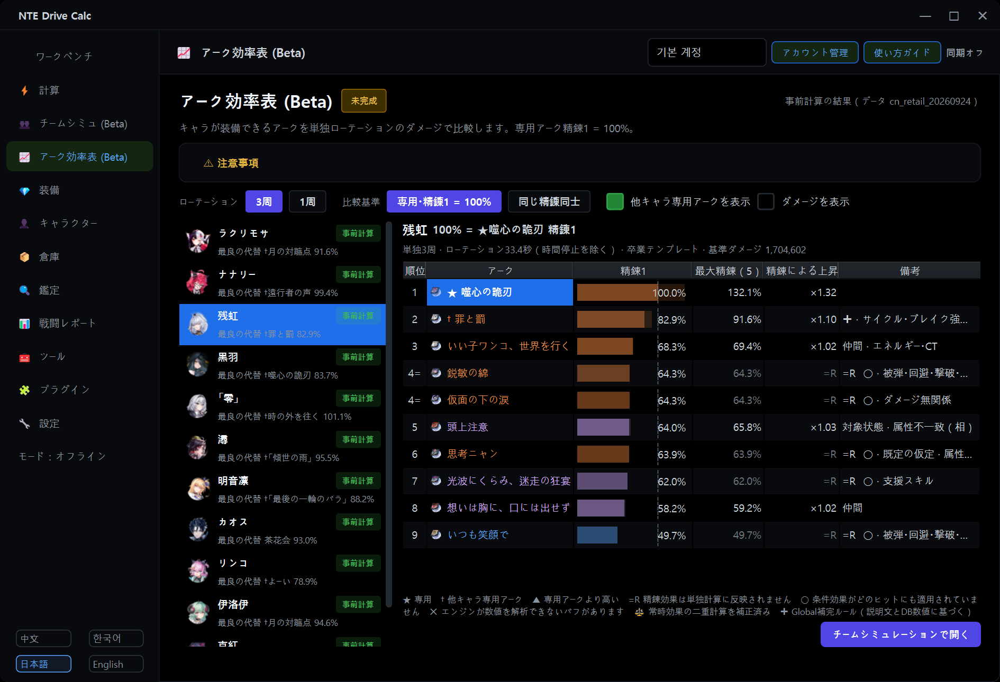
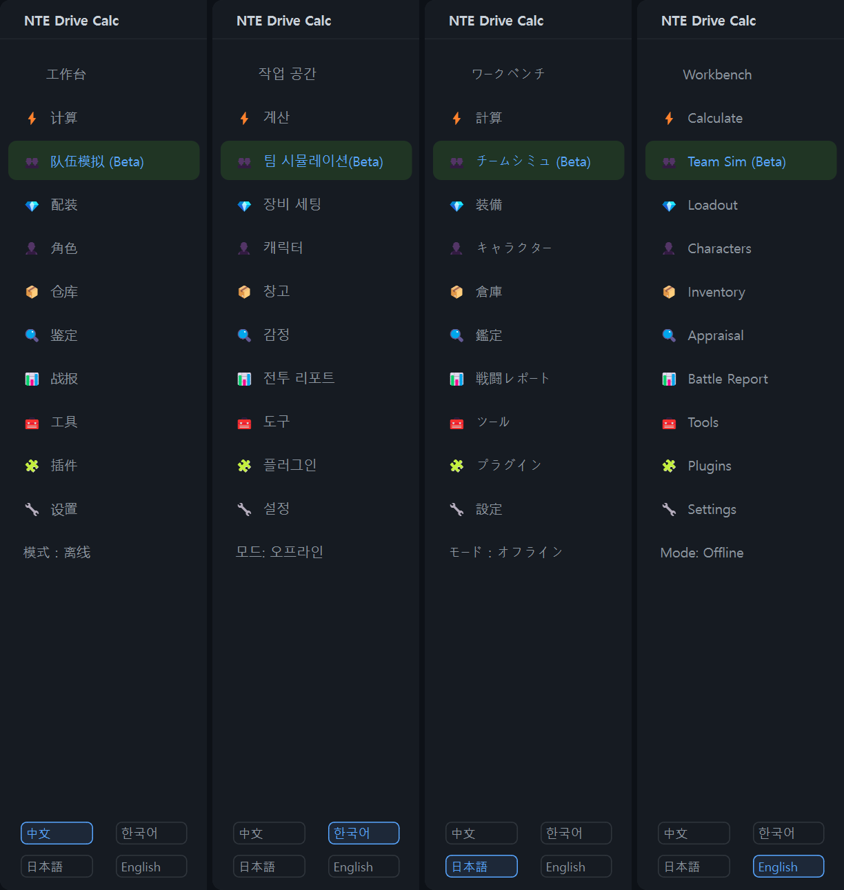

# NTE Drive Calc Global

**v2.3.6で起動時のキャラクターカタログエラーを修正しました。** v2.3.3～v2.3.5でこのエラーが出る場合は、インストーラーを既存のインストール先に実行してください。アカウントと所持品データを引き継ぎ、イェルムの所持品同期修正も適用します。[v2.3.6 Windowsインストーラー](https://github.com/LuinDe/NTE-Drive-Calc-Global/releases/download/v2.3.6/NTE_Drive_Calc_2.3.6_Multilingual_Setup.exe)


[한국어](README.md) | [English](README.en.md) | **日本語** | [中文](README.zh.md)

> [!IMPORTANT]
> **このプログラムはオリジナルではありません。オリジナルを改変して作った非公式ビルドです。**
>
> **オリジナル（公式）プロジェクト: [NTE Drive Calc — hxwd94666/NTE-Drive-Calculator](https://github.com/hxwd94666/NTE-Drive-Calculator)**
> <https://github.com/hxwd94666/NTE-Drive-Calculator>
>
> - NTE Drive Calc Global は、[hxwd94666](https://github.com/hxwd94666) 氏と NTE Drive Calc コントリビューターが作成した**公式 NTE Drive Calc 2.3.1 のソースコードを [LuinDe](https://github.com/LuinDe) が改変して作った派生ビルド**です。
> - **公式リリースではありません。** 原作者が作成・確認・サポートしているビルドではありません。
> - このビルドで起きた問題は、オリジナルのリポジトリではなく **[このリポジトリの Issues](../../issues)** に報告してください。原作者への問い合わせはご遠慮ください。
> - 公式版が必要な場合は、上のオリジナルのリンクから入手してください。
> - プログラムを作り、ソースコードを AGPL-3.0 で公開してくださった原作者とコントリビューターの皆さんに感謝します。ドライブ計算・スキャン・同期・戦闘レポート・育成記録など、このビルドの基本機能はすべてオリジナルのものです。下の「オリジナルからの変更点」にある部分（チームシミュレーション、アーク効率表など）はこのビルドで追加・変更したもので、その部分の誤りは原作者とは関係ありません。

## このリポジトリについて

[NTE Drive Calc](https://github.com/hxwd94666/NTE-Drive-Calculator)（异环驱动计算器）は、ゲーム Neverness to Everness（NTE／異環）のドライブ・カートリッジ育成を助ける Windows 用の計算ツールです。バッグのデータを取り込んで鑑定し、キャラクターごとの装備構成を計算し、ゲーム内で自動装備まで行います。機能全体の説明は[オリジナルの README](https://github.com/hxwd94666/NTE-Drive-Calculator#readme) をご覧ください。

**NTE Drive Calc Global** は、その公式 2.3.1 をもとに

- 画面を **韓国語 / English / 日本語 / 中国語** の 4 言語で使えるようにし、
- **チームシミュレーション (Beta)**、**アーク効率表 (Beta)**、**覚醒効率表 (Beta)**、**プカ特訓**の反映などの機能を追加し、
- オリジナルとは別に、**このリポジトリのリリースだけを受け取るプログラム内アップデート**を入れた

非公式の改変ビルドです。このリポジトリには改変したソースコード（`src/`）とビルドツールがあり、インストーラーは [Releases](../../releases) から入手できます。現在のバージョンは **Global 2.3.2** です。Global のバージョン番号はオリジナルとは別になりました。Global 2.3.2 は公式 2.3.1 をベースにしています。



## 2.3.2 での変更点

前のリリース（2.3.1-global.1）を使っていた方向けのまとめです。リリースごとの詳細と既知の制限は [RELEASE_NOTES.md](RELEASE_NOTES.md) にあります。

- **2.3.1-global.1 か 2.3.1-global.2 をお使いの場合、今回だけは手動でインストールしてください。** 2.3.1-global.1 には更新機能がなく、2026-10-19 に短期間だけ公開された 2.3.1-global.2 は新しいバージョン番号の形式を認識できません。このバージョンからは、新しいバージョンをプログラム内で受け取れます。
- **Global のバージョン番号はオリジナルとは別になりました。** Global 2.3.2 は公式 2.3.1 をベースにしており、2.3.1-global.2 の内容をすべて含みます。
- **新機能：プログラム内アップデート（Global 専用）** — このリポジトリのリリースだけを確認し、メンテナーの署名が正しいリリースだけをインストールします。オリジナルの更新機能は削除しました（下の[アップデート](#アップデート)）。
- **チームシミュレーション：アルティメットエネルギー・サイクル値・クールタイムと交代規則** — 24 人全員がヒットごとにエネルギーとサイクル値を蓄積し、クールタイムが適用されます。クールタイムが 0.3 秒以上残っていれば次のキャラへ交代します（下の 2）。
- **新機能：覚醒の自由選択と覚醒効率表** — 覚醒効果を順番に関係なく選べ、効果ごとの DPS 変化を表で確認できます（下の 3）。
- **明音凛を中国版リリースのデータで計算**します（下の 5）。
- **新機能：プカ特訓** — ゲーム 1.4 のアカウント共通の育成を、パネル・限界値・チームシミュレーション・戦闘レポートに反映します（下の 6）。
- **新機能：RTSS（RivaTuner）互換性のお知らせ** — ゲームが起動直後に落ちる原因になりうる RTSS の設定を、Loader の起動前にお知らせします（下の 10）。
- ホーム画面の「ワークベンチ」見出しのキャラクター画像が黒羽から**明音凛**に変わりました。
- **修正**：日本語の直接入力パレットのツールチップで中国語のままだったスキル名、小吱の日本語名（ちぃちゃん）、チームカードで長いキャラクター名が切れていた問題。
- 同じチームでも、チームシミュレーションと効率表の数値は 2.3.1-global.1 と異なります（クールタイム待ち・交代、覚醒の規則、明音凛のデータによるもの）。

<details>
<summary>2.3.1-global.1（Global 2.3.0 → 公式 2.3.1 ベース）での変更点</summary>

- **公式 2.3.1 ベース**：オリジナルが 2.3.1 で追加した機能（育成記録、プラグイン方式のゲーム内コンポーネントなど）がすべて入っています。
- **新機能：アーク効率表 (Beta)** — 専用アークを持つキャラクターごとに、装備できるアークの効率を専用アーク比の % で表示します（下の 4）。
- **チームシミュレーションのアーク補正**：選んだアークがキャラクターのステータスに反映されなかった問題を直し、常時効果の二重計算を補正し、「罪と罰」「月の対蹠点」の条件効果を計算に入れました（下の 2）。
- **ゲームフォルダーの保護**を 2.3.1 の新しいコンポーネント構成（`d3d12.dll` + `plugins\NTE_Plugin*.dll`）に合わせて作り直しました（下の 9）。
- **翻訳**：2.3.1 で新しく増えた文字列 約 700 件を 3 言語に翻訳しました。韓国語は 2.3.1 用の韓国語パッチの表現に合わせています。古いゲーム説明文 288 件も英語・日本語に翻訳しました。
- **修正**：翻訳文 9 か所で 2 つの値が入れ替わって表示されることがあった問題、英語のボタン・タブの `&` がショートカット記号として扱われていた問題（"and" に変更）、英語・日本語の用語の一部。

</details>

## オリジナルからの変更点

ファイル単位の詳しい一覧は [CHANGES.md](CHANGES.md) にあります。

### 1. 4 つの言語

- 画面の言語を **中文（原文）/ 한국어 / 日本語 / English** から選べます。プログラム**左下の言語ボタン**を押すと実行中にすぐ切り替わり（再起動不要）、選んだ言語は保存されます。
- 画面の文字列 約 10,100 件を言語ごとに翻訳しました。キャラクター・セット・アーク・スキル・モンスターの名前、効果の説明文、戦闘レポートの文章も翻訳して表示します。
- 韓国語は韓国版クライアントの公式名称に合わせています。英語・日本語は確認できた範囲で各言語のクライアントの用語に合わせており、確認できなかった名前（その言語で未実装のコンテンツなど）は仮訳または原文のままの場合があります。
- 2.3.2 から、韓国語の画面では覚醒（觉醒）を「돌파」と呼びます。英語・日本語は「Awakening」「覚醒」のままです。
- ゲーム資料（キャラクター・装備・アーク・モンスター）の検索欄で、ハングルとハングルの初声による検索ができます（中国語での検索は従来どおり使えます）。
- インストーラーも 4 言語に対応しています。



### 2. チームシミュレーション (Beta) — 新機能

> [!WARNING]
> **未完成の機能です。** プログラム内にも同じ警告が表示されます：*「この機能は未完成です。ローテーションの検証がまだ完全ではないため、結果が実戦と異なる場合があります。」*
> チームの強さを大まかに比べるためのもので、実戦の結果を保証するものではありません。

- メンバーを 4 人選ぶと、チーム全体の総ダメージ、DPS、メンバーごとの貢献を計算します。メンバーごとに覚醒・アーク・精錬・カートリッジセットを選べ、ドライブとメイン/サブステータスは公式卒業テンプレートに従います（自分の倉庫の装備は使いません）。
- **検証済みローテーション**：24 キャラクター分のローテーションを内蔵し、チームは 3 周します。
- **エスパーサイクルの反応は常に計算します。** 隣接属性のメンバーへ交代したときに、創生・覆紋・濁燃・黯星・浸染・延滞と、盈蓄・失諧を合わせて処理します（延滞・盈蓄・失諧はダメージなしで効果のみ表示）。
- **変身・形態中の攻撃**を反映します（残虹、黒羽、真紅、ハトホル、明音凛、翳 など）。
- **交代順**を選べます：自動（変身アタッカー優先）/ 自動（反応最多）/ 編成順。
- **説明パネル**：使用したローテーション、交代順とその順を選んだ理由、サイクル反応の表、メンバー別ローテーション、エネルギー・サイクル値・クールタイムの記録、前提と制限を結果の下に表示します。
- **直接入力モード**：ローテーションを文字で書いて計算します。サイクル値・クールタイム・バフ・数値のオプションがあり、名前を付けて保存し、読み込むことができます。書き方は下の[使い方](#使い方)をご覧ください。
- **アーク補正**（2.3.1 から。アーク効率表と同じ計算）：
  - メンバーのアーク・精錬を変えると、そのアークのステータスがキャラクターのステータスに反映されます（2.3.0 ではテンプレートのアークのステータスが残っていました）。
  - アークの常時効果がステータスと戦闘エンジンの両方で数えられていたのを、1 回だけ数えるようにしました。
  - 戦闘エンジンが数値を求められない「罪と罰」「月の対蹠点」の条件効果は、説明文とゲームデータの数値から計算します（**Global補完ルール**と表示。時間停止中は持続時間に数えません）。

#### アルティメットエネルギー・サイクル値・クールタイム（2.3.2）

- 24 人全員について、**ヒットごとのアルティメットエネルギーとエスパーサイクル値**をゲームデータどおりに蓄積し、**スキルのクールタイム**を適用します。クールタイムはゲームデータとコミュニティ資料（prydwen.gg、GameWith）で補い、クールタイムの時計は時間停止を除いた戦闘時間です。値ごとの出典と信頼度は説明欄に表示します。
- 資料のない値は推測しません。確認できなかったクールタイムはチェックせず、サイクル値の資料がない場合は従来の規則（1・3 周目の開始時にサイクル値 100）で代用し、説明欄にそう表示します。
- **リソースモデル**を選べます（アカウントごとに記憶）：ゲームデータ + コミュニティのクールタイム（既定）/ ゲームデータ / 旧ルール（エネルギー・クールタイムをチェックせず、1・3 周目にサイクル値を補充 = 2.3.1-global.1 と同じ計算）。
- **交代規則**：チームでは、次のスキルのクールタイムが **0.3 秒以上** 残っているか、アルティメットのエネルギーが足りないときは待たずに次のキャラへ交代し、**0.3 秒未満** なら待ってから使います。全員が準備できていないときは、最も早く準備できるメンバーを待ちます。交代と待機の内訳は説明欄に表示します。
- 単独で計算するアーク効率表・覚醒効率表は、交代相手がいないのでクールタイムを待ちます。
- 直接入力のチェック方法は チェックしない / 警告のみ（既定）/ 待機を挿入 / 厳格 から選びます。「厳格」は検証済みローテーションと同じ交代規則を使います。
- 検証済みのチームの多くは結果が変わりません。クールタイムに余裕のない速いチーム（例：伊洛伊入り）は交代が増えて総ダメージが下がることがあります。

### 3. 覚醒の自由選択と覚醒効率表 — 新機能（2.3.2）

- 異環の覚醒は、順番に関係なく選べます（例：③ → ⑤ → ①）。チームシミュレーションのキャラカードで 6 つの覚醒効果をそれぞれオン／オフでき（「覚醒 n/6」）、共鳴は選んだ効果に関係なく覚醒 3・6 で有効になります。「覚醒 N = 効果 1〜N」という前提はなくしました。
- 以前に保存したチームとサイクルはそのまま開けます（覚醒の数だけが保存されている場合は効果 1〜N として読みます）。
- 24 人の覚醒効果 192 個のうち **129 個を計算**に入れました。残りは 0% 扱いにせず、区別して表示します。
  - **要実測**（34 個）：効果の対象となるヒットやリソースがまだ計算機のタイムラインにない、または必要な数値・タイミングがゲームデータにも説明文にもないため、ゲーム内で測る必要がある効果。
  - **計算不可**（29 個）：回復・シールド・移動のようにダメージと関係がない、またはブレイク・撃破・被弾・複数の対象が必要で、動かないカカシ 1 体へのダメージには表れない効果。
  - シミュレーターで条件を再現できない効果は期待値で計算し「期待値」と表示します。ラクリモサ③は残りの継続ダメージを一度に精算してその層を消す形で計算します。
- アーク効率表の下に **キャラクター覚醒効率 (Beta)** 表があります（最初は折りたたみ）。キャラごとに、覚醒効果を 1 つだけ足したとき（覚醒 0 基準）と 6 つから 1 つだけ外したときの DPS 変化（%）、共鳴 3・共鳴 6、覚醒すべてを 1 周・3 周で表示します。値は事前計算済みで、データや計算方法が合わないときはその PC で計算し直します。

### 4. アーク効率表 (Beta) — 新機能

> [!WARNING]
> **未完成の機能です。** アーク同士を比べる表であり、実戦の結果ではありません。

- 左メニューの **アーク効率表 (Beta)** でキャラクターを選ぶと、そのキャラクターが装備できるアークを**単独ローテーションのダメージ**で比較します。**専用アークの精錬 1 = 100%** です。
- 列：順位、アーク、**精錬1 の %**、**最大精錬の %**、精錬による上昇、備考（`=R` 精錬効果は単独計算に反映されません、`○` 条件効果がどのヒットにも適用されていません、`✚` Global補完ルール など）。「ダメージを表示」をオンにするとダメージの数値も表示します。
- **3 周（既定）/ 1 周**、比較基準 **専用・精錬1 = 100% / 同じ精錬同士** を切り替えられます。
- **プカ特訓最大（Lv.20）基準で表示**：卒業テンプレートのプカ特訓レベルを 0（既定、以前と同じ結果）/ 20 から選びます（アカウントごとに記憶、どちらも事前計算済み）。
- **他のキャラクターの専用アーク**も、計算機の同タイプ規則で装備できる場合は **†** を付けて表示します（ゲーム内では未検証）。「他キャラ専用アークを表示」をオフにすると隠れます。
- 表に載るのは**専用アークを持つキャラクターだけ**（現在 11 人）です。専用アークのない恒常キャラクターは入れていません。ゲームデータに専用アークを持つ新キャラクターが加わると自動で表に入ります。
- 結果は事前計算済みなのですぐに開きます。ゲームデータや計算方法が変わって合わなくなった場合は、その PC で計算し直します（表示中のキャラクターから。途中でキャンセル可能）。
- **チームシミュレーションで開く**：選んだアークを装備したそのキャラクターでチームシミュレーションを開きます。
- 計算方法：キャラクター単独、公式卒業テンプレートのアークと精錬だけを入れ替え、検証済みローテーションどおりに、Lv80 の木人を相手に、チームシミュレーションと同じエンジン・同じアーク補正・同じクールタイム規則（単独なので待機）で計算します。支援スキル・仲間・編成・サイクル強度・ブレイク強度に依存するアーク効果は 0 として計算します。詳しい前提はページの「注意事項」と [RELEASE_NOTES.md](RELEASE_NOTES.md) にあります。

### 5. 明音凛：中国版リリースのデータ（2.3.2）

- 計算機に同梱のゲームデータ（2026-09-24）の明音凛はリリース前の値です。中国版の正式リリース（2026-10-15）後、**互いに独立した資料 2 つ以上で一致する値だけ**を実行時に置き換えて計算します。ゲームデータのファイル自体は変更せず、計算機のゲームデータがその 9-24 のデータのときだけ有効になります。
- 置き換えたもの：リリース状態、覚醒効果 ①〜⑥、共鳴 3・共鳴 6、「煌星激昂」（アルティメット 1 段目のあと 20 秒間 攻撃力 +20%）、アルティメット 2 段目を使えるタイミング、専用アーク「月の対蹠点」（スキルダメージ +28%（精錬1）、重ね掛けなし）など 46 項目。
- 出典：中国の公式告知（yh.wanmei.com、10-14・10-15・10-16）、中国版リリースクライアントの画面（バハムート forum.gamer.com.tw）、TapTap の攻略、中国版の情報と明記した日本の攻略（kamigame・AppMedia・GameWith）、アークの文面のみ LDShop。
- **未確認のもの**（ゲームデータの値のままで、画面に「未確認」と表示）：Lv80 の基礎ステータス、スキル倍率、通常攻撃の伝導の基本値、華彩連撃の持続時間、出典が 1 つだけの仕様 5 つ、専用アークの精錬1の会心率と相属性ダメージ（出典どうしで 16% と 15%・20% に分かれる）と精錬2〜5 のそのほかの値。**E・Q のクールタイムとアルティメットエネルギーは資料がありません。**
- 戦闘レポートの解析コンポーネント（オリジナルに含まれるプログラム、改変なし）はリリース前のデータで計算します。明音凛を含む記録には注記が 1 行表示されます。

### 6. プカ特訓 — 新機能（2.3.2）

- ゲーム 1.4 で追加されたアカウント共通の育成 **プカ特訓**（Lv 0〜20、出撃中のキャラクターに適用）を計算に入れます。**キャラクターページの家具ボーナスカード**でレベルを入力すると（既定 0）、キャラクターパネル、限界値、チームシミュレーション、新しく記録する戦闘レポートに、攻撃力・防御力・HP・会心率・会心ダメージ・サイクル強度・ブレイク強度が加わります（Lv 20 で合計 +28 / +30 / +420 / +2.5pt / +5pt / +12 / +12）。
- 戦闘レポートは記録開始時のレベルを記録に固定します。この機能より前に記録したレポートは Lv 0 として計算し、さかのぼって適用しません（カードに案内が出ます）。
- **特訓をすべて反映**（既定オン）：変更コピーと限界値の比較を再計算するときに特訓をすべて含めます。このとき「限界値の手動調整」行が表示され、数値化の状態が「一部」になることがあります。オフにすると攻撃力・会心ダメージの分だけ反映します。
- **プカ特訓最大（Lv.20）基準で表示**：アーク効率表・覚醒効率表と完成度の卒業テンプレートを Lv 0 / Lv 20 から選びます。
- レベル表は公開資料（公式の 1.4 告知、コミュニティの表）を照合して作りました。ブレイク強度の合計（12）と、攻撃力・防御力・HP が固定値で加算されるかどうかは、ゲーム内で確認していません。

### 7. プログラム内アップデート（Global 専用）— 新機能（2.3.2）

オリジナルの更新機能（オリジナルのリリース・Mirror酱の確認、公式インストーラーのダウンロード、更新ダイアログ）を削除し、**このリポジトリのリリースだけを確認するアップデート**を入れました。Global は今後オリジナルとは独立して開発・更新します。詳しくは下の[アップデート](#アップデート)をご覧ください。

### 8. 戦闘レポート：自分のキャラで比較 — 新機能

取り込んだ（インポートした）戦闘レポートで、自分のアカウントにもいるキャラクターを自分の育成状態と現在の装備に置き換え、同じ戦闘の流れで計算し直して元の結果と比べます。読み取り専用で、保存済みのデータは変更しません。

### 9. ゲームフォルダーにある他のプログラムのファイルを保護

公式 2.3.1 はゲームフォルダーに `d3d12.dll`（ホスト）と `plugins\NTE_Plugin*.dll` をデプロイし、以前の `NTE_Capture.dll`・`dwmapi.dll` を整理します。このビルドは、それらのファイルを**このプログラムのファイルだと確認できた場合（SHA-256）にだけ**置き換えまたは削除します。確認できないファイル（例：`d3d12.dll` という名前で入っている ReShade、UE4SS など他の MOD の `dwmapi.dll`）は上書きも削除もしません。その場合はデプロイを中止して画面に案内を表示し、整理のときはそのファイルだけを残してお知らせします。

### 10. RTSS（RivaTuner）互換性のお知らせ — 新機能（2.3.2）

- 作者の環境では、既定のフック方式の RTSS（RivaTuner Statistics Server、MSI Afterburner と一緒にインストールされる）と 2.3.1 のゲーム内コンポーネントの組み合わせで、ゲームが起動直後に落ちました（D3D12 のエラー `80004004 (E_ABORT)`）。
- このビルドは RTSS の設定を**読み取るだけ**で、そのおそれがあるときは **ネイティブ Loader を起動** を押したときに対処方法（RTSS で HTGame.exe のプロファイルを追加し、Setup → General → 「Use Microsoft Detours API hooking」をオン）を案内し、環境チェックの **検出詳細** にも表示します。RTSS の設定は変更しません。案内の画面では再チェック・続行・キャンセルを選べ、このアカウントで案内をオフにすることもできます。
- 自動同期が Loader を起動したときは画面を出さず、「検出詳細」にだけ表示します。設定の詳しい手順は[ガイドの RTSS の節](docs/COEXIST_RESHADE_DLSS.ja.md#rtssrivatunermsi-afterburnerと併用する)にあります。

### 11. 計算の修正

リンコのパッシブが有効なときの覆紋の追加ダメージについて、戦闘レポート再現計算の Python 側の参照計算式に残っていた複製比率 0.30 を 0.33（20% + 13%）に修正しました。0.33 はオリジナルのドキュメントが分析コンポーネントの値として示している数値です。この Python の計算式は、再現計算が分析コンポーネントを通らない場合に使われます。同梱の分析コンポーネント（改変なし）が計算する戦闘レポートの数値には影響しません。チームシミュレーションの覆紋はこの計算式ではなく、新しく作った別の計算式で計算しており、同じ比率（0.33）を使います。

### 12. そのほか

- 翻訳が原因で起こりうる問題への対策：文字列を比較するコードが原文と訳文の両方を受け付けるようにしました（戦闘レポートの通常攻撃の判定、プラグインの状態バッジ、同期の案内など）。2.3.1 の**育成記録**は翻訳された画面でも保存でき、保存した記録はどの言語でも開けます（公式 2.3.1 が保存した記録も開けます）。
- 韓国語・日本語フォントの優先適用、訳文の長さに合わせたボタン・ラベルの幅、既定のウィンドウサイズで育成画面が切れないよう案内文を折り返し、鑑定画面の手入力で翻訳後のステータス名を認識。
- 「使い方ガイド」のチュートリアル画像 7 枚を韓国語版に差し替えています（どの言語を選んでもこの画像は韓国語です）。
- プログラム全体をインストールするインストーラー。左上のタイトルは「NTE Drive Calc Global」です。

### 変更していないもの

- 実行ファイルは、公式 2.3.1 の実行ファイルから `src.*` の Python モジュールだけを差し替えたものです（オリジナルの更新モジュール 2 つは外しています）。それ以外の構成要素（nte-core、分析コンポーネント、ゲーム内コンポーネントとローダー、OCR モデル、ゲームの静的データベース、ViGEmBus ドライバーなど）は公式 2.3.1 の配布物と同じです。
- **戦闘レポートの解析コンポーネント（`nte-analysis-core`）は変更していません。** 記録した戦闘の分析はオリジナルと同じ計算で、チームシミュレーションのクールタイム・覚醒の規則と明音凛の補正は戦闘レポートには適用されません。
- スキャン（OCR）、同期、自動装備など、ゲームと連携する動作のロジックは、上の 9 と 10（読み取りだけの RTSS チェック）、翻訳に伴って必要になった文字列照合の調整（[CHANGES.md](CHANGES.md) の 7 節）を除いて変更していません。ただし、これらのファイルにも表示文字列を翻訳するための処理（`_L()`）は入っており、このビルドをゲームに接続してすべてを再検証したわけではありません（[RELEASE_NOTES.md](RELEASE_NOTES.md) の「確認した範囲」）。

## ダウンロードとインストール

1. [Releases](../../releases) から `NTE_Drive_Calc_2.3.5_Multilingual_Setup.exe` をダウンロードします。プログラム全体が入っているので、先に公式版をインストールする必要はありません。
2. NTE Drive Calc が起動している場合は先に終了します。
3. インストーラーを実行し、ユーザー アカウント制御（UAC）で「はい」を押します。
   - コード署名のないファイルなので、**「Windows によって PC が保護されました」（SmartScreen）** が表示されることがあります。「詳細情報」→「実行」を押してください。実行前に、下の [SHA-256](#ファイルの確認-sha-256) や[署名](#署名を自分で確認する)でファイルを確認できます。
4. インストール言語を選びます（Windows の表示言語が 4 言語のいずれかならその言語、それ以外は英語が既定で選ばれます）。
5. 案内文を読み、「次へ」を押してインストールを完了します。追加タスク（デスクトップのショートカット、ViGEmBus 仮想ゲームパッドドライバーのインストール）は公式インストーラーと同じ選択項目です。

初めてインストールした場合、プログラムはインストール時に選んだ言語で起動します。すでに言語を設定してある場合は、その設定が維持されます。

### すでに NTE Drive Calc がインストールされている場合

- 公式版と**同じ場所**（既定：`C:\Program Files\NTE Drive Calc`）、**同じプログラム項目**としてインストールされます。Global 2.3.1（2.3.1-global.1）、公式 2.3.1（またはそれ以前の公式版）、[韓国語パッチ](https://github.com/LuinDe/NTE-Drive-Calc-KO)を適用した 2.3.1、以前の多言語版（Global 2.3.0）の上にそのままインストールしてください。先にアンインストールする必要はありません。
- **ユーザーデータはそのまま残ります。** アカウント、設定、ドライブ・倉庫のデータ、戦闘レポートの記録、育成記録、ログ、保存したローテーション、効率表のキャッシュが残ります。`accounts`、`config`、`data`、`logs`、`migration`、`scanned_images` フォルダーのユーザーファイルは削除も変更もしません（公式インストーラーと同じく、既定ファイル `config\stats.json` と静的データベースのバックアップ `migration\game_static.previous.sqlite3` だけを書き直します）。
- 韓国語パッチが作ったバックアップファイル（`NTE_Drive_Calc.original.exe` など）は削除しません。
- Global 2.3.0 の上にインストールすると、2.3.1 では使わないファイルがいくつか（`_internal\NTE_Capture.dll` など）プログラムフォルダーに残ります。公式 2.3.0 → 2.3.1 のアップグレードでも同じファイルが残り、動作には影響しません。
- インストール後、Windows の「インストールされているアプリ」での名前は「NTE Drive Calc 2.3.2 多言語版 (Global)」、バージョンは 2.3.2 と表示されます（日本語でインストールした場合）。

## アップデート

### プログラム内アップデート（Global 専用）

2.3.2 から、新しい Global のバージョンをプログラム内で受け取れます。

- **アップデートはこのリポジトリ（LuinDe/NTE-Drive-Calc-Global）のリリースからだけ届きます。** Global はオリジナルとは独立して開発・更新し、バージョン番号もオリジナルとは別の Global 独自の `v<major>.<minor>.<patch>`（例：`v2.3.2`）です。オリジナルのサーバーにバージョンを問い合わせることはなく、プログラム内アップデートで公式ビルドがインストールされることもありません。オリジナルの新しい公式版も通知しません。
- 確認のタイミング：起動時に 1 日 1 回まで、そして **「設定」→「ソフトウェア更新」カードの［更新確認］** を押したとき。カードには Global のバージョン、参考としてベースになったオリジナルのバージョン（2.3.1）、リリース署名鍵のフィンガープリントが表示されます。
- 新しいバージョンがあると、バージョンと更新内容に **［今すぐ更新］［後で］［このバージョンをスキップ］** が表示されます。［今すぐ更新］でインストーラーをダウンロードして確認し、［今すぐインストールして再起動］を押すか、終了時にインストールできます。インストールはプログラムを閉じたあと、同じフォルダーに管理者権限でウィザードなしで行われ（進行状況のウィンドウだけ表示）、ユーザーデータは残ります。［今すぐインストールして再起動］を選んだ場合は、終わったあとにプログラムが再起動します。
- ダウンロードしたファイルは `インストールフォルダー\updates\` に置き、インストール後に片付けます。

### 何を確認するか（署名の検証）

- このリポジトリの正式なリリースだけを対象にします（下書き・プレリリースは無視）。今より新しい Global のバージョンで、決まったファイル名とこのリポジトリのダウンロード URL だけを使います。
- リリースごとに **マニフェスト**（`NTE_Drive_Calc_<バージョン>_release.json`）とその **署名**（`.sig`）があります。マニフェストにはタグ・バージョン・インストーラーのファイル名とサイズと SHA-256、インストールされる実行ファイルの SHA-256、リリースノートのダイジェストが書かれ、メンテナーのリリース署名鍵（Ed25519、OpenSSH の `ssh-keygen -Y sign`）で署名されています。プログラムはその公開鍵を内蔵しています。
- 署名がない、または正しくないリリースは**通知しません**。ダウンロードしたインストーラーは、サイズと SHA-256 が署名付きマニフェストと GitHub の値の両方に一致したときだけ実行します。リリースノートが署名されたものと違う場合は、更新内容の代わりに「検証できない」旨を表示します。
- リリース署名鍵（公開鍵）のフィンガープリント：`SHA256:P5tE1mAUxx8UvnE6qZcx5xIwlkl3MwgP3vPuxr4EEyw`

```text
ssh-ed25519 AAAAC3NzaC1lZDI1NTE5AAAAICWQNY5RryTryNGlYL7zw4+biBXAnTkfOgFvZFHKQTQV nte-global-release-20261107
```

### 自動確認をオフにする

「設定」→「ソフトウェア更新」カードの **「起動時に更新を自動確認する（1日1回まで）」** のチェックを外すと、プログラムは自分では確認しなくなります。その場合も［更新確認］を押せばすぐに確認します。

### 2.3.1-global.1 から移る場合

2.3.1-global.1 とそれ以前のバージョンにはこの機能がないため、**2.3.2 は一度だけ手動で** [Releases](../../releases) から入手してインストールしてください（上の[ダウンロードとインストール](#ダウンロードとインストール)）。2026-10-19 に短期間公開された 2.3.1-global.2 も新しいバージョン番号の形式を認識できないため、同じ方法で 2.3.2 を一度だけ手動でインストールしてください。その後の Global のバージョンからはプログラム内で受け取れます。

### 署名を自分で確認する

プログラム内アップデートは以下の確認を自動で行います。インストーラーを手動でダウンロードしたときに同じ確認をするには、Windows 10/11 に入っている OpenSSH の `ssh-keygen` を使います。

1. リリースからインストーラー、`NTE_Drive_Calc_<バージョン>_release.json`、`NTE_Drive_Calc_<バージョン>_release.json.sig` を同じフォルダーにダウンロードします。
2. そのフォルダーで **コマンドプロンプト**（cmd）を開き、次の 2 行を実行します（PowerShell では `<` が使えません）。1 行目はメンテナーの公開鍵で `allowed_signers` ファイルを作ります。例は 2.3.4 です。

```bat
echo nte-global-release-20261107 namespaces="nte-drive-calc-global-release" ssh-ed25519 AAAAC3NzaC1lZDI1NTE5AAAAICWQNY5RryTryNGlYL7zw4+biBXAnTkfOgFvZFHKQTQV> allowed_signers
ssh-keygen -Y verify -f allowed_signers -I nte-global-release-20261107 -n nte-drive-calc-global-release -s NTE_Drive_Calc_2.3.4_release.json.sig < NTE_Drive_Calc_2.3.4_release.json
```

3. `Good "nte-drive-calc-global-release" signature for nte-global-release-20261107 with ED25519 key SHA256:P5tE1mAUxx8UvnE6qZcx5xIwlkl3MwgP3vPuxr4EEyw` と表示されれば、マニフェストはメンテナーの鍵で署名されています。`Could not verify signature` と表示されたらファイルを使わず、[Issues](../../issues) に報告してください。
4. マニフェストをメモ帳で開き、`installer` の `sha256` と `size` がダウンロードしたインストーラーと一致することを確認します（`certutil -hashfile NTE_Drive_Calc_2.3.4_Multilingual_Setup.exe SHA256`）。

## 公式ビルドに戻すには

- **公式インストーラー**（`NTE_Drive_Calc_Setup_2.3.1.exe`）をもう一度実行し、同じ場所にインストールします。実行ファイルとチュートリアル画像が公式のものに戻り、ユーザーデータはそのまま残ります。公式インストーラーはオリジナルのプロジェクトから入手してください：<https://github.com/hxwd94666/NTE-Drive-Calculator>
- 後で公式の新しいバージョンのインストーラーを実行した場合も、同じ場所に公式ビルドがインストールされます。その場合、多言語機能、チームシミュレーション、効率表、Global のアップデートはなくなり、公式ビルド自身の更新機能が再び動作します（Global のプログラム内アップデートが公式ビルドをインストールすることはありません）。
- 完全に削除するには、Windows の「インストールされているアプリ」（アプリと機能）またはスタートメニューのアンインストール用ショートカットを使います。公式版と同じく、アンインストールしてもユーザーデータのフォルダーは削除されません。
- 韓国語パッチのインストーラーは、このビルド向けに作られたものではありません。このビルドの上でそのインストーラーの「オリジナルに復元」は使わず、上の方法を使ってください。

## 使い方

### 言語の切り替え

プログラムの左下に `中文` `한국어` `日本語` `English` のボタンがあります。押すとすぐに切り替わります。

### チームシミュレーション

左メニューの **チームシミュ (Beta)** で、① メンバーを 4 人選び、② メンバーごとに覚醒・アーク・精錬・カートリッジセットを決め、③ **チーム計算** を押します。既定のモードは「検証済みローテーション」です。アークの一覧にはそのキャラクターが装備できるアークが出て、他のキャラクターの専用アークには持ち主の名前が付きます。

- **覚醒**：キャラカードの ①〜⑥ ボタンで効果を 1 つずつオン／オフします（「覚醒 n/6」）。⋯ メニューですべて選択・すべて解除・卒業テンプレートどおりの選択ができ、効果にマウスを重ねると説明と計算の扱い（「要実測」「計算不可」「期待値」）が表示されます。
- **リソースモデル**：交代順の下の「リソースモデル」で ゲームデータ + コミュニティのクールタイム（既定）/ ゲームデータ / 旧ルール を選びます。
- 結果の下の説明欄で、エネルギー・サイクル値・クールタイム待ちと交代の内訳を確認できます。

### アーク効率表と覚醒効率表

左メニューの **アーク効率表 (Beta)** で、左の一覧のキャラクターを押します。上のボタンで周回数（3 周 / 1 周）と比較基準を切り替え、表のアークを選んで **チームシミュレーションで開く** を押すと、そのアークでチームシミュレーションを開きます。表の下の記号の説明とページ上部の「注意事項」もあわせてご覧ください。ページ下部の **キャラクター覚醒効率 (Beta)** を開くと覚醒効率表が表示されます。**プカ特訓最大（Lv.20）基準で表示** は両方の表に適用されます。

### プカ特訓

キャラクターページの **家具ボーナス** カードでプカ特訓のレベル（0〜20）を入力します。アカウントごとに 1 つのレベルで、すべてのキャラクターの計算に使われます。戦闘レポートのカードの **特訓をすべて反映** で、再計算のときの反映範囲を切り替えられます。

### ローテーションを自分で入力する

**直接入力** ボタンを押し、**テキスト入力** 欄に `キャラクター 行動` を `>` でつなげて書きます。

```text
零 サポート > 零 E > 零 通常 通常 通常 > 伊洛伊 交代 > 伊洛伊 Q > 伊洛伊 E > 伊洛伊 通常
```

- **サポート**は支援スキルで登場します。退場するメンバーと隣接属性なら、エスパーサイクルの反応が発生します。最初のステップのサポートは、退場するメンバーがいないためスキルだけが出ます。
- **交代**は通常交代です。支援スキルも反応もありません。
- 使える行動：`サポート` `交代` `通常` `強攻撃` `E` `E長押し` `Q` `カウンター` `回避` `落下` `登場攻撃` `特殊` `待機`（使える行動はキャラクターによって異なります）
- `通常 通常 通常` = `通常x3` = `通常 3回`。連続攻撃の特定の段は `#N` で選びます（例：`通常#4`）。`待機 2` は 2 秒の待機です。
- かっこ内に書いたメモは無視されます。区切りは `>` のほかに `→` と改行も使えます。
- メンバーのボタンと行動のボタンを押してステップを作ることもできます。韓国語・英語・中国語の書き方もいつでも認識します。
- **▶ オプション**：サイクル値モード（入力どおり / サイクル値をチェック）と開始時のサイクル値、クールタイム・エネルギーの値とチェック方法（チェックしない / 警告のみ（既定）/ 待機を挿入 / 厳格）、エンジンが推定したチームバフのオン/オフ、手動バフ、繰り返し回数、敵レベル・敵の耐性・敵の防御力ダウン・敵の被ダメージアップ、ボスかどうか・敵の数、交代時間。クールタイム・エネルギーの欄はリソースモデルの値が既定で入り、自分で書き換えられます。
- ローテーションは名前を付けて**保存**し、**読み込む**ことができます。**検証済みローテーションを読み込む**で内蔵のローテーション（1 周または 3 周）を取り込み、書き換えて使うこともできます。
- 上限は 200 ステップ、繰り返しを含めた実行行動 600 個です。

<details>
<summary>直接入力モードの計算結果の画面を見る（上の例、韓国語表示、2.3.1-global.1）</summary>


</details>

<details>
<summary>チームシミュレーションの画面を見る（2.3.1-global.1）</summary>


</details>

## ReShade・DLSS5 と併用する

ReShade（`d3d12.dll`）と DLSS5 アドオンを使いながら計算機のネイティブ機能も使うには、読み込み方式を **ネイティブ Loader（予備）** に切り替えてください。この方式では、ゲームフォルダーに計算機のファイルを置きません。設定の順序、バックアップ、ビルドごとの違い（公式版は ReShade の `d3d12.dll` を削除・上書きすることがあります）はガイドにまとめました。

→ [ガイド：ReShade・DLSS5 と併用する（Loader 方式）](docs/COEXIST_RESHADE_DLSS.ja.md)

> 2026-10-14、実際のゲームで Loader と ReShade を一緒に使ってもゲームが落ちずに動くことを確認しました（PC 1 台。計算機の接続はまだ画面で確認していません）。DLSS5 アドオンは最新版である必要があります。RTSS（RivaTuner / MSI Afterburner）も使う場合は[ガイドの RTSS の節](docs/COEXIST_RESHADE_DLSS.ja.md#rtssrivatunermsi-afterburnerと併用する)の設定が必要で、このビルドはその設定がないと Loader の起動前にお知らせします（上の 10）。

## 注意事項

- **動作環境はオリジナルと同じです。** Windows 10/11 x64、ゲームの言語は **简体中文（簡体字中国語）**（スキャン・鑑定の文字認識は中国語の画面を前提にしています）、推奨解像度は 1080p・2K・4K・2560x1600、スキャン機能には ViGEmBus 仮想ゲームパッドドライバーが必要です。詳しくは[オリジナルの README](https://github.com/hxwd94666/NTE-Drive-Calculator#readme) に従ってください。
- **ゲームと連携する機能にはリスクがあります。** オリジナルのプログラムは作業モード（オフライン / 低リスク / 中リスク / 開発）を分けており、低リスク（パケットキャプチャ・入力シミュレーション）と中リスク（ゲームにコンポーネントを読み込み、ゲーム内で操作する）のモードについて、*ゲームの保護機能に検知されたり互換性の問題が起きたりする可能性がある*と自ら警告しています。このビルドは、「オリジナルからの変更点」の 9（ゲームフォルダーのファイル保護）と 10（読み取りだけの RTSS チェック）を除いてその部分の動作を変更していないため、リスクは少なくともオリジナルと同じです。使う前にプログラム内の案内と[オリジナルのドキュメント](https://github.com/hxwd94666/NTE-Drive-Calculator)を読み、ゲームの規則・利用規約・お住まいの地域の法律をご自身で確認してください。
- 言語の切り替え、チームシミュレーション、効率表、プカ特訓の入力はオフラインモードでも動作し、ゲームには接続しません。プログラム内アップデートは GitHub（このリポジトリ）にだけ接続します。
- **チームシミュレーション・アーク効率表・覚醒効率表は Beta です。** Lv80・耐性 20% の動かないカカシが前提です。クールタイムの一部はコミュニティ資料（低信頼度）で、確認できなかったクールタイム（E は 6 人、Q は 3 人）はチェックしません。アルティメットのエネルギーコストは潯しかゲームデータにないため、ほかのキャラはエネルギー不足でアルティメットを遅らせません。覚醒効果 63 個はまだ計算しません（「要実測」「計算不可」と表示）。効率表は単独計算なので、チームに依存する効果は 0 として計算します。そのほかの制限は、計算結果の下の「前提と制限」、効率表の「注意事項」、[RELEASE_NOTES.md](RELEASE_NOTES.md) にあります。
- インストーラーと実行ファイルには**コード署名がありません。** プログラム内アップデートは別のリリース署名鍵で確認します（上の[アップデート](#アップデート)）。
- 公式インストーラーで公式の新しいバージョンをインストールすると、公式ビルドに置き換わります。Global のプログラム内アップデートは、このリポジトリの Global のリリースだけをインストールします。
- 原作者はこのビルドをサポートしていません。プログラム内のアップデート・ダウンロード・リリース・問い合わせのリンクはこのリポジトリにつながります。**オリジナルの GitHub・チャットグループ（QQ / Discord）・支援のリンクはクレジットとしてそのまま残しており、原作者のページにつながります。** このビルドで起きた問題はそちらに書き込まず、[このリポジトリの Issues](../../issues) に報告してください。

## ファイルの確認 (SHA-256)

| ファイル | サイズ（バイト） | SHA-256 |
|---|---:|---|
| `NTE_Drive_Calc_2.3.2_Multilingual_Setup.exe`（インストーラー） | 184,850,846 | `c9faeb139a4dbad0c2d978b847c86b97dd9c3ee984bc1efba1d8db4f25623f87` |
| `NTE_Drive_Calc_2.3.2_Multilingual_source.zip`（ソースコード） | 7,478,833 | `29ef19f2566f63745177c4da05c311cb73dee3f7cffa342f4001d86b0ce601aa` |
| インストールされる `NTE_Drive_Calc.exe` | 25,221,222 | `3a165259d6395050311d30816f34ac547b2b7646e8991e7acb68f36ff4ef384f` |
| （参考）もとになった公式 2.3.1 の `NTE_Drive_Calc.exe` | 21,320,661 | `5b8fa8d2b7580bacd494c0f71e76d7b05cf1bee4f9b94bb945993a2e1c69e8c3` |

インストーラーの SHA-256 は署名付きマニフェスト `NTE_Drive_Calc_2.3.2_release.json` にもあります（上の[署名を自分で確認する](#署名を自分で確認する)）。PowerShell での確認方法：

```powershell
Get-FileHash .\NTE_Drive_Calc_2.3.2_Multilingual_Setup.exe -Algorithm SHA256
Get-FileHash "C:\Program Files\NTE Drive Calc\NTE_Drive_Calc.exe" -Algorithm SHA256
```

以前のリリース（2.3.1-global.1、Global 2.3.0）のファイルとハッシュは、[Releases](../../releases) のそれぞれのリリースのページと [RELEASE_NOTES.md](RELEASE_NOTES.md) にあります。

## ソースからのビルド

このリポジトリの [`src/`](src) は、配布している実行ファイルに入っている `src.*` モジュールすべてのソースです。ビルドツールは [`build_tools/`](build_tools) にあります（[build_tools/README.md](build_tools/README.md)）。

実行ファイルは、オリジナルを最初からパッケージし直すのではなく、**公式 2.3.1 の実行ファイルの PYZ アーカイブにある `src.*` モジュールだけを、このソースをコンパイルしたものに置き換えて**作ります。それ以外はバイト単位でそのままです。実行ファイルが `python311.dll` を内蔵しているため、**Python 3.11** が必要です。2.3.2 からオリジナルの更新モジュール 2 つはソースにないため、`--remove` / `--removed` で意図的に外すことを指定します。

```powershell
python build_tools/rebuild_exe_l10n.py      <公式 2.3.1 の NTE_Drive_Calc.exe> src <出力 exe> --remove=src.features.settings.updates --remove=src.ui.controllers.update_controller
python build_tools/verify_exe_l10n_g231.py  <公式 2.3.1 の NTE_Drive_Calc.exe> <出力 exe> src --removed=src.features.settings.updates --removed=src.ui.controllers.update_controller
```

もとになる公式の実行ファイルの SHA-256 は `5b8fa8d2…e8c3`（オリジナルのリリース `2.3.1` のインストーラーでインストールされるファイル。オリジナルのコミット `0e7a6b4`）で、CPython 3.11.15（Windows x64）でビルドすると、結果の SHA-256 は配布している実行ファイル（`3a165259…384f`）と同じになります。ほかの 3.11.x では圧縮結果が変わってハッシュが異なることがあり、その場合は `verify_exe_l10n_g231.py` で内容がこのソースと一致することを確認できます。

`src/app/global_release.py` にはメンテナーのリリース署名用の公開鍵が入っています。自分でビルドして独自のリリースを配布する場合は、`build_tools/pin_release_key.py` で自分の公開鍵を入れてください（秘密鍵はこのリポジトリにはありません）。インストーラー・ソース zip・リリースマニフェストの作り方は [build_tools/README.md](build_tools/README.md) にあります。

対応するソースについての告知は [SOURCE_OFFER.md](SOURCE_OFFER.md) にあります。

## ライセンス

- NTE Drive Calc は **GNU AGPL-3.0** で配布されているプログラムで、このビルドはその派生物であり、同じライセンスに従います。全文：[LICENSE](LICENSE)、告知：[NOTICE](NOTICE)
- 原著作権：**NTE Drive Calc contributors**（[hxwd94666](https://github.com/hxwd94666)）— <https://github.com/hxwd94666/NTE-Drive-Calculator>
- 改変：[LuinDe](https://github.com/LuinDe)、2026-10-20（Global 2.3.2。オリジナルのコミット `0e7a6b4` = 公式 2.3.1 がベース。オリジナルの `2.3.1` タグはそれより前のコミットを指しています）。2.3.1-global.2 は 2026-10-19（短期間公開）、2.3.1-global.1 は 2026-10-11、最初の版 Global 2.3.0 は 2026-10-05。
- インストーラーに同梱されている nte-core、ゲーム内コンポーネントとローダー、ViGEmBus などは、それぞれのライセンスに従う別の構成要素で、改変していません。出所と条件は [NOTICE](NOTICE) とオリジナルのリポジトリの `third_party/` をご覧ください。

## 免責事項

このプログラムはファンが作った非公式ツールです。ゲームの開発会社・運営会社とは一切関係がなく、承認もサポートも受けていません。Neverness to Everness / 异环 の名称、キャラクター、画像、その他のゲーム素材に関する権利は、それぞれの権利者に帰属します。プログラムは現状のまま提供され、使用によって生じた結果は利用者ご自身の責任となります。
