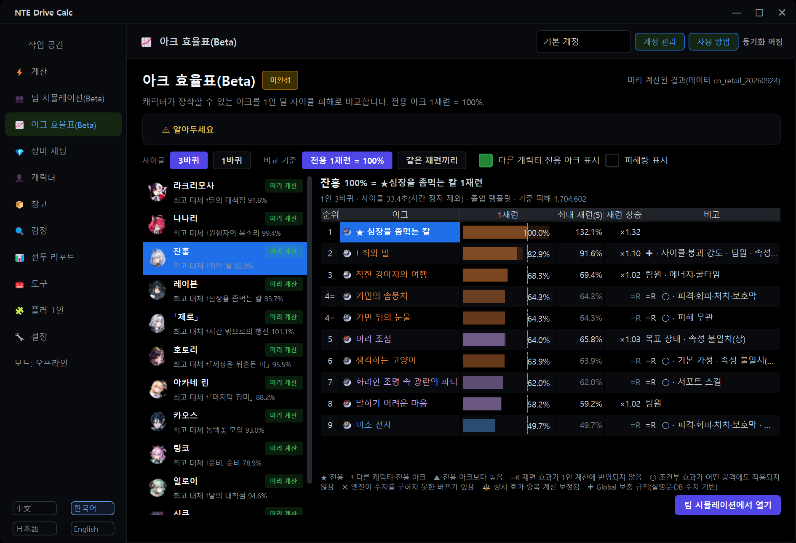
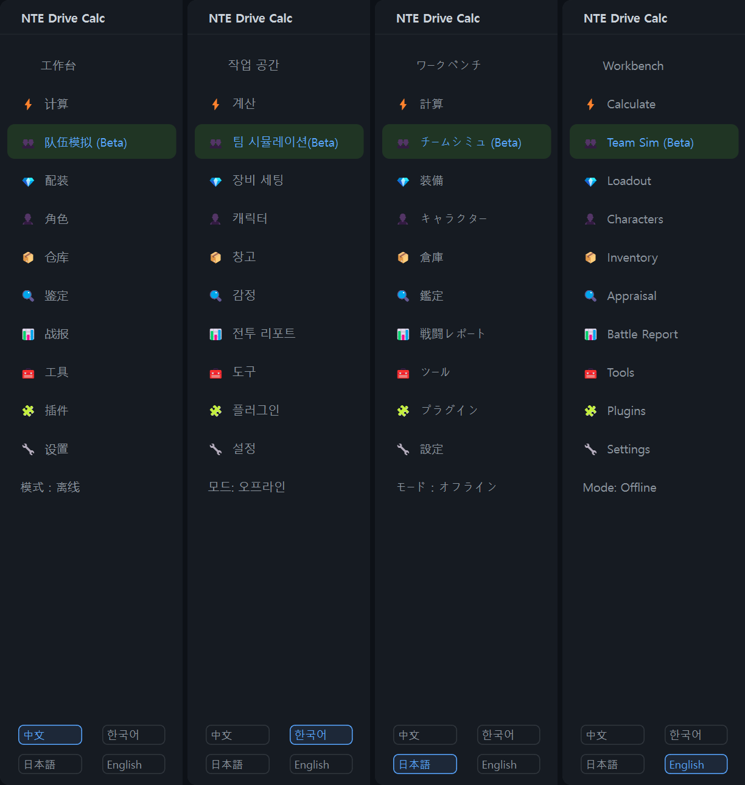
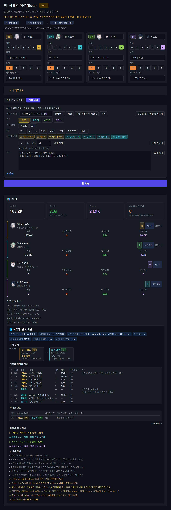
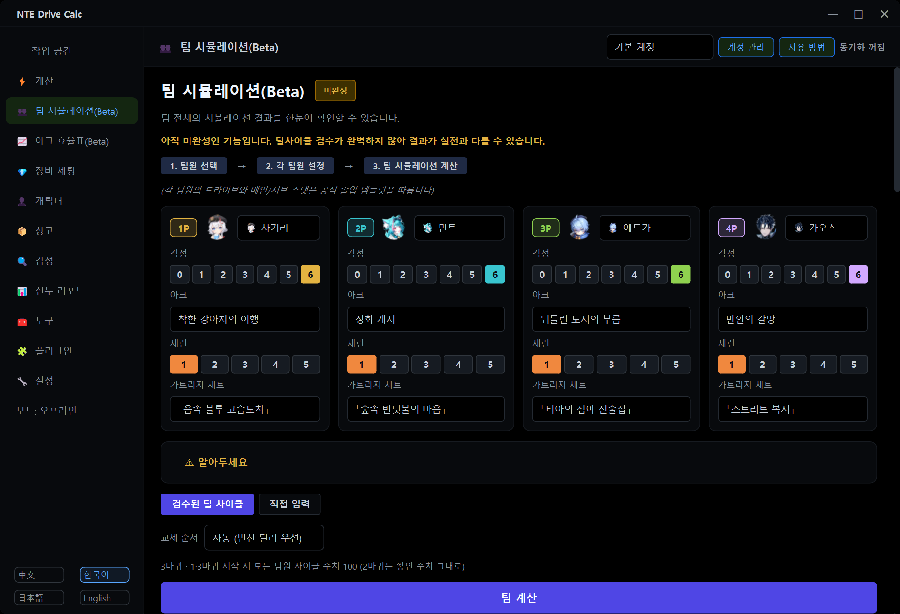

# NTE Drive Calc Global

**v2.3.5에서 엘림의 가방 동기화 오류를 수정했습니다.** v2.3.4 사용자는 프로그램 안에서 업데이트할 수 있습니다. v2.3.3 이하에서는 서명 키 전환을 위해 한 번 [v2.3.5 설치 파일](https://github.com/LuinDe/NTE-Drive-Calc-Global/releases/download/v2.3.5/NTE_Drive_Calc_2.3.5_Multilingual_Setup.exe)을 직접 실행해 주세요.


**한국어** | [English](README.en.md) | [日本語](README.ja.md) | [中文](README.zh.md)

> [!IMPORTANT]
> **이 프로그램은 원본이 아닙니다. 원본 프로그램을 수정해서 만든 비공식 빌드입니다.**
>
> **원본(공식) 프로젝트: [NTE Drive Calc — hxwd94666/NTE-Drive-Calculator](https://github.com/hxwd94666/NTE-Drive-Calculator)**
> <https://github.com/hxwd94666/NTE-Drive-Calculator>
>
> - NTE Drive Calc Global은 [hxwd94666](https://github.com/hxwd94666) 님과 NTE Drive Calc 기여자들이 만든 **공식 NTE Drive Calc 2.3.1의 소스 코드를 [LuinDe](https://github.com/LuinDe)가 수정해서 만든 파생 빌드**입니다.
> - **공식 릴리스가 아닙니다.** 원작자가 만들었거나 검수했거나 지원하는 빌드가 아닙니다.
> - 이 빌드에서 생긴 문제는 원본 저장소가 아니라 **[이 저장소의 Issues](../../issues)** 에 알려 주세요. 원작자에게 문의하지 말아 주세요.
> - 공식 버전이 필요하면 위 원본 링크에서 받으시면 됩니다.
> - 프로그램을 만들고 소스 코드를 AGPL-3.0으로 공개해 주신 원작자와 기여자분들께 감사드립니다. 드라이브 계산·스캔·동기화·전투 리포트·육성 기록 등 이 빌드의 기본 기능은 모두 원본의 것입니다. 아래 "원본과 달라진 점"에 적힌 부분(팀 시뮬레이션, 아크 효율표 등)은 이 빌드에서 추가하거나 바꾼 것이며, 그 부분의 오류는 원작자와 관계가 없습니다.

## 이 저장소는 무엇인가요

[NTE Drive Calc](https://github.com/hxwd94666/NTE-Drive-Calculator)(异环驱动计算器)는 게임 이환(异环 / Neverness to Everness, NTE)의 드라이브·카트리지 육성을 도와주는 Windows용 계산기입니다. 가방 데이터를 가져와 감정하고, 캐릭터별 장비 구성을 계산하고, 게임 안에서 자동으로 장착해 줍니다. 기능 전체에 대한 설명은 [원본 README](https://github.com/hxwd94666/NTE-Drive-Calculator#readme)를 보세요.

**NTE Drive Calc Global**은 그 공식 2.3.1을 바탕으로

- 화면을 **한국어 / English / 日本語 / 中文** 네 가지 언어로 쓸 수 있게 하고,
- **팀 시뮬레이션(Beta)**, **아크 효율표(Beta)**, **돌파 효율표(Beta)**, **푸카 특훈** 반영 등 몇 가지 기능을 더하고,
- 원본과 별개로 **이 저장소의 릴리스만 받는 프로그램 안 업데이트**를 넣은

비공식 수정 빌드입니다. 이 저장소에는 수정된 소스 코드(`src/`)와 빌드 도구가 있고, 설치 프로그램은 [Releases](../../releases)에서 받을 수 있습니다. 현재 버전은 **Global 2.3.2**입니다. Global의 버전 번호는 이제 원본과 별개이며, Global 2.3.2는 공식 2.3.1을 바탕으로 합니다.



## 2.3.2에서 달라진 점

이전 릴리스(2.3.1-global.1)를 쓰던 분을 위한 요약입니다. 릴리스별 자세한 내용과 알려진 한계는 [RELEASE_NOTES.md](RELEASE_NOTES.md)에 있습니다.

- **2.3.1-global.1이나 2.3.1-global.2를 쓰고 있다면 이번 한 번은 직접 설치해야 합니다.** 2.3.1-global.1에는 업데이트 기능이 없고, 2026-10-19에 잠시 공개되었던 2.3.1-global.2는 새 버전 번호 형식을 알아보지 못합니다. 이 버전부터는 새 버전을 프로그램 안에서 받습니다.
- **버전 번호가 원본과 별개가 되었습니다.** Global 2.3.2는 공식 2.3.1을 바탕으로 하며, 2.3.1-global.2의 내용이 모두 들어 있습니다.
- **새 기능: 프로그램 안 업데이트(Global 전용)** — 이 저장소의 릴리스만 확인하고, 배포자의 서명이 맞는 릴리스만 설치합니다. 원본의 업데이트 기능은 뺐습니다(아래 [업데이트](#업데이트)).
- **팀 시뮬레이션: 울티메이트 에너지·사이클 수치·쿨타임과 교체 규칙** — 24명 모두 타격마다 에너지와 사이클 수치를 쌓고 쿨타임을 적용합니다. 쿨타임이 0.3초 이상 남으면 다음 캐릭터로 교체합니다(아래 2번).
- **새 기능: 돌파 자유 선택과 돌파 효율표** — 돌파 효과를 순서와 관계없이 고르고, 효과 하나하나의 DPS 변화를 표로 봅니다(아래 3번).
- **아카네 린을 중국 정식 출시 데이터로 계산**합니다(아래 5번).
- **새 기능: 푸카 특훈** — 게임 1.4의 계정 성장을 패널·한계 이득·팀 시뮬레이션·전투 리포트에 반영합니다(아래 6번).
- **새 기능: RTSS(RivaTuner) 호환성 안내** — 게임이 시작하자마자 꺼질 수 있는 RTSS 설정을 Loader 시작 전에 알려 줍니다(아래 10번).
- 홈 화면 "작업 공간" 머리글의 캐릭터 그림이 레이븐에서 **아카네 린**으로 바뀌었습니다.
- **수정**: 일본어 직접 입력 팔레트 툴팁의 중국어 스킬 이름, 치즈(小吱)의 일본어 이름, 팀 카드에서 긴 캐릭터 이름이 잘리던 것.
- 같은 팀이라도 팀 시뮬레이션과 효율표의 숫자가 2.3.1-global.1과 다릅니다(쿨타임 대기·교체, 돌파 규칙, 아카네 린 데이터 때문).

<details>
<summary>2.3.1-global.1(Global 2.3.0 → 공식 2.3.1 기반)에서 달라진 점</summary>

- **공식 2.3.1 기반**: 원본이 2.3.1에서 추가한 기능(육성 기록, 플러그인 방식의 게임 내 컴포넌트 등)이 모두 들어 있습니다.
- **새 기능: 아크 효율표(Beta)** — 전용 아크가 있는 캐릭터마다, 장착할 수 있는 아크의 효율을 전용 아크 대비 %로 보여 줍니다(아래 4번).
- **팀 시뮬레이션 계산 보정**: 고른 아크가 캐릭터 스탯에 반영되지 않던 문제를 고쳤고, 상시 효과 중복 계산을 바로잡았으며, 「죄와 벌」·「달의 대척점」의 조건부 효과를 계산에 넣었습니다(아래 2번).
- **게임 폴더 보호**를 2.3.1의 새 컴포넌트 구조(`d3d12.dll` + `plugins\NTE_Plugin*.dll`)에 맞춰 다시 만들었습니다(아래 9번).
- **번역**: 2.3.1에서 새로 생긴 문장 약 700개를 세 언어로 번역했습니다. 한국어는 2.3.1 한국어 패치의 표현(공식 스킬명, 倾陷 = 붕괴, 援护技 = 서포트 스킬)을 따릅니다. 영어·일본어는 예전 게임 설명문 288개도 새로 번역했습니다.
- **수정**: 번역문 9곳에서 값이 서로 자리를 바꿔 나올 수 있던 문제, 영어 버튼·탭의 `&`가 단축키 표시로 먹히던 문제(이제 "and"), 영어·일본어 용어 일부.

</details>

## 원본과 달라진 점

파일 단위의 자세한 목록은 [CHANGES.md](CHANGES.md)에 있습니다.

### 1. 네 가지 언어

- 화면 언어를 **中文(원문) / 한국어 / 日本語 / English** 중에서 고를 수 있습니다. 프로그램 **왼쪽 아래의 언어 버튼**을 누르면 실행 중에 바로 바뀌고(재시작 불필요), 고른 언어는 저장됩니다.
- 화면 문자열 약 10,100개를 언어별로 번역했습니다. 캐릭터·세트·아크·스킬·몬스터 이름, 효과 설명문, 전투 리포트 문장도 번역되어 표시됩니다.
- 한국어는 한국 서버 클라이언트의 공식 명칭을 기준으로 했습니다. 영어·일본어는 확인할 수 있었던 범위에서 각 언어 클라이언트의 용어를 따랐고, 확인하지 못한 이름(그 언어로 아직 출시되지 않은 콘텐츠 등)은 임시 번역이거나 원문 그대로일 수 있습니다.
- 한국어 화면에서 각성(觉醒)은 **돌파**라고 부릅니다(2.3.2부터). 같은 화면에 레벨 돌파(突破)가 함께 나오는 곳은 "레벨 돌파"로 구분합니다. 영어·일본어는 "Awakening" / 「覚醒」 그대로입니다.
- 게임 자료(캐릭터·장비·아크·몬스터)의 검색창에서 한글과 초성으로 검색할 수 있습니다(중국어 검색은 그대로 됩니다).
- 설치 프로그램도 네 가지 언어로 나옵니다.



### 2. 팀 시뮬레이션 (Beta) — 새 기능

> [!WARNING]
> **미완성 기능입니다.** 프로그램 안에도 같은 경고가 표시됩니다: *"아직 미완성인 기능입니다. 딜사이클 검수가 완벽하지 않아 결과가 실전과 다를 수 있습니다."*
> 팀의 체급을 대략 비교하기 위한 용도이며, 실전 결과를 보장하지 않습니다.

- 팀원 4명을 고르면 팀 전체의 총 피해, DPS, 팀원별 기여를 계산합니다. 팀원마다 돌파·아크·재련·카트리지 세트를 고를 수 있고, 드라이브와 메인/서브 스탯은 공식 졸업 템플릿을 따릅니다(내 창고의 장비를 쓰지 않습니다).
- **검수된 딜 사이클**: 캐릭터 24명의 딜 사이클이 들어 있고, 팀은 3바퀴를 돕니다.
- **에스퍼 사이클 반응은 항상 계산**합니다. 인접 속성 팀원으로 교체할 때 블라썸·헥스·스코치·노바·스테인·레모라와 차지·디스코드를 함께 처리합니다(레모라·차지·디스코드는 피해 없이 효과만 표시).
- **변신·형태 상태의 공격**을 반영합니다(잔홍, 레이븐, 신쿠, 하토르, 아카네 린, 스키아 등).
- **교체 순서**를 고를 수 있습니다: 자동(변신 딜러 우선) / 자동(반응 최대) / 편성 순서대로.
- **설명 패널**: 사용한 딜 사이클, 교체 순서와 그 순서를 고른 이유, 사이클 반응 표, 팀원별 딜 사이클, 에너지·사이클 수치·쿨타임 기록, 가정과 한계를 결과 아래에 보여 줍니다.
- **직접 입력 모드**: 딜 사이클을 글로 적어서 계산합니다. 사이클 수치·쿨타임·버프·수치 옵션이 있고, 이름을 붙여 저장하고 불러올 수 있습니다. 표기법은 아래 [사용법](#사용법)을 보세요.
- **아크 보정**(2.3.1부터, 아크 효율표와 같은 계산):
  - 팀원의 아크·재련을 바꾸면 그 아크의 스탯이 캐릭터 스탯에 반영됩니다(2.3.0에서는 템플릿 아크의 스탯이 그대로 남았습니다).
  - 아크의 상시 효과가 스탯과 전투 엔진에서 두 번 계산되던 것을 한 번만 계산합니다.
  - 전투 엔진이 수치를 구하지 못하는 「죄와 벌」·「달의 대척점」의 조건부 효과는 설명문과 게임 데이터 수치로 계산합니다(**Global 보충 규칙**으로 표시, 시간 정지 구간은 지속시간에서 뺍니다).

#### 울티메이트 에너지·사이클 수치·쿨타임 (2.3.2)

- 24명 모두 **타격마다 울티메이트 에너지와 에스퍼 사이클 수치**를 게임 데이터대로 쌓고, **스킬 쿨타임**을 적용합니다. 쿨타임은 게임 데이터와 커뮤니티 자료(prydwen.gg, GameWith)로 채웠고, 쿨타임 시계는 시간 정지를 뺀 전투 시간입니다. 값마다 출처와 신뢰도가 설명란에 나옵니다.
- 자료가 없는 값은 추측하지 않습니다. 확인하지 못한 쿨타임은 검사하지 않고, 사이클 수치 자료가 없는 경우에는 예전 규칙(1·3바퀴 시작 때 사이클 수치 100)을 대신 쓰며, 설명란에 그렇게 표시합니다.
- **자원 모델**을 고를 수 있습니다(계정별로 기억): 게임 데이터 + 커뮤니티 쿨타임(기본) / 게임 데이터 / 기존 규칙(에너지·쿨타임 검사 없이 1·3바퀴 시작 때 사이클 수치 보충 = 2.3.1-global.1과 같은 계산).
- **교체 규칙**: 팀에서 다음 스킬의 쿨타임이 **0.3초 이상** 남았거나 울티메이트 에너지가 모자라면 기다리지 않고 다음 캐릭터로 교체합니다. **0.3초 미만**이면 기다렸다가 사용합니다. 모든 팀원이 준비되지 않았으면 가장 빨리 준비되는 팀원을 기다립니다. 교체·대기 내역은 설명란에 나옵니다.
- 혼자 돌리는 아크 효율표·돌파 효율표는 교체할 팀원이 없으므로 쿨타임을 기다립니다.
- 직접 입력의 검사 방식은 검사 안 함 / 경고만(기본) / 대기 삽입 / 엄격 중에서 고릅니다. "엄격"은 검수된 딜 사이클과 같은 교체 규칙을 씁니다.
- 검수된 팀 대부분은 결과가 같습니다. 쿨타임이 빠듯한 빠른 팀(예: 일로이가 들어간 팀)은 교체가 늘어 총피해가 줄 수 있습니다.

### 3. 돌파 자유 선택과 돌파 효율표 — 새 기능 (2.3.2)

- 이환의 돌파(각성)는 순서와 관계없이 고를 수 있습니다(예: ③ → ⑤ → ①). 팀 시뮬레이션의 캐릭터 카드에서 돌파 효과 6개를 하나씩 켜고 끌 수 있고("돌파 n/6"), 공명은 고른 효과와 관계없이 돌파 3개·6개에서 켜집니다. 예전처럼 "돌파 N = 1~N번 효과"로 가정하지 않습니다.
- 예전에 저장한 팀과 사이클은 그대로 열립니다(돌파 수만 저장된 경우 1~N번 효과로 읽습니다).
- 24명의 돌파 효과 192개 중 **129개를 계산**에 넣었습니다. 나머지는 0%로 보지 않고 따로 표시합니다.
  - **측정 필요**(34개): 효과가 붙는 타격이나 자원이 아직 계산기의 타임라인에 없거나, 필요한 수치·발동 시점이 게임 데이터에도 설명문에도 없어서 게임에서 재 봐야 하는 효과.
  - **계산 불가**(29개): 회복·보호막·이동처럼 피해와 관계없거나, 붕괴·처치·피격·여러 대상이 있어야 발동해서 움직이지 않는 허수아비 1명에게 주는 피해로는 나타나지 않는 효과.
  - 시뮬레이션에서 조건을 재현할 수 없는 효과는 기대값으로 넣고 "기대값"으로 표시합니다. 라크리모사 ③은 남은 지속 피해를 한 번에 정산하고 그 층을 지우는 방식으로 계산합니다.
- 아크 효율표 아래에 **캐릭터 돌파 효율(Beta)** 표가 있습니다(처음에는 접혀 있음). 캐릭터별로 돌파 효과를 하나만 더했을 때(돌파 0 기준)와 돌파 6개에서 하나만 뺐을 때의 DPS 변화(%), 공명3·공명6, 돌파 전체를 1바퀴·3바퀴로 보여 줍니다. 값은 미리 계산해 두었고, 데이터나 계산 방식이 맞지 않으면 그 PC에서 다시 계산합니다.

### 4. 아크 효율표 (Beta) — 새 기능

> [!WARNING]
> **미완성 기능입니다.** 아크끼리 비교하는 표일 뿐 실전 결과가 아닙니다.

- 왼쪽 메뉴 **아크 효율표(Beta)** 에서 캐릭터를 고르면, 그 캐릭터가 낄 수 있는 아크를 **1인 딜 사이클 피해**로 비교합니다. **전용 아크 1재련 = 100%** 입니다.
- 열: 순위, 아크, **1재련 %**, **최대 재련 %**, 재련 상승 배율, 비고(재련 효과가 1인 계산에 반영되지 않음 `=R`, 조건부 효과가 어떤 공격에도 적용되지 않음 `○`, Global 보충 규칙 `✚` 등). "피해량 표시"를 켜면 피해 수치도 나옵니다.
- **3바퀴(기본) / 1바퀴**, 비교 기준 **전용 1재련 = 100% / 같은 재련끼리**를 고를 수 있습니다.
- **푸카 특훈 만렙(20) 기준으로 보기**: 졸업 템플릿의 푸카 특훈 레벨을 0(기본, 이전과 같은 결과) / 20 중에서 고릅니다(계정별로 기억, 두 경우 모두 미리 계산되어 있음).
- **다른 캐릭터의 전용 아크**도 계산기의 같은 유형 규칙으로 낄 수 있으면 **†** 를 붙여 함께 보여 줍니다(게임에서 실측하지 않음). "다른 캐릭터 전용 아크 표시"를 끄면 숨겨집니다.
- **전용 아크가 있는 캐릭터만**(현재 11명) 표에 나옵니다. 전용 아크가 없는 상시 캐릭터는 넣지 않았습니다. 게임 데이터에 전용 아크가 있는 새 캐릭터가 생기면 자동으로 들어갑니다.
- 결과는 미리 계산되어 들어 있어서 바로 열립니다. 게임 데이터나 계산 방식이 바뀌어 맞지 않으면 그 PC에서 다시 계산합니다(보고 있는 캐릭터부터, 진행 중 취소 가능).
- **팀 시뮬레이션에서 열기**: 고른 아크를 낀 그 캐릭터로 팀 시뮬레이션을 엽니다.
- 계산 방식: 캐릭터 혼자, 공식 졸업 템플릿에서 아크와 재련만 바꾸고, 검수된 딜 사이클대로, Lv80 허수아비를 상대로, 팀 시뮬레이션과 같은 엔진·같은 아크 보정·같은 쿨타임 규칙(혼자이므로 대기)으로 계산합니다. 서포트 스킬·팀원·팀 구성·사이클 강도·붕괴 강도에 달린 아크 효과는 0으로 계산됩니다. 자세한 가정은 페이지의 "알아두세요"와 [RELEASE_NOTES.md](RELEASE_NOTES.md)에 있습니다.

### 5. 아카네 린: 중국 정식 출시 데이터 (2.3.2)

- 계산기에 들어 있는 게임 데이터(2026-09-24)의 아카네 린 값은 출시 전 값입니다. 중국 서버 정식 출시(2026-10-15) 뒤 **서로 독립된 자료 두 곳 이상에서 일치하는 값만** 실행 중에 바꿔서 계산합니다. 게임 데이터 파일 자체는 바꾸지 않고, 계산기의 게임 데이터가 바로 그 9-24 데이터일 때만 켜집니다.
- 바꾼 것: 출시 상태, 돌파 효과 ①~⑥, 공명3·공명6, 「반짝이는 별의 격정」(울티메이트 1단 뒤 20초 동안 공격력 +20%), 울티메이트 2단 사용 가능 시점, 전용 아크 「달의 대척점」(스킬 피해 증가 1재련 +28%, 중첩 없음) 등 46개 항목.
- 자료: 중국 공식 공지(yh.wanmei.com, 10-14·10-15·10-16), 중국 출시 클라이언트 화면(바하무트 forum.gamer.com.tw), TapTap 공략, 중국판 정보임을 밝힌 일본 공략(kamigame·AppMedia·GameWith), 아크 문구만 LDShop.
- **확인되지 않은 것**(게임 데이터 값을 그대로 쓰고 화면에 "미확인"으로 표시): Lv80 기본 능력치, 스킬 배율, 평타 전달 기본값, 카덴차 연격 지속 시간, 자료가 한 곳뿐인 메커니즘 5개, 전용 아크의 1재련 치명타 확률·상(相) 속성 피해(자료끼리 16%와 15%·20%로 엇갈림)와 2~5재련의 나머지 값. **E·Q 쿨타임과 울티메이트 에너지는 자료가 없습니다.**
- 전투 리포트의 분석 컴포넌트(원본에 포함된 프로그램, 수정하지 않음)는 출시 전 데이터로 계산합니다. 아카네 린이 있는 기록에는 안내가 한 줄 나옵니다.

### 6. 푸카 특훈 — 새 기능 (2.3.2)

- 게임 1.4에서 생긴 계정 성장 **푸카 특훈**(Lv 0~20, 출전 중인 캐릭터에게 적용)을 계산에 넣습니다. **캐릭터 페이지의 가구 보너스 카드**에 레벨을 입력하면(기본 0) 캐릭터 패널, 한계 이득, 팀 시뮬레이션, 새로 녹화하는 전투 리포트에 공격력·방어력·HP·치명 확률·치명 피해·사이클 강도·붕괴 강도가 더해집니다(Lv 20 합계 +28 / +30 / +420 / +2.5%p / +5%p / +12 / +12).
- 전투 리포트는 녹화를 시작할 때의 레벨을 기록에 고정합니다. 이 기능 전에 녹화한 기록은 Lv 0으로 계산하며 소급하지 않습니다(카드에 안내가 나옵니다).
- **특훈 전체 반영**(기본 켜짐): 수정 사본과 한계 이득 비교를 다시 계산할 때 특훈 전체를 넣습니다. 이때 "한계 이득 수동 조정" 줄이 보이고 정량화 상태가 "부분"으로 나올 수 있습니다. 끄면 공격력·치명 피해 몫만 반영됩니다.
- **푸카 특훈 만렙(20) 기준으로 보기**: 아크 효율표·돌파 효율표와 졸업률의 졸업 템플릿을 Lv 0 / Lv 20 중에서 고릅니다.
- 레벨표는 공개 자료(공식 1.4 공지, 커뮤니티 표)를 대조해 만들었습니다. 붕괴 강도 합계(12)와, 공격력·방어력·HP가 고정치로 더해지는지는 게임에서 확인하지 않았습니다.

### 7. 프로그램 안 업데이트 (Global 전용) — 새 기능 (2.3.2)

원본의 업데이트 기능(원본 릴리스·Mirror酱 확인, 공식 설치 파일 내려받기, 업데이트 창)을 빼고, **이 저장소의 릴리스만 확인하는 업데이트**를 넣었습니다. Global은 이제 원본과 별개로 개발·업데이트됩니다. 자세한 내용은 아래 [업데이트](#업데이트)에 있습니다.

### 8. 전투 리포트: 내 캐릭터로 비교 — 새 기능

가져온(import) 전투 리포트에서, 내 계정에도 있는 캐릭터를 내 육성 상태와 현재 장비로 바꿔 같은 전투 흐름으로 다시 계산하고 원래 결과와 비교합니다. 읽기 전용이라 저장된 데이터는 바뀌지 않습니다.

### 9. 게임 폴더에 있는 다른 프로그램의 파일 보호

공식 2.3.1은 게임 폴더에 `d3d12.dll`(호스트)과 `plugins\NTE_Plugin*.dll`을 배포하고, 예전의 `NTE_Capture.dll`·`dwmapi.dll`을 정리합니다. 이 빌드는 그 파일들이 **이 프로그램의 파일로 확인될 때만(SHA-256)** 교체하거나 삭제합니다. 확인되지 않는 파일(예: `d3d12.dll` 이름으로 설치된 ReShade, UE4SS 등 다른 모드의 `dwmapi.dll`)은 덮어쓰지도 지우지도 않습니다. 그런 경우 배포는 중단되고 화면에 안내가 나오며, 정리할 때는 그 파일만 남겨 두고 알려 줍니다.

### 10. RTSS(RivaTuner) 호환성 안내 — 새 기능 (2.3.2)

- 작성자 환경에서는 RTSS(RivaTuner Statistics Server, MSI Afterburner와 함께 설치됨)가 기본 후킹 방식으로 켜져 있으면 2.3.1의 게임 내 컴포넌트와 함께 게임이 시작하자마자 꺼졌습니다(D3D12 오류 `80004004 (E_ABORT)`).
- 이 빌드는 RTSS 설정을 **읽기만** 해서, 그럴 위험이 있으면 **네이티브 Loader 시작**을 누를 때 해결 방법(RTSS에서 HTGame.exe 프로필을 추가하고 Setup → General → "Use Microsoft Detours API hooking" 켜기)을 안내하고, 환경 검사의 **검사 상세**에도 표시합니다. RTSS 설정은 바꾸지 않습니다. 안내 창에서 다시 검사·계속·취소를 고르거나, 이 계정에서 안내를 끌 수 있습니다.
- 자동 동기화로 Loader가 시작될 때는 창을 띄우지 않고 "검사 상세"에만 표시합니다. 자세한 설정 방법은 [가이드의 RTSS 절](docs/COEXIST_RESHADE_DLSS.ko.md#rtssrivatunermsi-afterburner와-함께-쓰기)에 있습니다.

### 11. 계산 수정

링코의 패시브가 적용될 때 헥스(覆纹) 추가 피해의 복제 비율이 전투 리포트 재현 계산의 파이썬 쪽 참조 계산식에 0.30으로 남아 있던 것을 0.33(20% + 13%)으로 고쳤습니다. 0.33은 원본 문서가 원본 분석 컴포넌트의 값으로 적어 둔 수치입니다. 이 파이썬 계산식은 재현 계산이 분석 컴포넌트를 거치지 않을 때 쓰입니다. 함께 들어 있는 분석 컴포넌트(수정하지 않음)가 계산하는 전투 리포트 수치에는 영향이 없습니다. 팀 시뮬레이션의 헥스는 이 계산식이 아니라 새로 만든 별도 계산식으로 계산하며, 같은 비율(0.33)을 씁니다.

### 12. 그 밖에

- 번역 때문에 생길 수 있는 문제를 막는 수정: 문구를 비교하는 코드가 원문과 번역문을 모두 받도록 했습니다(전투 리포트의 일반 공격 판정, 플러그인 상태 배지, 동기화 안내 등). 2.3.1의 **육성 기록**은 번역된 화면에서도 저장되고, 저장한 기록은 어느 언어에서나 열립니다(공식 2.3.1이 저장한 기록도 열립니다).
- 한글·일본어 글꼴 우선 적용, 번역문 길이에 맞춘 버튼·라벨 폭, 기본 창 크기에서 육성 화면이 잘리지 않도록 안내문 줄바꿈, 감정 화면 수동 입력의 번역된 스탯 이름 인식.
- "사용 방법" 튜토리얼 이미지 7장을 한국어판으로 교체했습니다(다른 언어를 골라도 이 이미지는 한국어입니다).
- 프로그램 전체를 설치하는 설치 프로그램. 왼쪽 위 제목은 "NTE Drive Calc Global"입니다.

### 바꾸지 않은 것

- 실행 파일은 공식 2.3.1 실행 파일에서 `src.*` 파이썬 모듈만 교체한 것입니다(원본의 업데이트 모듈 2개는 뺐습니다). 그 밖의 구성 요소(nte-core, 분석 컴포넌트, 게임 내 컴포넌트·로더, OCR 모델, 게임 정적 데이터베이스, ViGEmBus 드라이버 등)는 공식 2.3.1 배포본과 같습니다.
- **전투 리포트의 분석 컴포넌트(`nte-analysis-core`)는 바꾸지 않았습니다.** 녹화한 전투의 분석은 원본과 같은 계산이며, 팀 시뮬레이션의 쿨타임·돌파 규칙과 아카네 린 보정은 전투 리포트에 적용되지 않습니다.
- 스캔(OCR), 동기화, 자동 장착 등 게임과 연동되는 동작의 로직은 위 9번과 10번(읽기만 하는 RTSS 검사), 번역 때문에 필요해진 문구 비교 수정([CHANGES.md](CHANGES.md) 7절)을 빼고 바꾸지 않았습니다. 다만 해당 파일에도 화면 문자열 번역 처리(`_L()`)는 들어갔고, 이 빌드를 게임에 연결해 전부 다시 검증하지는 않았습니다([RELEASE_NOTES.md](RELEASE_NOTES.md)의 "확인 범위").

## 다운로드와 설치

1. [Releases](../../releases)에서 `NTE_Drive_Calc_2.3.5_Multilingual_Setup.exe`를 받습니다. 프로그램 전체가 들어 있어서 공식 버전을 먼저 설치할 필요가 없습니다.
2. NTE Drive Calc가 켜져 있으면 먼저 종료합니다.
3. 설치 파일을 실행하고 사용자 계정 컨트롤(UAC) 창에서 "예"를 누릅니다.
   - 코드 서명이 없는 파일이라 **"Windows의 PC 보호"(SmartScreen)** 창이 뜰 수 있습니다. "추가 정보" → "실행"을 누르면 됩니다. 실행 전에 아래 [SHA-256](#파일-확인-sha-256)이나 [서명](#서명-직접-확인하기)으로 파일을 확인할 수 있습니다.
4. 설치 언어를 고릅니다(한국어 Windows에서는 한국어가 기본으로 선택됩니다).
5. 안내문을 읽고 "다음"을 눌러 설치를 마칩니다. 추가 작업(바탕 화면 바로 가기, ViGEmBus 가상 게임패드 드라이버 설치)은 공식 설치 프로그램과 같은 선택 항목입니다.

처음 설치하면 프로그램은 설치할 때 고른 언어로 시작합니다. 이미 언어를 설정해 둔 경우에는 그 설정이 유지됩니다.

### 이미 NTE Drive Calc가 설치되어 있다면

- 공식 버전과 **같은 위치**(기본: `C:\Program Files\NTE Drive Calc`), **같은 프로그램 항목**으로 설치됩니다. Global 2.3.1(2.3.1-global.1), 공식 2.3.1(또는 그 이전 공식 버전), [한국어 패치](https://github.com/LuinDe/NTE-Drive-Calc-KO) 2.3.1 적용본, 이전 다국어판(Global 2.3.0) 위에 그대로 설치하면 됩니다. 먼저 제거할 필요가 없습니다.
- **사용자 데이터는 그대로 유지됩니다.** 계정, 설정, 드라이브·창고 데이터, 전투 리포트 기록, 육성 기록, 로그, 저장한 사이클, 효율표 캐시가 남습니다. `accounts`, `config`, `data`, `logs`, `migration`, `scanned_images` 폴더의 사용자 파일은 지우거나 바꾸지 않습니다(공식 설치 프로그램과 마찬가지로 기본 파일 `config\stats.json`과 정적 DB 백업 `migration\game_static.previous.sqlite3`만 새로 씁니다).
- 한국어 패치가 만든 백업 파일(`NTE_Drive_Calc.original.exe` 등)은 지우지 않습니다.
- 이전 다국어판(2.3.0) 위에 설치하면 2.3.1에서 쓰지 않는 파일 몇 개(`_internal\NTE_Capture.dll` 등)가 프로그램 폴더에 남습니다. 공식 2.3.0 → 2.3.1 업그레이드에서도 같은 파일이 남으며 동작에는 영향이 없습니다.
- 설치 후 Windows "설치된 앱" 목록의 이름은 "NTE Drive Calc 2.3.2 다국어판 (Global)"이고, 버전은 2.3.2로 나옵니다(한국어로 설치한 경우).

## 업데이트

### 프로그램 안 업데이트 (Global 전용)

2.3.2부터 새 Global 버전을 프로그램 안에서 받을 수 있습니다.

- **업데이트는 이 저장소(LuinDe/NTE-Drive-Calc-Global)의 릴리스에서만 옵니다.** Global은 원본과 별개로 개발·업데이트되며, 버전 번호도 원본과 별개인 Global 고유 번호(`v<주>.<부>.<수>`, 예: `v2.3.2`)입니다. 원본 서버에 버전을 묻지 않고, 프로그램 안 업데이트로 공식 빌드가 설치되는 일은 없습니다. 원본의 새 공식 버전도 알리지 않습니다.
- 확인 시점: 프로그램을 시작할 때 하루에 한 번까지, 그리고 **설정 → "소프트웨어 업데이트" 카드의 [업데이트 확인]** 을 누를 때. 카드에는 Global 버전, 참고용으로 바탕이 된 원본 버전(2.3.1), 릴리스 서명 키의 지문이 나옵니다.
- 새 버전이 있으면 버전과 업데이트 내용을 보여 주고 **[지금 업데이트] [나중에] [이 버전 건너뛰기]** 중에서 고르게 합니다. [지금 업데이트]를 누르면 설치 프로그램을 내려받아 확인한 뒤, [지금 설치하고 다시 시작]을 누르거나 프로그램을 끌 때 설치할 수 있습니다. 설치는 프로그램을 닫은 뒤 같은 폴더에 관리자 권한으로 설치 마법사 없이(진행 창만 표시) 진행되고, 사용자 데이터는 그대로 남습니다. [지금 설치하고 다시 시작]을 골랐다면 끝난 뒤 프로그램이 다시 시작됩니다.
- 내려받는 파일은 `설치 폴더\updates\`에 두고, 설치가 끝나면 정리합니다.

### 무엇을 확인하나요 (서명 검증)

- 이 저장소의 정식 릴리스만 봅니다(초안·사전 릴리스는 무시). 지금보다 새 Global 버전이어야 하고, 정해진 파일 이름과 이 저장소의 다운로드 주소만 씁니다.
- 릴리스마다 **매니페스트**(`NTE_Drive_Calc_<버전>_release.json`)와 그 **서명**(`.sig`)이 있습니다. 매니페스트에는 태그·버전·설치 파일 이름·크기·SHA-256, 설치되는 실행 파일의 SHA-256, 릴리스 본문의 다이제스트가 적혀 있고, 배포자의 릴리스 서명 키(Ed25519, OpenSSH `ssh-keygen -Y sign`)로 서명됩니다. 프로그램은 그 공개키를 내장하고 있습니다.
- 서명이 없거나 맞지 않는 릴리스는 **알리지 않습니다.** 내려받은 설치 프로그램은 크기와 SHA-256이 서명된 매니페스트와 GitHub가 알려 주는 값에 모두 맞을 때만 실행합니다. 릴리스 본문이 서명된 것과 다르면 업데이트 내용 대신 "검증할 수 없음" 안내를 보여 줍니다.
- 릴리스 서명 키(공개키) 지문: `SHA256:P5tE1mAUxx8UvnE6qZcx5xIwlkl3MwgP3vPuxr4EEyw`

```text
ssh-ed25519 AAAAC3NzaC1lZDI1NTE5AAAAICWQNY5RryTryNGlYL7zw4+biBXAnTkfOgFvZFHKQTQV nte-global-release-20261107
```

### 자동 확인 끄기

설정 → "소프트웨어 업데이트" 카드에서 **"시작할 때 자동으로 업데이트 확인 (하루 한 번)"** 의 체크를 끄면 프로그램이 스스로 확인하지 않습니다. 그때도 [업데이트 확인]을 누르면 바로 확인합니다.

### 2.3.1-global.1에서 올 때

2.3.1-global.1과 그 이전 버전에는 이 기능이 없으므로, **2.3.2는 한 번 직접** [Releases](../../releases)에서 받아 설치해야 합니다(위 [다운로드와 설치](#다운로드와-설치)). 2026-10-19에 잠시 공개되었던 2.3.1-global.2도 새 버전 번호 형식을 알아보지 못하므로 같은 방법으로 2.3.2를 한 번 직접 설치해 주세요. 그 뒤의 Global 버전부터 프로그램 안에서 받을 수 있습니다.

### 서명 직접 확인하기

프로그램 안 업데이트는 아래 확인을 스스로 합니다. 설치 파일을 직접 받았을 때 같은 확인을 하려면 Windows 10/11에 들어 있는 OpenSSH의 `ssh-keygen`을 씁니다.

1. 릴리스에서 설치 파일, `NTE_Drive_Calc_<버전>_release.json`, `NTE_Drive_Calc_<버전>_release.json.sig`를 한 폴더에 받습니다.
2. 그 폴더에서 **명령 프롬프트**(cmd)를 열고 아래 두 줄을 실행합니다(PowerShell에서는 `<`를 쓸 수 없습니다). 첫 줄은 배포자의 공개키로 `allowed_signers` 파일을 만듭니다. 예는 2.3.4입니다.

```bat
echo nte-global-release-20261107 namespaces="nte-drive-calc-global-release" ssh-ed25519 AAAAC3NzaC1lZDI1NTE5AAAAICWQNY5RryTryNGlYL7zw4+biBXAnTkfOgFvZFHKQTQV> allowed_signers
ssh-keygen -Y verify -f allowed_signers -I nte-global-release-20261107 -n nte-drive-calc-global-release -s NTE_Drive_Calc_2.3.4_release.json.sig < NTE_Drive_Calc_2.3.4_release.json
```

3. `Good "nte-drive-calc-global-release" signature for nte-global-release-20261107 with ED25519 key SHA256:P5tE1mAUxx8UvnE6qZcx5xIwlkl3MwgP3vPuxr4EEyw`가 나오면 매니페스트가 배포자의 키로 서명된 것입니다. `Could not verify signature`가 나오면 그 파일을 쓰지 말고 [Issues](../../issues)에 알려 주세요.
4. 매니페스트를 메모장으로 열어 `installer`의 `sha256`과 `size`가 받은 설치 파일과 같은지 확인합니다(`certutil -hashfile NTE_Drive_Calc_2.3.4_Multilingual_Setup.exe SHA256`).

## 공식 빌드로 되돌리기

- **공식 설치 프로그램**(`NTE_Drive_Calc_Setup_2.3.1.exe`)을 다시 실행해 같은 위치에 설치하면 됩니다. 실행 파일과 튜토리얼 이미지가 공식 것으로 바뀌고 사용자 데이터는 그대로 남습니다. 공식 설치 프로그램은 원본 프로젝트에서 받으세요: <https://github.com/hxwd94666/NTE-Drive-Calculator>
- 나중에 공식 새 버전의 설치 프로그램을 실행해도 같은 자리에 공식 빌드가 설치됩니다. 이 경우 다국어 기능, 팀 시뮬레이션, 효율표, Global 업데이트는 사라지고, 공식 빌드의 업데이트 기능이 다시 동작합니다. (Global의 프로그램 안 업데이트는 공식 빌드를 설치하지 않습니다.)
- 완전히 지우려면 Windows "설치된 앱"(앱 및 기능)이나 시작 메뉴의 제거 바로 가기를 사용합니다. 공식 버전과 마찬가지로 제거해도 사용자 데이터 폴더는 지워지지 않습니다.
- 한국어 패치의 설치 프로그램은 이 빌드용이 아닙니다. 이 빌드 위에서 그 프로그램의 "원본으로 복원"을 쓰지 말고 위 방법을 쓰세요.

## 사용법

### 언어 바꾸기

프로그램 왼쪽 아래에 `中文` `한국어` `日本語` `English` 버튼이 있습니다. 누르면 바로 바뀝니다.

### 팀 시뮬레이션

왼쪽 메뉴의 **팀 시뮬레이션(Beta)** 에서 ① 팀원 4명을 고르고 ② 팀원별 돌파·아크·재련·카트리지 세트를 정한 뒤 ③ **팀 계산**을 누릅니다. 기본 모드는 "검수된 딜 사이클"입니다. 아크 목록에는 그 캐릭터가 낄 수 있는 아크가 나오고, 다른 캐릭터의 전용 아크에는 주인 이름이 붙습니다.

- **돌파**: 캐릭터 카드의 ①~⑥ 버튼으로 효과를 하나씩 켜고 끕니다("돌파 n/6"). ⋯ 메뉴로 전부 켜기·전부 끄기·졸업 템플릿대로 고르기를 할 수 있고, 효과 위에 마우스를 올리면 설명과 계산 여부("측정 필요"·"계산 불가"·"기대값")가 나옵니다.
- **자원 모델**: 교체 순서 아래의 "자원 모델"에서 게임 데이터 + 커뮤니티 쿨타임(기본) / 게임 데이터 / 기존 규칙을 고릅니다.
- 결과 아래 설명란에서 에너지·사이클 수치·쿨타임 대기와 교체 내역을 볼 수 있습니다.

### 아크 효율표와 돌파 효율표

왼쪽 메뉴의 **아크 효율표(Beta)** 에서 왼쪽 목록의 캐릭터를 누릅니다. 위쪽 버튼으로 바퀴 수(3바퀴/1바퀴)와 비교 기준을 바꾸고, 표의 아크를 고른 뒤 **팀 시뮬레이션에서 열기**를 누르면 그 아크로 팀 시뮬레이션을 엽니다. 표 아래의 기호 설명과 페이지 위의 "알아두세요"를 함께 보세요. 페이지 아래의 **캐릭터 돌파 효율(Beta)** 을 펼치면 돌파 효율표가 나옵니다. **푸카 특훈 만렙(20) 기준으로 보기**는 두 표 모두에 적용됩니다.

### 푸카 특훈

캐릭터 페이지의 **가구 보너스** 카드에서 푸카 특훈 레벨(0~20)을 입력합니다. 계정마다 하나의 레벨이며 모든 캐릭터 계산에 쓰입니다. 전투 리포트 카드의 **특훈 전체 반영**으로 다시 계산할 때의 반영 범위를 바꿀 수 있습니다.

### 딜 사이클 직접 입력

**직접 입력** 버튼을 누르고 **표기** 칸에 `캐릭터 동작`을 `>`로 이어 적습니다.

```text
제로 서포트 > 제로 E > 제로 평타 평타 평타 > 일로이 교체 > 일로이 Q > 일로이 E > 일로이 평타
```

- **서포트**는 서포트 스킬로 입장합니다. 나가는 팀원과 인접 속성이면 에스퍼 사이클 반응이 발동합니다. 맨 첫 단계의 서포트는 나가는 팀원이 없어 스킬만 나갑니다.
- **교체**는 일반 교체입니다. 서포트 스킬도 반응도 없습니다.
- 쓸 수 있는 동작: `서포트` `교체` `평타` `강공격` `E` `E홀드` `Q` `반격` `회피` `낙하` `등장공격` `특수` `대기` (캐릭터에 따라 쓸 수 있는 동작이 다릅니다)
- `평타 평타 평타` = `평타x3` = `평타 3번` = `평타 3타`. 연속기의 특정 타는 `#N`으로 고릅니다(예: `평타#4`). `대기 2`는 2초 대기입니다.
- 괄호 안에 적은 메모는 무시됩니다. 구분자는 `>` 외에 `→`와 줄바꿈도 됩니다.
- 팀원 버튼과 동작 버튼을 눌러서 단계를 만들어도 됩니다. 영어·일본어·중국어 표기도 언제나 인식합니다.
- **▶ 옵션**: 사이클 수치 모드(입력대로 / 사이클 수치 검사)와 시작 사이클 수치, 쿨타임·에너지 값과 검사 방식(검사 안 함 / 경고만(기본) / 대기 삽입 / 엄격), 엔진이 추론한 팀 버프 켜기/끄기, 수동 버프, 반복 횟수, 적 레벨·저항·방어력 감소·취약, 보스 여부·적 수, 교체 시간. 쿨타임·에너지 값은 자원 모델의 값이 기본으로 들어가고 직접 고칠 수 있습니다.
- 사이클은 이름을 붙여 **저장**하고 **불러올** 수 있습니다. **검수된 딜 사이클 불러오기**로 내장 사이클(1바퀴 또는 3바퀴)을 가져와 고쳐 쓸 수도 있습니다.
- 한도는 200단계, 반복을 포함해 실행 동작 600개입니다.

<details>
<summary>직접 입력 모드의 계산 결과 화면 보기 (위 예시, 2.3.1-global.1 화면)</summary>



</details>

<details>
<summary>팀 시뮬레이션 화면 보기 (2.3.1-global.1 화면)</summary>



</details>

## ReShade·DLSS5와 함께 쓰기

ReShade(`d3d12.dll`)와 DLSS5 애드온을 쓰면서 계산기의 네이티브 기능도 쓰려면 로드 방식을 **네이티브 Loader (예비)** 로 바꾸세요. 이 방식은 게임 폴더에 계산기 파일을 두지 않습니다. 설정 순서, 백업, 빌드별 차이(공식판은 ReShade의 `d3d12.dll`을 지우거나 덮어쓸 수 있음)는 가이드에 정리했습니다.

→ [가이드: ReShade·DLSS5와 함께 쓰기 (Loader 방식)](docs/COEXIST_RESHADE_DLSS.ko.md)

> 2026-10-14 실제 게임에서 Loader와 ReShade를 함께 켜도 게임이 꺼지지 않고 실행되는 것을 확인했습니다(PC 한 대, 계산기 연결은 아직 화면으로 확인하지 못함). DLSS5 애드온은 최신 버전이어야 합니다. RTSS(RivaTuner/MSI Afterburner)를 함께 쓴다면 [가이드의 RTSS 절](docs/COEXIST_RESHADE_DLSS.ko.md#rtssrivatunermsi-afterburner와-함께-쓰기)에 있는 설정이 필요하고, 이 빌드는 그 설정이 빠져 있으면 Loader 시작 전에 알려 줍니다(위 10번).

## 주의 사항

- **요구 환경은 원본과 같습니다.** Windows 10/11 x64, 게임 언어 **简体中文**(스캔·감정의 문자 인식이 중국어 화면을 기준으로 합니다), 권장 해상도 1080p·2K·4K·2560x1600, 스캔 기능에는 ViGEmBus 가상 게임패드 드라이버가 필요합니다. 자세한 내용은 [원본 README](https://github.com/hxwd94666/NTE-Drive-Calculator#readme)를 따르세요.
- **게임과 연동되는 기능에는 위험이 있습니다.** 원본 프로그램은 작업 모드(오프라인 / 저위험 / 중위험 / 개발)를 나누고, 저위험(패킷 캡처·입력 시뮬레이션)과 중위험(게임에 컴포넌트를 로드하고 게임 안에서 조작) 모드에 대해 *게임 보호 기능에 걸리거나 호환성 문제가 생길 수 있다*고 직접 경고합니다. 이 빌드는 "원본과 달라진 점" 9번(게임 폴더의 파일 보호)과 10번(읽기만 하는 RTSS 검사)을 빼고 그 부분의 동작을 바꾸지 않았으므로 위험은 최소한 원본과 같습니다. 사용하기 전에 프로그램 안의 안내와 [원본 문서](https://github.com/hxwd94666/NTE-Drive-Calculator)를 읽고, 게임 규정·이용 약관·현지 법을 직접 확인하세요.
- 언어 전환, 팀 시뮬레이션, 효율표, 푸카 특훈 입력은 오프라인 모드에서도 동작하며 게임에 연결하지 않습니다. 프로그램 안 업데이트는 GitHub(이 저장소)에만 연결합니다.
- **팀 시뮬레이션, 아크 효율표, 돌파 효율표는 Beta입니다.** 적 80레벨·저항 20%의 움직이지 않는 허수아비 기준입니다. 쿨타임 일부는 커뮤니티 자료(신뢰도 낮음)이고, 확인하지 못한 쿨타임(E: 하토르·잔홍·아카네 린·카오스·일로이·신쿠, Q: 잔홍·아카네 린·신쿠)은 검사하지 않습니다. 울티메이트 에너지 비용은 호토리만 게임 데이터에 있어서 다른 캐릭터는 에너지 부족으로 울티메이트를 미루지 않습니다. 돌파 효과 63개는 아직 계산하지 않습니다("측정 필요"·"계산 불가"로 표시). 효율표는 1인 계산이라 팀에 기대는 효과는 0으로 계산됩니다. 그 밖의 한계는 계산 결과 아래 "가정과 한계", 효율표의 "알아두세요", [RELEASE_NOTES.md](RELEASE_NOTES.md)에 있습니다.
- 설치 파일과 실행 파일에는 **코드 서명이 없습니다.** 프로그램 안 업데이트는 별도의 릴리스 서명 키로 확인합니다(위 [업데이트](#업데이트)).
- 공식 설치 프로그램으로 공식 새 버전을 설치하면 공식 빌드로 바뀝니다. Global의 프로그램 안 업데이트는 이 저장소의 Global 릴리스만 설치합니다.
- 원작자는 이 빌드를 지원하지 않습니다. 프로그램 안의 업데이트·다운로드·릴리스·문의 링크는 이 저장소로 연결됩니다. **원본 GitHub·채팅 그룹(QQ/Discord)·후원 링크는 원작자 표기로 그대로 두어 원작자의 페이지로 연결됩니다.** 이 빌드에서 생긴 문제를 그쪽에 올리지 말고 [이 저장소의 Issues](../../issues)에 알려 주세요.

## 파일 확인 (SHA-256)

| 파일 | 크기(바이트) | SHA-256 |
|---|---:|---|
| `NTE_Drive_Calc_2.3.2_Multilingual_Setup.exe` (설치 프로그램) | 184,850,846 | `c9faeb139a4dbad0c2d978b847c86b97dd9c3ee984bc1efba1d8db4f25623f87` |
| `NTE_Drive_Calc_2.3.2_Multilingual_source.zip` (소스 코드) | 7,478,833 | `29ef19f2566f63745177c4da05c311cb73dee3f7cffa342f4001d86b0ce601aa` |
| 설치되는 `NTE_Drive_Calc.exe` | 25,221,222 | `3a165259d6395050311d30816f34ac547b2b7646e8991e7acb68f36ff4ef384f` |
| (참고) 바탕이 된 공식 2.3.1 `NTE_Drive_Calc.exe` | 21,320,661 | `5b8fa8d2b7580bacd494c0f71e76d7b05cf1bee4f9b94bb945993a2e1c69e8c3` |

설치 프로그램의 SHA-256은 서명된 매니페스트 `NTE_Drive_Calc_2.3.2_release.json`에도 있습니다(위 [서명 직접 확인하기](#서명-직접-확인하기)). PowerShell에서 확인하는 방법:

```powershell
Get-FileHash .\NTE_Drive_Calc_2.3.2_Multilingual_Setup.exe -Algorithm SHA256
Get-FileHash "C:\Program Files\NTE Drive Calc\NTE_Drive_Calc.exe" -Algorithm SHA256
```

이전 릴리스(2.3.1-global.1, Global 2.3.0)의 파일과 해시는 [Releases](../../releases)의 해당 릴리스와 [RELEASE_NOTES.md](RELEASE_NOTES.md)에 있습니다.

## 소스에서 빌드하기

이 저장소의 [`src/`](src)는 배포되는 실행 파일에 들어 있는 `src.*` 모듈 전체의 소스입니다. 빌드 도구는 [`build_tools/`](build_tools)에 있습니다([build_tools/README.md](build_tools/README.md)).

실행 파일은 원본을 처음부터 다시 패키징하지 않고, **공식 2.3.1 실행 파일의 PYZ 아카이브에서 `src.*` 모듈만 이 소스를 컴파일한 것으로 바꿔** 만듭니다. 나머지는 바이트 단위로 그대로 둡니다. 실행 파일이 `python311.dll`을 내장하므로 **Python 3.11**이 필요합니다. 2.3.2부터 원본의 업데이트 모듈 두 개는 소스에 없으므로 `--remove` / `--removed`로 일부러 뺀다고 알려 줍니다.

```powershell
python build_tools/rebuild_exe_l10n.py      <공식 2.3.1 NTE_Drive_Calc.exe> src <출력 exe> --remove=src.features.settings.updates --remove=src.ui.controllers.update_controller
python build_tools/verify_exe_l10n_g231.py  <공식 2.3.1 NTE_Drive_Calc.exe> <출력 exe> src --removed=src.features.settings.updates --removed=src.ui.controllers.update_controller
```

기준이 되는 공식 실행 파일은 SHA-256 `5b8fa8d2…e8c3`(원본 릴리스 `2.3.1`의 설치 프로그램으로 설치되는 파일, 원본 커밋 `0e7a6b4`)이고, CPython 3.11.15(Windows x64)로 빌드하면 결과물의 SHA-256이 배포된 실행 파일(`3a165259…384f`)과 같습니다. 다른 3.11.x에서는 압축 결과가 달라 해시가 다를 수 있으며, 그때는 `verify_exe_l10n_g231.py`가 내용이 이 소스와 일치하는지 확인해 줍니다.

`src/app/global_release.py`에는 배포자의 릴리스 서명 공개키가 들어 있습니다. 직접 빌드해서 자기 릴리스를 배포하려면 `build_tools/pin_release_key.py`로 자기 공개키를 넣으세요(개인키는 이 저장소에 없습니다). 설치 프로그램·소스 zip·릴리스 매니페스트를 만드는 순서는 [build_tools/README.md](build_tools/README.md)에 있습니다.

대응 소스에 대한 고지는 [SOURCE_OFFER.md](SOURCE_OFFER.md)에 있습니다.

## 라이선스

- NTE Drive Calc는 **GNU AGPL-3.0**으로 배포되는 프로그램이고, 이 빌드는 그 파생물이며 같은 라이선스를 따릅니다. 전문: [LICENSE](LICENSE), 고지: [NOTICE](NOTICE)
- 원저작권: **NTE Drive Calc contributors** ([hxwd94666](https://github.com/hxwd94666)) — <https://github.com/hxwd94666/NTE-Drive-Calculator>
- 수정: [LuinDe](https://github.com/LuinDe), 2026-10-20 (Global 2.3.2, 원본 커밋 `0e7a6b4` = 공식 2.3.1 기준. 원본의 `2.3.1` 태그는 그보다 앞선 커밋을 가리킵니다). 2.3.1-global.2는 2026-10-19(잠시 공개), 2.3.1-global.1은 2026-10-11, 첫 버전 Global 2.3.0은 2026-10-05.
- 설치 프로그램에 함께 들어 있는 nte-core, 게임 내 컴포넌트·로더, ViGEmBus 등은 각자의 라이선스를 따르는 별도 구성 요소이며 수정하지 않았습니다. 출처와 조건은 [NOTICE](NOTICE)와 원본 저장소의 `third_party/`를 보세요.

## 면책

이 프로그램은 팬이 만든 비공식 도구입니다. 게임의 개발사·배급사와 아무 관계가 없고, 승인이나 지원을 받지 않았습니다. Neverness to Everness / 异环 / 이환의 이름, 캐릭터, 이미지와 그 밖의 게임 자료에 대한 권리는 각 권리자에게 있습니다. 프로그램은 있는 그대로 제공되며, 사용으로 생기는 결과는 사용자 본인의 책임입니다.
