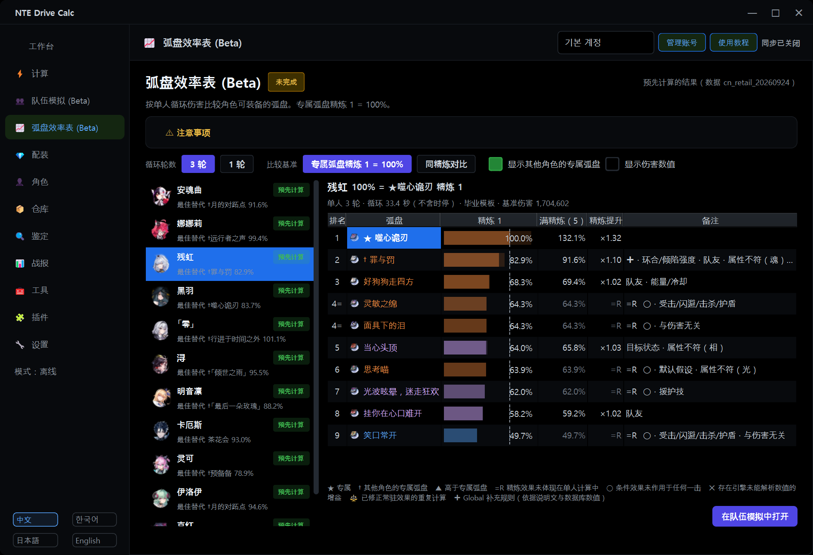
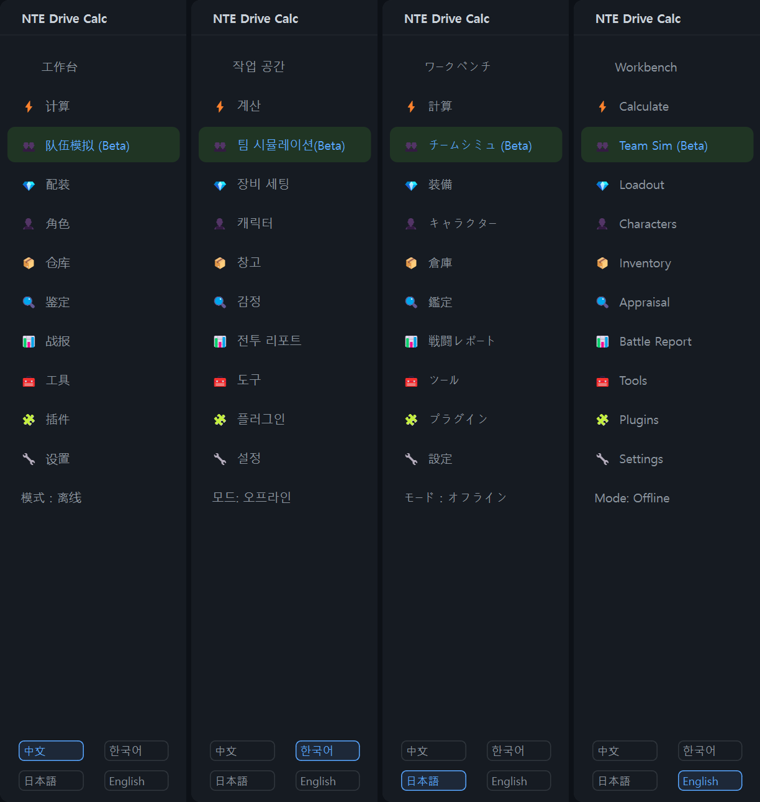

# NTE Drive Calc Global

**已有用户请先[手动下载并运行 v2.3.4 安装程序](https://github.com/LuinDe/NTE-Drive-Calc-Global/releases/download/v2.3.4/NTE_Drive_Calc_2.3.4_Multilingual_Setup.exe)。** 本版启用新的发布签名密钥。手动安装一次后，即可在应用内获取使用此密钥签名的后续更新。


[한국어](README.md) | [English](README.en.md) | [日本語](README.ja.md) | **中文**

> [!IMPORTANT]
> **本程序不是原版，而是在原版基础上修改而成的非官方构建。**
>
> **原版（官方）项目：[NTE Drive Calc — hxwd94666/NTE-Drive-Calculator](https://github.com/hxwd94666/NTE-Drive-Calculator)**
> <https://github.com/hxwd94666/NTE-Drive-Calculator>
>
> - NTE Drive Calc Global 是 [LuinDe](https://github.com/LuinDe) **修改官方 NTE Drive Calc 2.3.1 的源代码后制作的衍生构建**；原程序由 [hxwd94666](https://github.com/hxwd94666) 与 NTE Drive Calc 贡献者开发。
> - **它不是官方发布版本。** 原作者没有制作、审核或支持本构建。
> - 本构建出现的问题请反馈到 **[本仓库的 Issues](../../issues)**，不要反馈到原版仓库，也请不要就此联系原作者。
> - 如需官方版本，请从上面的原版链接获取。
> - 感谢原作者与各位贡献者开发了这款程序，并以 AGPL-3.0 公开源代码。驱动计算、扫描、同步、战报、养成记录等本构建的基础功能全部来自原版。下面“与原版的不同之处”所列的部分（队伍模拟、弧盘效率表等）是本构建新增或修改的，其中的错误与原作者无关。

## 这个仓库是什么

[NTE Drive Calc](https://github.com/hxwd94666/NTE-Drive-Calculator)（异环驱动计算器）是面向《异环》（Neverness to Everness，NTE）驱动与卡带养成的 Windows 计算工具：获取背包数据并鉴定，计算各角色的配装，并在游戏内自动装配。完整的功能说明请看[原版 README](https://github.com/hxwd94666/NTE-Drive-Calculator#readme)。

**NTE Drive Calc Global** 是基于官方 2.3.1 的非官方修改构建：

- 界面可以使用 **韩语 / English / 日语 / 中文** 四种语言；
- 增加了 **队伍模拟 (Beta)**、**弧盘效率表 (Beta)**、**觉醒效率表 (Beta)**、**噗卡特训** 等功能；
- 加入了与原版分开、**只获取本仓库发布的程序内更新**。

本仓库包含修改后的源代码（`src/`）和构建工具，安装程序请到 [Releases](../../releases) 下载。当前版本为 **Global 2.3.2**。Global 的版本号现已独立于原版，Global 2.3.2 基于官方 2.3.1。



## 2.3.2 的变化

写给之前使用 2.3.1-global.1 的用户的摘要。各版本的详细内容和已知限制见 [RELEASE_NOTES.md](RELEASE_NOTES.md)。

- **正在使用 2.3.1-global.1 或 2.3.1-global.2 的用户需要手动安装一次本版本。** 2.3.1-global.1 没有更新功能；2026-10-19 短暂发布的 2.3.1-global.2 无法识别新的版本号格式。从本版本起，新版本可以在程序内获取。
- **Global 的版本号现已独立于原版。** Global 2.3.2 基于官方 2.3.1，包含 2.3.1-global.2 的全部内容。
- **新功能：程序内更新（仅 Global）** —— 只检查本仓库的发布，只安装带有维护者有效签名的发布。原版的更新功能已删除（见下面的[更新](#更新)）。
- **队伍模拟：终结能量、环合值、冷却与切换规则** —— 全部 24 名角色逐击累积能量和环合值并应用冷却；技能冷却还剩 0.3 秒及以上时切换到下一名角色（见下面第 2 项）。
- **新功能：自由选择觉醒与觉醒效率表** —— 觉醒效果可以不按顺序选择，并可在表中查看每个效果带来的 DPS 变化（见下面第 3 项）。
- **明音凛按国服上线数据计算**（见下面第 5 项）。
- **新功能：噗卡特训** —— 把游戏 1.4 的账号通用养成计入面板、边际收益、队伍模拟和战报（见下面第 6 项）。
- **新功能：RTSS（RivaTuner）兼容性提醒** —— 在启动 Loader 之前提示可能导致游戏一启动就崩溃的 RTSS 设置（见下面第 10 项）。
- 首页“工作台”标题旁的角色头像由黑羽改为**明音凛**。
- **修复**：日语直接输入面板提示中仍为中文的技能名、小吱的日语名、队伍卡片中较长的角色名被截断。
- 同一支队伍在队伍模拟和效率表中的数值与 2.3.1-global.1 不同（因冷却等待与切换、觉醒规则、明音凛的数据）。

<details>
<summary>2.3.1-global.1（Global 2.3.0 → 基于官方 2.3.1）的变化</summary>

- **基于官方 2.3.1**：包含原版在 2.3.1 中新增的全部功能（养成记录、插件式游戏内组件等）。
- **新功能：弧盘效率表 (Beta)** —— 对每个拥有专属弧盘的角色，以专属弧盘为基准，用百分比显示其可装备弧盘的效率（见下面第 4 项）。
- **队伍模拟的弧盘修正**：修复了所选弧盘没有反映到角色面板的问题，修正了常驻效果的重复计算，并把「罪与罚」「月的对跖点」的条件效果纳入计算（见下面第 2 项）。
- **游戏目录保护**按 2.3.1 新的组件结构（`d3d12.dll` + `plugins\NTE_Plugin*.dll`）重新实现（见下面第 9 项）。
- **翻译**：2.3.1 新增的约 700 条文本已译为三种语言。韩语采用 2.3.1 韩语补丁的译法。另外 288 条较早的游戏说明文也补译为英语和日语。
- **修复**：9 处译文中两个数值可能互换位置显示的问题；英语按钮、标签页中的 `&` 被当作快捷键标记的问题（现改为 "and"）；部分英语、日语用词。

</details>

## 与原版的不同之处

按文件列出的详细清单见 [CHANGES.md](CHANGES.md)。

### 1. 四种语言

- 界面语言可选 **中文（原文）/ 한국어 / 日本語 / English**。点击程序**左下角的语言按钮**，运行中即可立即切换（无需重启），所选语言会被保存。
- 每种语言翻译了约 10,100 条界面文本。角色、套装、弧盘、技能、怪物的名称，效果说明以及战报中的文字也会翻译后显示。
- 韩语以韩服客户端的官方名称为准。英语、日语在能够确认的范围内采用各语言客户端的用语，未能确认的名称（例如该语言尚未上线的内容）可能是暂定译名或保留原文。
- 从 2.3.2 起，韩语界面把觉醒称为“돌파”；英语、日语仍为“Awakening”“覚醒”。
- 游戏资料（角色、装备、弧盘、怪物）的搜索框支持用韩文和韩文初声（초성）搜索（中文搜索照常可用）。
- 安装程序同样提供四种语言。



### 2. 队伍模拟 (Beta) — 新功能

> [!WARNING]
> **这是尚未完成的功能。** 程序内也会显示同样的提示：*“该功能尚未完成，角色循环的审核还不完善，结果可能与实战不同。”*
> 它只用于粗略比较队伍强度，不保证与实战结果一致。

- 选择 4 名队员后，计算整支队伍的总伤害、DPS 和各队员的贡献。每名队员可以选择觉醒、弧盘、精炼和卡带套装；驱动与主/副词条按官方毕业模板计算（不使用你仓库里的装备）。
- **已审核循环**：内置 24 名角色的循环，队伍运行 3 轮。
- **环合反应始终参与计算。** 切换到相邻属性的队员时，一并处理创生、覆纹、浊燃、黯星、浸染、延滞以及盈蓄、失谐（延滞、盈蓄、失谐只显示效果，不计伤害）。
- 计入**变身/形态中的攻击**（残虹、黑羽、真红、哈索尔、明音凛、翳等）。
- 可以选择**出场顺序**：自动（变身输出优先）/ 自动（环合最多）/ 按编队顺序。
- **说明面板**：在结果下方显示所使用的循环、出场顺序及选择该顺序的原因、环合反应表、各队员循环、能量/环合值/冷却记录，以及假设与限制。
- **直接输入模式**：用文字写出循环来计算。提供环合值、冷却、Buff 与数值等选项，循环可以命名保存并读取。写法见下面的[使用方法](#使用方法)。
- **弧盘修正**（自 2.3.1 起，与弧盘效率表使用同一套计算）：
  - 更换队员的弧盘或精炼后，该弧盘的属性会反映到角色面板（2.3.0 中仍保留模板弧盘的属性）。
  - 弧盘的常驻效果原先在面板和战斗引擎中被各算一次，现在只计算一次。
  - 战斗引擎无法求出数值的「罪与罚」「月的对跖点」的条件效果，按说明文与游戏数据中的数值计算（标注为 **Global 补充规则**；时停期间不计入持续时间）。

#### 终结能量、环合值与冷却（2.3.2）

- 全部 24 名角色按游戏数据**逐击累积终结能量和环合值**，并应用**技能冷却**。冷却来自游戏数据和社区资料（prydwen.gg、GameWith），冷却计时为扣除时停的战斗时间。每个数值的来源和可信度显示在说明栏。
- 没有资料的数值不做推测：未能确认的冷却不做检查；没有环合值资料时沿用旧规则（第 1、3 轮开始时环合值 100），并在说明栏注明。
- 可以选择**资源模型**（按账号记忆）：游戏数据 + 社区冷却（默认）/ 游戏数据 / 旧规则（不检查能量与冷却，第 1、3 轮补满 = 与 2.3.1-global.1 相同的计算）。
- **切换规则**：在队伍中，下一个技能的冷却还剩 **0.3 秒及以上**，或终结技能量不足时，不等待而直接切换到下一名角色；剩余**不足 0.3 秒**时等待后使用。所有队员都未就绪时，等待最早就绪的队员。切换与等待的明细显示在说明栏。
- 单人计算的弧盘效率表、觉醒效率表没有可切换的队友，因此等待冷却。
- 直接输入的检查方式可选 不检查 / 仅警告（默认）/ 插入等待 / 严格。“严格”使用与已审核循环相同的切换规则。
- 多数已审核队伍结果不变；冷却紧张的快节奏队伍（例如带伊洛伊的队伍）切换会增加，总伤害可能下降。

### 3. 自由选择觉醒与觉醒效率表 — 新功能（2.3.2）

- 《异环》的觉醒可以不按顺序选择（例如 ③ → ⑤ → ①）。在队伍模拟的角色卡片上可以分别开关 6 个觉醒效果（“觉醒 n/6”），共鸣与所选效果无关，在觉醒 3 次、6 次时生效。不再假设“觉醒 N = 效果 1–N”。
- 以前保存的队伍和循环照常打开（只保存了觉醒次数时按效果 1–N 读取）。
- 24 名角色的 192 个觉醒效果中，**129 个已计入计算**。其余不按 0% 处理，而是单独标注：
  - **需要实测**（34 个）：效果作用的命中或资源尚未出现在计算器的时间轴上，或所需数值、时机在游戏数据和说明文中都没有，需要在游戏中实测。
  - **无法计算**（29 个）：治疗、护盾、移动等与伤害无关，或需要倾陷、击杀、受击、多个目标才会触发，在对单个不动木桩的伤害中体现不出来。
  - 模拟器无法再现条件的效果按期望值计算并标注“期望值”。安魂曲③按一次性结算剩余持续伤害并移除该层计算。
- 弧盘效率表下方有 **角色觉醒效率 (Beta)** 表（初始为折叠）。按角色显示只加一个觉醒效果（以觉醒 0 为基准）、从全部 6 个中去掉一个时的 DPS 变化（%），以及共鸣 3、共鸣 6、全部觉醒，分 1 轮和 3 轮。数值已预先计算，数据或计算方式不一致时会在本机重新计算。

### 4. 弧盘效率表 (Beta) — 新功能

> [!WARNING]
> **这是尚未完成的功能。** 该表只是弧盘之间的比较，不代表实战结果。

- 在左侧菜单的 **弧盘效率表 (Beta)** 中选择角色，即可用**该角色单人循环的伤害**比较其可装备的弧盘。**专属弧盘精炼 1 = 100%**。
- 列：排名、弧盘、**精炼 1 的 %**、**满精炼的 %**、精炼提升倍数、备注（`=R` 精炼效果未体现在单人计算中、`○` 条件效果未作用于任何一击、`✚` Global 补充规则 等）。勾选“显示伤害数值”后还会显示伤害。
- 可以切换 **3 轮（默认）/ 1 轮**，以及比较基准 **专属弧盘精炼 1 = 100% / 同精炼对比**。
- **按噗卡特训满级（Lv.20）查看**：毕业模板的噗卡特训等级可选 0（默认，与以前结果相同）/ 20（按账号记忆，两种都已预先计算）。
- 按计算器的同类型规则可以装备的**其他角色的专属弧盘**也会加上 **†** 一并列出（未在游戏内实测）。取消“显示其他角色的专属弧盘”即可隐藏。
- 表中**只有拥有专属弧盘的角色**（目前 11 名）。没有专属弧盘的常驻角色不在表中。游戏数据中出现拥有专属弧盘的新角色时会自动加入。
- 结果已预先计算，打开即可显示。若游戏数据或计算方式变化导致不一致，会在本机重新计算（从正在查看的角色开始，可中途取消）。
- **在队伍模拟中打开**：以装备所选弧盘的该角色打开队伍模拟。
- 计算方式：角色单人，在官方毕业模板中只更换弧盘与精炼，按已审核循环行动，对象为 80 级木桩，使用与队伍模拟相同的引擎、相同的弧盘修正和相同的冷却规则（单人时等待）。依赖援护技、队友、队伍构成、环合强度或倾陷强度的弧盘效果按 0 计算。详细假设见页面上的“注意事项”和 [RELEASE_NOTES.md](RELEASE_NOTES.md)。

### 5. 明音凛：国服上线数据（2.3.2）

- 计算器自带的游戏数据（2026-09-24）中，明音凛是上线前的数值。国服正式上线（2026-10-15）后，**只有至少两个相互独立的资料一致的数值**才会在运行时替换计算。游戏数据文件本身不修改，并且只在计算器的游戏数据正是这份 9-24 数据时生效。
- 替换的内容：上线状态、觉醒效果 ①–⑥、共鸣 3、共鸣 6、「烁星激昂」（终结技第一段后 20 秒内攻击力 +20%）、终结技第二段可用的时机、专属弧盘「月的对跖点」（技能伤害 +28%（精炼 1），不叠层）等共 46 项。
- 资料来源：国服官方公告（yh.wanmei.com，10-14、10-15、10-16）、国服上线客户端截图（巴哈姆特 forum.gamer.com.tw）、TapTap 攻略、注明为国服信息的日本攻略（kamigame、AppMedia、GameWith），弧盘文本另参考 LDShop。
- **未确认的内容**（沿用游戏数据中的数值，界面上标注“未确认”）：80 级基础属性、技能倍率、普攻传导基础值、华彩连段持续时间、只有一个来源的 5 项机制、专属弧盘精炼 1 的暴击率与相属性伤害（来源之间为 16% 与 15%、20% 不一致）以及精炼 2–5 的其余数值。**E、Q 冷却与终结能量没有资料。**
- 战报的分析组件（原版自带的程序，未修改）仍使用上线前的数据计算，含明音凛的记录会显示一行提示。

### 6. 噗卡特训 — 新功能（2.3.2）

- 把游戏 1.4 新增的账号通用养成 **噗卡特训**（Lv 0–20，作用于出战角色）纳入计算。在**角色页的家具加成卡片**中输入等级（默认 0）后，角色面板、边际收益、队伍模拟以及新录制的战报中会加上攻击力、防御力、生命值、暴击率、暴击伤害、环合强度和倾陷强度（Lv 20 合计 +28 / +30 / +420 / +2.5% / +5% / +12 / +12）。
- 战报在开始录制时把等级固定在记录中。在此功能之前录制的战报按 Lv 0 计算，不追溯（卡片上会有提示）。
- **全部计入特训**（默认开启）：重算修改副本与边际对比时计入全部特训加成。此时会出现“边际手工调整”行，量化状态可能显示为“部分”。关闭后只计入攻击力和暴击伤害部分。
- **按噗卡特训满级（Lv.20）查看**：在 Lv 0 / Lv 20 之间切换弧盘效率表、觉醒效率表和毕业率所用的毕业模板。
- 等级表是对照公开资料（官方 1.4 公告、社区表格）整理的。倾陷强度合计（12）以及攻击力、防御力、生命值是否为固定值加成，未在游戏内确认。

### 7. 程序内更新（仅 Global）— 新功能（2.3.2）

删除了原版的更新功能（检查原版发布、Mirror酱，下载官方安装程序，更新对话框），换成**只检查本仓库发布的更新**。Global 今后独立于原版开发和更新。详见下面的[更新](#更新)。

### 8. 战报：与我的角色对比 — 新功能

对于导入的战报，把其中你账号里也拥有的角色替换为你自己的养成状态和当前装备，在同一条战斗轴上重新计算，并与原结果对比。该功能只读，不会改动已保存的数据。

### 9. 保护游戏目录中其他程序的文件

官方 2.3.1 会向游戏目录部署 `d3d12.dll`（宿主）和 `plugins\NTE_Plugin*.dll`，并清理旧的 `NTE_Capture.dll`、`dwmapi.dll`。本构建只有在**确认（SHA-256）是本程序自己的文件**时，才会替换或删除这些文件。无法确认的文件（例如以 `d3d12.dll` 为名安装的 ReShade、UE4SS 等其他模组的 `dwmapi.dll`）既不会被覆盖，也不会被删除；此时部署会中止并在界面上给出提示，清理时也只保留该文件并告知。

### 10. RTSS（RivaTuner）兼容性提醒 — 新功能（2.3.2）

- 在作者的环境中，以默认挂钩方式运行的 RTSS（RivaTuner Statistics Server，随 MSI Afterburner 一起安装）与 2.3.1 的游戏内组件同时使用时，游戏一启动就会崩溃（D3D12 错误 `80004004 (E_ABORT)`）。
- 本构建**只读取** RTSS 设置；检测到这种风险时，点击 **启动原生 Loader** 会提示解决方法（在 RTSS 中添加 HTGame.exe 配置，并开启 Setup → General →“Use Microsoft Detours API hooking”），环境检测的 **检测详情** 中也会列出。不会修改 RTSS 设置。提醒窗口中可以重新检测、继续或取消，也可以为当前账号关闭此提醒。
- 由自动同步启动 Loader 时不弹出窗口，只在“检测详情”中显示。详细设置步骤见[指南的 RTSS 一节](docs/COEXIST_RESHADE_DLSS.zh.md#与-rtssrivatunermsi-afterburner一起使用)。

### 11. 计算修正

灵可的被动生效时，战报重放计算的 Python 侧参考算式中覆纹追加伤害的复制比例原为 0.30，现改为 0.33（20% + 13%），即原版文档为其分析组件给出的数值。该 Python 算式在重放计算不经过分析组件时使用。由随附的分析组件（未修改）计算的战报数值不受影响。队伍模拟的覆纹不使用该算式，而是使用新编写的独立算式，采用相同的比例（0.33）。

### 12. 其他

- 防止翻译引起的问题：比较文本的代码同时接受原文和译文（战报的普攻判定、插件状态标记、同步提示等）。2.3.1 的**养成记录**在翻译后的界面中也能保存，保存的记录在任何语言下都能打开（官方 2.3.1 保存的记录也能打开）。
- 优先使用韩文、日文字体；按钮和标签宽度随译文长度变化；养成页面的提示文字自动换行，默认窗口大小下不会被截断；鉴定页的手动输入可以识别翻译后的词条名称。
- “使用教程”的 7 张教程图片替换为韩语版（无论选择哪种语言，这些图片都是韩语）。
- 提供安装整个程序的安装包。左上角标题为“NTE Drive Calc Global”。

### 没有改动的部分

- 可执行文件是在官方 2.3.1 可执行文件的基础上，只替换了 `src.*` Python 模块（并去掉了原版的 2 个更新模块）。其余组件（nte-core、分析组件、游戏内组件与加载器、OCR 模型、游戏静态数据库、ViGEmBus 驱动等）与官方 2.3.1 发行版相同。
- **战报的分析组件（`nte-analysis-core`）没有修改。** 录制战斗的分析与原版计算相同，队伍模拟的冷却、觉醒规则和明音凛的修正不适用于战报。
- 扫描（OCR）、同步、自动装配等与游戏交互的行为，除上面第 9、10 项（只读的 RTSS 检测）以及因翻译而必需的文本匹配调整（见 [CHANGES.md](CHANGES.md) 第 7 节）外，逻辑均未改动。不过这些文件同样加入了翻译界面文本所需的处理（`_L()`），而且本构建没有连接游戏逐项重新验证（见 [RELEASE_NOTES.md](RELEASE_NOTES.md) 的“验证范围”）。

## 下载与安装

1. 从 [Releases](../../releases) 下载 `NTE_Drive_Calc_2.3.4_Multilingual_Setup.exe`。安装包包含整个程序，不需要先安装官方版本。
2. 如果 NTE Drive Calc 正在运行，请先退出。
3. 运行安装程序，在用户账户控制（UAC）窗口中点击“是”。
   - 该文件没有代码签名，可能会出现 **“Windows 已保护你的电脑”（SmartScreen）** 窗口。点击“更多信息”→“仍要运行”即可。运行前可以用下面的 [SHA-256](#文件校验-sha-256) 或[签名](#自行验证签名)核对文件。
4. 选择安装语言（Windows 的显示语言是这四种之一时默认选中该语言，否则默认英语）。
5. 阅读说明后点击“下一步”完成安装。附加任务（桌面快捷方式、安装 ViGEmBus 虚拟手柄驱动）与官方安装程序的选项相同。

首次安装时，程序会以安装时选择的语言启动；如果之前已经设置过语言，则保留原设置。

### 如果已经安装了 NTE Drive Calc

- 安装位置与官方版本**相同**（默认：`C:\Program Files\NTE Drive Calc`），使用**同一个程序条目**。可以直接安装在 Global 2.3.1（2.3.1-global.1）、官方 2.3.1（或更早的官方版本）、打过[韩语补丁](https://github.com/LuinDe/NTE-Drive-Calc-KO)的 2.3.1 或之前的多语言版（Global 2.3.0）之上，不需要先卸载。
- **用户数据会保留。** 账号、设置、驱动与仓库数据、战报记录、养成记录、日志、保存的循环、效率表缓存都会保留。`accounts`、`config`、`data`、`logs`、`migration`、`scanned_images` 文件夹中的用户文件不会被删除或修改（与官方安装程序一样，只会重新写入默认文件 `config\stats.json` 和静态数据库备份 `migration\game_static.previous.sqlite3`）。
- 韩语补丁创建的备份文件（`NTE_Drive_Calc.original.exe` 等）不会被删除。
- 安装在 Global 2.3.0 之上时，几个 2.3.1 不再使用的文件（如 `_internal\NTE_Capture.dll`）会留在程序目录中。官方 2.3.0 → 2.3.1 升级也会留下相同的文件，不影响使用。
- 安装后，Windows“已安装的应用”列表中的名称为“NTE Drive Calc 2.3.2 多语言版 (Global)”，版本显示为 2.3.2（以中文安装时）。

## 更新

### 程序内更新（仅 Global）

从 2.3.2 起，可以在程序内获取新的 Global 版本。

- **更新只来自本仓库（LuinDe/NTE-Drive-Calc-Global）的发布。** Global 独立于原版开发和更新，版本号也是独立于原版的 Global 自己的 `v<major>.<minor>.<patch>`（例如 `v2.3.2`）。不会向原版服务器查询版本，程序内更新也不会安装官方构建；原版的新官方版本也不会提示。
- 检查时机：启动时每天至多一次，以及点击 **“设置”→“软件更新”卡片中的［检查更新］** 时。卡片上显示 Global 版本、作为参考的原版基础版本（2.3.1）以及发布签名密钥的指纹。
- 发现新版本时，显示版本号与更新说明，以及 **［立即更新］［稍后］［跳过此版本］**。［立即更新］会下载并核验安装程序；之后可以点击［立即安装并重启］，或在退出程序时安装。程序关闭后，安装程序以管理员权限在同一目录中运行，不显示安装向导（只显示进度窗口），用户数据保留；选择［立即安装并重启］时，安装完成后程序会重新启动。
- 下载的文件放在 `安装目录\updates\` 中，安装完成后清理。

### 检查什么（签名验证）

- 只看本仓库的正式发布（忽略草稿和预发布）；版本必须比当前版本新，只使用固定的文件名和本仓库的下载地址。
- 每个发布都带有**清单**（`NTE_Drive_Calc_<版本>_release.json`）及其**签名**（`.sig`）。清单中写明标签、版本、安装程序的文件名、大小和 SHA-256、安装后可执行文件的 SHA-256 以及发布说明的摘要，并由维护者的发布签名密钥（Ed25519，OpenSSH `ssh-keygen -Y sign`）签名。程序内置了对应的公钥。
- 没有签名或签名不正确的发布**不会提示**。下载的安装程序只有在大小和 SHA-256 同时与签名清单和 GitHub 提供的值一致时才会运行。发布说明与签名时不一致时，显示“无法验证”提示而不显示更新内容。
- 发布签名密钥（公钥）指纹：`SHA256:P5tE1mAUxx8UvnE6qZcx5xIwlkl3MwgP3vPuxr4EEyw`

```text
ssh-ed25519 AAAAC3NzaC1lZDI1NTE5AAAAICWQNY5RryTryNGlYL7zw4+biBXAnTkfOgFvZFHKQTQV nte-global-release-20261107
```

### 关闭自动检查

在“设置”→“软件更新”卡片中取消勾选 **“启动时自动检查更新（每天至多一次）”**，程序就不会再自行检查。此时点击［检查更新］仍会立即检查。

### 从 2.3.1-global.1 升级

2.3.1-global.1 及更早的版本没有这个功能，因此**需要手动从 [Releases](../../releases) 下载并安装一次 2.3.2**（见上面的[下载与安装](#下载与安装)）。2026-10-19 短暂发布的 2.3.1-global.2 同样无法识别新的版本号格式，请用同样的方法手动安装一次 2.3.2。之后的 Global 版本即可在程序内获取。

### 自行验证签名

程序内更新会自动完成下面的检查。手动下载安装程序时如果想做同样的检查，可以使用 Windows 10/11 自带的 OpenSSH `ssh-keygen`。

1. 从发布页把安装程序、`NTE_Drive_Calc_<版本>_release.json` 和 `NTE_Drive_Calc_<版本>_release.json.sig` 下载到同一文件夹。
2. 在该文件夹中打开**命令提示符**（cmd），运行下面两行（PowerShell 不支持 `<` 重定向）。第一行用维护者的公钥生成 `allowed_signers` 文件。示例为 2.3.4。

```bat
echo nte-global-release-20261107 namespaces="nte-drive-calc-global-release" ssh-ed25519 AAAAC3NzaC1lZDI1NTE5AAAAICWQNY5RryTryNGlYL7zw4+biBXAnTkfOgFvZFHKQTQV> allowed_signers
ssh-keygen -Y verify -f allowed_signers -I nte-global-release-20261107 -n nte-drive-calc-global-release -s NTE_Drive_Calc_2.3.4_release.json.sig < NTE_Drive_Calc_2.3.4_release.json
```

3. 显示 `Good "nte-drive-calc-global-release" signature for nte-global-release-20261107 with ED25519 key SHA256:P5tE1mAUxx8UvnE6qZcx5xIwlkl3MwgP3vPuxr4EEyw` 表示清单由维护者的密钥签名。如果显示 `Could not verify signature`，请不要使用这些文件，并在 [Issues](../../issues) 中反馈。
4. 用记事本打开清单，确认 `installer` 下的 `sha256` 和 `size` 与下载的安装程序一致（`certutil -hashfile NTE_Drive_Calc_2.3.4_Multilingual_Setup.exe SHA256`）。

## 恢复为官方构建

- 重新运行**官方安装程序**（`NTE_Drive_Calc_Setup_2.3.1.exe`），安装到同一位置即可。可执行文件和教程图片会恢复为官方版本，用户数据保持不变。官方安装程序请从原版项目获取：<https://github.com/hxwd94666/NTE-Drive-Calculator>
- 以后运行官方新版本的安装程序时，同样会在原位置安装官方构建。此时多语言功能、队伍模拟、效率表和 Global 更新将不再存在，官方构建自己的更新功能会重新生效（Global 的程序内更新不会安装官方构建）。
- 如需彻底卸载，请使用 Windows“已安装的应用”（应用和功能）或开始菜单中的卸载快捷方式。与官方版本一样，卸载不会删除用户数据文件夹。
- 韩语补丁的安装程序不是为本构建制作的。请不要在本构建上使用它的“恢复原版”，而应使用上面的方法。

## 使用方法

### 切换语言

程序左下角有 `中文` `한국어` `日本語` `English` 四个按钮，点击后立即切换。

### 队伍模拟

在左侧菜单的 **队伍模拟 (Beta)** 中：① 选择 4 名队员，② 为每名队员设置觉醒、弧盘、精炼和卡带套装，③ 点击 **计算队伍**。默认模式是“已审核循环”。弧盘列表中显示该角色可装备的弧盘，其他角色的专属弧盘会标注其所属角色。

- **觉醒**：用角色卡片上的 ①–⑥ 按钮逐个开关效果（“觉醒 n/6”）。⋯ 菜单可以全选、取消全选或按毕业模板选择；把鼠标停在效果上会显示说明和计算情况（“需要实测”“无法计算”“期望值”）。
- **资源模型**：在出场顺序下方的“资源模型”中选择 游戏数据 + 社区冷却（默认）/ 游戏数据 / 旧规则。
- 结果下方的说明栏中可以看到能量、环合值、冷却等待和切换的明细。

### 弧盘效率表与觉醒效率表

在左侧菜单的 **弧盘效率表 (Beta)** 中点击左侧列表里的角色。用上方的按钮切换轮数（3 轮 / 1 轮）和比较基准；在表中选中弧盘后点击 **在队伍模拟中打开**，即可用该弧盘打开队伍模拟。请同时参阅表格下方的符号说明和页面上方的“注意事项”。展开页面下方的 **角色觉醒效率 (Beta)** 即可看到觉醒效率表。**按噗卡特训满级（Lv.20）查看** 对两个表都生效。

### 噗卡特训

在角色页的 **家具加成** 卡片中输入噗卡特训等级（0–20）。每个账号一个等级，所有角色的计算都会使用。战报卡片上的 **全部计入特训** 可以切换重算时的计入范围。

### 直接输入循环

点击 **直接输入** 按钮，在 **文本输入** 框中按 `角色 动作` 的顺序用 `>` 连接：

```text
零 援护 > 零 E > 零 普攻 普攻 普攻 > 伊洛伊 切换 > 伊洛伊 Q > 伊洛伊 E > 伊洛伊 普攻
```

- **援护**表示以援护技登场。与切出队员属性相邻时会触发环合反应。第一步的援护因为没有切出队员，只释放技能。
- **切换**表示普通切换，不放援护技，也不触发反应。
- 可用动作：`援护` `切换` `普攻` `重击` `E` `E长按` `Q` `反击` `闪避` `下落` `登场攻击` `特殊` `等待`（可用的动作因角色而异）
- `普攻 普攻 普攻` = `普攻x3` = `普攻 3次`。连段中的某一段用 `#N` 指定（例如 `普攻#4`）。`等待 2` 表示等待 2 秒。
- 括号里的备注会被忽略。分隔符除了 `>`，也可以用 `→` 或换行。
- 也可以点击队员按钮和动作按钮来添加步骤。韩语、英语、日语的写法随时都能识别。
- **▶ 选项**：环合值模式（按输入执行 / 检查环合值）与开始时环合值；冷却、能量数值及检查方式（不检查 / 仅警告（默认）/ 插入等待 / 严格）；开关引擎推算的队伍 Buff；手动 Buff；重复次数；敌人等级、抗性、防御降低与易伤；是否首领与敌人数量；切换耗时。冷却与能量栏默认填入资源模型的数值，可以自行修改。
- 循环可以命名**保存**并**读取**。也可以用**读取已审核循环**导入内置循环（1 轮或 3 轮）后再修改。
- 上限为 200 步，含重复在内最多执行 600 个动作。

<details>
<summary>查看直接输入模式的计算结果界面（上面的例子，韩语界面，2.3.1-global.1）</summary>


</details>

<details>
<summary>查看队伍模拟界面（2.3.1-global.1）</summary>


</details>

## 与 ReShade、DLSS5 一起使用

如果想在使用 ReShade（`d3d12.dll`）和 DLSS5 插件的同时使用计算器的原生功能，请把加载方式改为 **原生 Loader（备用）**。这种方式不会在游戏目录中放置计算器文件。设置顺序、备份以及各构建的差异（官方版可能删除或覆盖 ReShade 的 `d3d12.dll`）都整理在指南中。

→ [指南：与 ReShade、DLSS5 一起使用（Loader 方式）](docs/COEXIST_RESHADE_DLSS.zh.md)

> 2026-10-14 已在实际游戏中确认：Loader 与 ReShade 一起使用时游戏可以正常启动和运行，不会崩溃（一台电脑；计算器连接尚未在画面上确认）。DLSS5 插件需要是最新版。如果还使用 RTSS（RivaTuner / MSI Afterburner），需要按[指南的 RTSS 一节](docs/COEXIST_RESHADE_DLSS.zh.md#与-rtssrivatunermsi-afterburner一起使用)进行设置；缺少该设置时，本构建会在启动 Loader 前提示（见上面第 10 项）。

## 注意事项

- **运行环境与原版相同。** Windows 10/11 x64；游戏语言：**简体中文**（扫描与鉴定的文字识别以中文游戏界面为准）；推荐分辨率 1080p、2K、4K 或 2560x1600；扫描功能需要 ViGEmBus 虚拟手柄驱动。详情请以[原版 README](https://github.com/hxwd94666/NTE-Drive-Calculator#readme) 为准。
- **与游戏交互的功能存在风险。** 原版程序划分了工作模式（离线 / 低风险 / 中风险 / 开发），并且自己提示：低风险模式（抓包与模拟输入）和中风险模式（加载游戏组件并执行游戏内操作）*可能触发游戏保护或兼容问题*。除“与原版的不同之处”第 9 项（保护游戏目录中的文件）和第 10 项（只读的 RTSS 检测）外，本构建没有改动这部分的行为，因此风险至少与原版相同。使用前请阅读程序内的提示和[原版文档](https://github.com/hxwd94666/NTE-Drive-Calculator)，并自行确认适用的游戏规则、服务条款和当地法律。
- 语言切换、队伍模拟、效率表和噗卡特训的输入在离线模式下也能使用，不会连接游戏。程序内更新只连接 GitHub（本仓库）。
- **队伍模拟、弧盘效率表和觉醒效率表都是 Beta。** 它们以 80 级、抗性 20%、原地不动的训练木桩为前提。部分冷却来自社区资料（低可信度）；未能确认的冷却（变轨技能：哈索尔、残虹、明音凛、卡厄斯、伊洛伊、真红；终结技：残虹、明音凛、真红）不做检查。终结技能量消耗只有浔有游戏数据，其他角色不会因能量不足而推迟终结技。63 个觉醒效果尚未计算（标注为“需要实测”“无法计算”）。效率表是单人计算，依赖队伍的效果按 0 计算。其他限制见计算结果下方的“假设与限制”、效率表的“注意事项”和 [RELEASE_NOTES.md](RELEASE_NOTES.md)。
- 安装程序和可执行文件**没有代码签名**。程序内更新用单独的发布签名密钥进行验证（见上面的[更新](#更新)）。
- 用官方安装程序安装官方新版本后，本构建会被官方构建替换。Global 的程序内更新只安装本仓库的 Global 发布。
- 原作者不为本构建提供支持。程序内的更新、下载、发布和反馈链接指向本仓库。**原版的 GitHub、交流群（QQ / Discord）和赞助链接作为对原作者的署名保留，会打开原作者的页面。** 本构建出现的问题请不要反馈到那里，请反馈到[本仓库的 Issues](../../issues)。

## 文件校验 (SHA-256)

| 文件 | 大小（字节） | SHA-256 |
|---|---:|---|
| `NTE_Drive_Calc_2.3.2_Multilingual_Setup.exe`（安装程序） | 184,850,846 | `c9faeb139a4dbad0c2d978b847c86b97dd9c3ee984bc1efba1d8db4f25623f87` |
| `NTE_Drive_Calc_2.3.2_Multilingual_source.zip`（源代码） | 7,478,833 | `29ef19f2566f63745177c4da05c311cb73dee3f7cffa342f4001d86b0ce601aa` |
| 安装后的 `NTE_Drive_Calc.exe` | 25,221,222 | `3a165259d6395050311d30816f34ac547b2b7646e8991e7acb68f36ff4ef384f` |
| （参考）作为基础的官方 2.3.1 `NTE_Drive_Calc.exe` | 21,320,661 | `5b8fa8d2b7580bacd494c0f71e76d7b05cf1bee4f9b94bb945993a2e1c69e8c3` |

安装程序的 SHA-256 也写在签名清单 `NTE_Drive_Calc_2.3.2_release.json` 中（见上面的[自行验证签名](#自行验证签名)）。在 PowerShell 中校验：

```powershell
Get-FileHash .\NTE_Drive_Calc_2.3.2_Multilingual_Setup.exe -Algorithm SHA256
Get-FileHash "C:\Program Files\NTE Drive Calc\NTE_Drive_Calc.exe" -Algorithm SHA256
```

之前版本（2.3.1-global.1、Global 2.3.0）的文件和哈希见 [Releases](../../releases) 中对应的发布页和 [RELEASE_NOTES.md](RELEASE_NOTES.md)。

## 从源代码构建

本仓库的 [`src/`](src) 是发布的可执行文件中全部 `src.*` 模块的源代码。构建工具在 [`build_tools/`](build_tools)（见 [build_tools/README.md](build_tools/README.md)）。

可执行文件不是从头重新打包的，而是**只把官方 2.3.1 可执行文件 PYZ 归档中的 `src.*` 模块替换为由本源代码编译的结果**，其余部分逐字节保持不变。可执行文件内嵌 `python311.dll`，因此需要 **Python 3.11**。从 2.3.2 起，原版的 2 个更新模块不在源代码中，需要用 `--remove` / `--removed` 表明是有意去掉的。

```powershell
python build_tools/rebuild_exe_l10n.py      <官方 2.3.1 NTE_Drive_Calc.exe> src <输出 exe> --remove=src.features.settings.updates --remove=src.ui.controllers.update_controller
python build_tools/verify_exe_l10n_g231.py  <官方 2.3.1 NTE_Drive_Calc.exe> <输出 exe> src --removed=src.features.settings.updates --removed=src.ui.controllers.update_controller
```

作为基础的官方可执行文件的 SHA-256 为 `5b8fa8d2…e8c3`（由原版 Release `2.3.1` 的安装程序安装的文件，对应原版提交 `0e7a6b4`）。使用 CPython 3.11.15（Windows x64）构建时，结果的 SHA-256 与发布的可执行文件（`3a165259…384f`）相同。其他 3.11.x 版本的压缩结果可能不同，哈希也会不同；这时可以用 `verify_exe_l10n_g231.py` 确认内容与本源代码一致。

`src/app/global_release.py` 中包含维护者的发布签名公钥。如果你自己构建并发布自己的版本，请用 `build_tools/pin_release_key.py` 写入你自己的公钥（私钥不在本仓库中）。安装程序、源代码 zip 和发布清单的制作方法见 [build_tools/README.md](build_tools/README.md)。

关于对应源代码的说明见 [SOURCE_OFFER.md](SOURCE_OFFER.md)。

## 许可证

- NTE Drive Calc 以 **GNU AGPL-3.0** 发布；本构建是它的衍生作品，适用相同的许可证。全文：[LICENSE](LICENSE)，声明：[NOTICE](NOTICE)
- 原始版权：**NTE Drive Calc contributors**（[hxwd94666](https://github.com/hxwd94666)）— <https://github.com/hxwd94666/NTE-Drive-Calculator>
- 修改：[LuinDe](https://github.com/LuinDe)，2026-10-20（Global 2.3.2，基于原版提交 `0e7a6b4`，即官方 2.3.1；原版的 `2.3.1` 标签指向更早的提交）。2.3.1-global.2（短暂发布）：2026-10-19；2.3.1-global.1：2026-10-11；首个版本 Global 2.3.0：2026-10-05。
- 安装包中附带的 nte-core、游戏内组件与加载器、ViGEmBus 等是适用各自许可证的独立组件，未作修改。其来源和条款见 [NOTICE](NOTICE) 以及原版仓库的 `third_party/`。

## 免责声明

本程序是玩家自制的非官方工具，与游戏的开发商、发行商没有任何关系，也未获得其认可或支持。Neverness to Everness / 异环 的名称、角色、图像及其他游戏素材的权利归各自权利人所有。程序按现状提供，使用所产生的后果由使用者自行承担。
