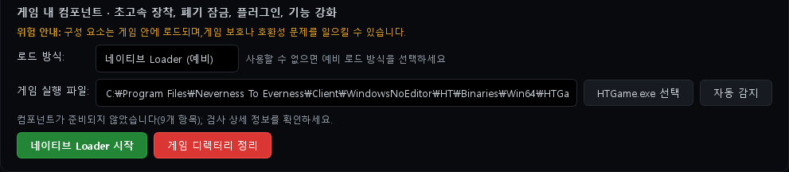
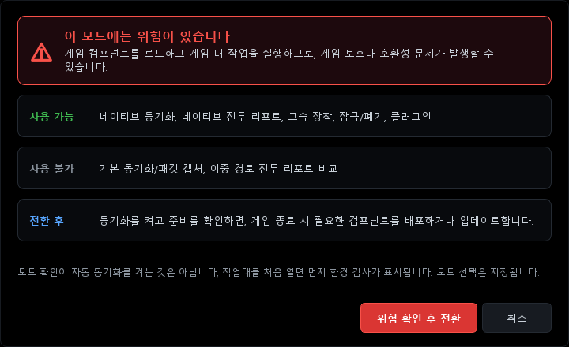
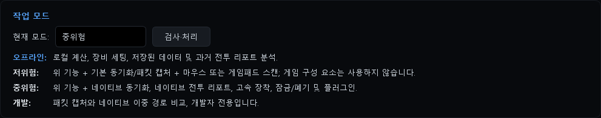
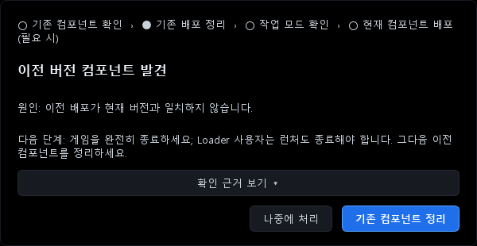

# Using with ReShade and DLSS5 (Loader method)

[한국어](COEXIST_RESHADE_DLSS.ko.md) | **English** | [日本語](COEXIST_RESHADE_DLSS.ja.md) | [中文](COEXIST_RESHADE_DLSS.zh.md)

This guide explains how to use the native features of NTE Drive Calc 2.3.1 (native sync, native battle reports, Rapid Equip, plugins) together with ReShade and DLSS5 (a neural rendering add-on).
It applies to the official 2.3.1, the Korean patch v2.3.1-ko and Global 2.3.1. Where the builds behave differently, this is marked.

> [!WARNING]
> **Part of this has not yet been tested in the actual game on 2.3.1.**
> Starting with 2.3.1, the calculator file that the Loader loads into the game is also named `d3d12.dll`. It sits in the calculator's folder, so it does not clash with the ReShade file in the game folder. However, it has not been confirmed whether ReShade still loads correctly, or whether the two conflict, when two DLLs with the same name end up in one game process. The original author also marked this Loader build as not validated in the game.
> After you start using it, be sure to check it with [Step 5](#step-5-check-that-it-works).

## Who this is for

- You use ReShade and a DLSS5 add-on and also want the calculator's native features
- You could not keep the calculator's D3D method and ReShade together because both use the name `d3d12.dll`
- You saw the "Legacy component found" dialog after updating from 2.3.0 to 2.3.1

## At a glance

With the Loader method, the calculator **does not put a single file in the game folder.** The files it needs (the calculator host `d3d12.dll` and the plugins under `plugins\`) are prepared in `calculator install folder\config\native-loader` (or `%LOCALAPPDATA%\NTE Drive Calc\config\native-loader` if the install folder is not writable). When the official launcher starts the game, the Loader loads these files into the game. That leaves the `d3d12.dll` slot in the game folder free for ReShade.
The D3D method, by contrast, places the calculator's `d3d12.dll` directly in the game folder, so it cannot share the folder with ReShade, which uses the same name.

| | D3D capture proxy | Native Loader (Fallback) |
|---|---|---|
| Where the calculator's files go | Game folder `Win64` | Calculator folder `config\native-loader` |
| `d3d12.dll` in the game folder | Used by the calculator | Used by ReShade |
| Using it with ReShade (`d3d12.dll`) | Not possible | Files do not clash. Whether they actually work together on 2.3.1 is not confirmed (pending check) |
| Start-up order | Deploy in advance with the game closed | Every time: calculator (Loader) → launcher → game |

## Read this first

- ReShade, DLSS5 add-ons and the calculator's native features all load outside code into the game. Depending on the game's policies, your account may be penalized, and you use them at your own risk.
- In the author's setup, with ReShade installed as `dxgi.dll`, ACE showed an "illegal module (dxgi.dll)" warning several times, together with a notice that the account could be penalized. This guide does not cover ways to avoid detection. Renaming a file is not a way to avoid detection, and not seeing a warning under another name does not mean it is allowed.
- The Loader method only means that no file is placed in the game folder. The Loader, running with administrator rights, injects code into the official launcher process and loads the calculator DLL into the game (inferred from analysis of the executable). Having no file in the game folder does not mean a lower detection risk. **How ACE reacts to the Loader method has not been confirmed yet.** The calculator itself warns that components are loaded into the game and may trigger game protection or compatibility issues.
- If you do not want any DLL in the game at all, use the calculator in **Low Risk** mode. Packet capture (Npcap) gives you inventory sync and basic battle reports without putting anything in the game folder or the game process. In that case you do not need the Loader setup in this guide (on the official build, if an old D3D record may remain, do [Step 0](#step-0-official-build-only-before-you-start-the-calculator) before changing the mode). Note that the app also warns that packet capture and simulated input in Low Risk mode may trigger game protection or compatibility issues.

> [!CAUTION]
> **`dwmapi.dll` can be deleted too,** because older calculator versions used that file name.
> The official build deletes **any** `dwmapi.dll` in the game folder on **Start native Loader** (when you press it yourself), **Clean Game Directory**, **Clean up old components** in the upgrade dialog, and a manual D3D deploy. If there is a `dwmapi.dll` in the game folder, it also shows the "Legacy component found" dialog on every start.
> The Korean patch and Global delete only the calculator's own old file and do not show the dialog because of another `dwmapi.dll`. No build deletes it on an automatic start. If another mod uses the name `dwmapi.dll`, back it up first.

## What you need

| Item | Details |
|---|---|
| Calculator | One of: official 2.3.1, [Korean patch v2.3.1-ko](https://github.com/LuinDe/NTE-Drive-Calc-KO/releases/tag/v2.3.1-ko) (Korean UI), [Global 2.3.1](https://github.com/LuinDe/NTE-Drive-Calc-Global/releases/tag/v2.3.1-global.1). **If you use ReShade, the Korean patch or Global is recommended.** See [Differences between builds](#differences-between-builds) for why. The calculator runs with administrator rights (a UAC prompt appears). |
| Work mode | **Medium Risk** (or Development), with the risk acknowledged. |
| Runtime | Microsoft Visual C++ 2015–2022 Redistributable (x64). The calculator checks for it before starting the Loader. |
| Game path | The calculator must have the `HTGame.exe` path set. The game must keep the official folder layout (`game install folder\Client\WindowsNoEditor\HT\Binaries\Win64\HTGame.exe`). The official launcher `NTELauncher.exe` or `NTEGlobalLauncher.exe` must be in the install root (the folder that contains `Client`), or inside an `NTELauncher\` folder there. |
| Starting the game | Use the **official launcher**. The Loader reaches the game through the launcher. |
| Graphics mods | ReShade (add-on build) and a DLSS5 add-on. For installation, see the external guides in [Step 3](#step-3-install-reshade-and-dlss5). |

## Before you start: back up

Copy the following files from the game folder `game install folder\Client\WindowsNoEditor\HT\Binaries\Win64` to another location.

| Type | Files |
|---|---|
| ReShade itself | `d3d12.dll` (the file whose Properties → Details → Product name is `ReShade`) |
| ReShade settings | `ReShade.ini`, the preset you use (e.g. `ReShadePreset.ini`), the `reshade-shaders\` folder |
| Add-ons | All `*.addon64`, including add-ons you disabled by renaming them (e.g. `*.addon64x`) |
| DLSS files | Files you added or replaced when installing DLSS5, such as `nvngx_dlss.dll` and `nvngx_dlssnr.dll`. Also any you put in other folders (e.g. `Client\WindowsNoEditor\Engine\Plugins\Runtime\Nvidia\…\Binaries\ThirdParty\Win64`) |
| Other mods | `dwmapi.dll`, OptiScaler and other mod files in the same folder |
| Anything else | The `D3D12\` folder and other files created or changed during installation |

If you are installing DLSS5 for the first time, back up the original files it will replace (such as `nvngx_dlss.dll`) **before** installing.
Copying the whole game folder can take a lot of space. At a minimum, back up the `Win64` folder and every folder you put DLSS files in.

**Why the backup matters**

1. Running **Uninstall** in the ReShade installer deletes every `*.addon64` in that folder (this happened in the author's setup).
2. The official 2.3.1 calculator deletes the game folder's `d3d12.dll` **by file name alone** when it cleans up, and the D3D method's automatic deploy **overwrites it without a backup.** Following [Step 0](#step-0-official-build-only-before-you-start-the-calculator) avoids this, but keep a backup in case of mistakes.

> [!NOTE]
> If the game is installed under `C:\Program Files`, Windows asks for administrator permission when you copy files into that folder or rename them.

## Step 0 (official build only): before you start the calculator

If you use the official build, have used the **D3D capture proxy** method before, and `Win64\d3d12.dll` is now ReShade, rename that file to `d3d12.dll.reshade-hold` **before** starting the calculator. If you are not sure whether you used the D3D method, doing this anyway is the safe choice.

- If you have ever turned on auto sync, the official build may redeploy its D3D files as soon as it starts. ReShade's `d3d12.dll` is then overwritten without a backup.
- As soon as you change the loading method or the work mode (including Low Risk and Offline), it may also delete the files listed in the old deployment record by name alone.
- After finishing Steps 1 and 2, check that there is no calculator `d3d12.dll` in `Win64`, then rename the file back.
- If another mod's `dwmapi.dll` is there, rename it the same way (see the [CAUTION above](#read-this-first)). The official build deletes `dwmapi.dll` every time you press **Start native Loader** yourself, so after renaming it back, either use only the automatic start or switch to the Korean patch or Global.

The simplest option is to install the Korean patch or Global before starting the official build. The Korean patch and Global never overwrite or delete a `d3d12.dll` that is not a calculator file.

## Step 1: Switch the calculator to the Loader method

**Order matters.** Change the loading method to Loader first, then change the work mode. Turn on auto sync only after the Loader has been started once ([Step 4](#step-4-start-up-order-every-time)).
If you choose Medium Risk while still on the default D3D method, the official build treats ReShade's `d3d12.dll` as an old calculator file and shows the "Legacy component found" dialog. If auto sync is also on, it overwrites that file with the calculator's file while the game is closed.

> The screenshots below show the Korean UI of Global 2.3.1 (test environment, no account data). The English labels are written in the steps; for the official build's Chinese labels, see the [UI label reference](#ui-label-reference).

1. In the sidebar, go to **🔧 Settings** → the **Environment Configuration** card → the **In-game component · Quick Equip, Discard/Lock, Plugins, Feature Enhancements** section.
2. Under **Loading Method:**, choose **Native Loader (Fallback)**. It is saved immediately, with no confirmation. You can change it even in Offline mode.
3. If the **Game Executable:** field is empty, press **Auto Detect** or set it yourself with **Select HTGame.exe**.
   Once Loader is selected, the green button below is renamed **Start native Loader**. At first it says "Components not ready (N issues)"; they become ready after the Loader has been started once.

   

4. In the **Work Mode** card at the top of the same page, choose **Medium Risk** under **Current Mode:**. In the confirmation dialog, press **Acknowledge Risk and Switch**. Development mode also works, but the app labels it as for developers only.

   

   

## Step 2: Former D3D users only — clean up calculator files

If you used the **D3D capture proxy** method before, calculator files may still be in the game folder. If you have used the Loader method from the start, skip this step.

**How to tell** — calculator files remain if you see any of these in the `Win64` folder:
- `plugins\NTE_Plugin*.dll` (2.3.1) or `NTE_Capture.dll` (older versions)
- `d3d12.dll` whose Properties → Details → Product name is not `ReShade` (the 2.3.1 calculator host shows `NTE Combat Debug Tools`; the 2.3.0 host has an empty product name)

**Cleaning up**

1. Close the game and the launcher completely.
2. With Step 1 done, press **Start native Loader**. The calculator first cleans up the old D3D files it recorded, then starts the Loader.
3. If files still remain, press the red **Clean Game Directory** button.
   This button stops a running Loader, deletes the files prepared in `config\native-loader` and pauses sync (automatic start stops too). When the cleanup is done, ① in Work Mode, choose **Medium Risk** → **Acknowledge Risk and Switch** again, ② press **Start native Loader** again, and ③ if auto sync shows as off, turn it back on after starting the Loader (it shows as off while sync is paused).

**Build-specific notes**

- **Korean patch and Global**: if the game folder's `d3d12.dll` is not a calculator file (ReShade, for example), they leave it in place. Just follow the steps above.
- **Official build**: during cleanup it deletes `d3d12.dll` **by name alone.** If ReShade is `d3d12.dll` at that moment, ReShade is deleted.
  - If ReShade is already `d3d12.dll`: you should have renamed it before starting the calculator, as in [Step 0](#step-0-official-build-only-before-you-start-the-calculator). If a calculator `d3d12.dll` has appeared in `Win64` before you rename ReShade back, do not overwrite it; check that the loading method is Loader and clean it up first with **Start native Loader**.
  - If ReShade is not `d3d12.dll` yet (for example, you were using it as `dxgi.dll`): finish the cleanup first, then go on to [Step 3](#step-3-install-reshade-and-dlss5).

## Step 3: Install ReShade and DLSS5

This guide does not cover how to install ReShade or DLSS5 themselves. Follow these guides instead.

- **ReShade official site**: <https://reshade.me> — download the version "with full add-on support". The author used the ReShade 6.8 add-on build.
- **Community guide** (Korean): [이환 DLSS 5 적용 방법 A to Z](https://arca.live/b/nevernesstoeverness/181463229) (Arca Live, NTE channel) — covers getting the files, installing ReShade, replacing the DLSS files and checking that it works in game.
- **RenoDX**: <https://github.com/clshortfuse/renodx>

The files referenced in external guides have not been verified by this repository. Check their sources yourself before downloading.

To use them with this guide, only these points matter:

- This guide assumes a setup where ReShade is `Win64\d3d12.dll`. If the installer created `dxgi.dll`, rename it to `d3d12.dll`.
- If you already use ReShade as `d3d12.dll`, leave it as is. The Loader method does not touch this file (on the official build, only once Steps 0 and 2 are done).
- Back up your add-ons before uninstalling or reinstalling with the ReShade installer.

## Step 4: Start-up order every time

1. With the launcher and the game closed, start **the calculator first** (allow the UAC prompt).
2. Start the Loader.
   - If auto sync is on, the calculator starts it by itself.
   - Otherwise press **🔧 Settings → Environment Configuration → Start native Loader**. The "**Native Loader started**" dialog means it worked.
3. (Optional, once) After **Native Loader started** appears, keep the calculator open and, while the Loader is running (the game may already be running), go to **Workbench** → **Game Data Sync** and turn on **Auto Sync**. The first time, an environment check screen appears first.
   - If you turn it on before starting the Loader, you get "Current components are not deployed yet; deploy them first, then come back to enable sync." and it stays off.
   - Once it is on, from then on the calculator starts the Loader by itself while the game and the launcher are closed. If the launcher or the game is open, it waits until they close and retries (every 15 seconds). If it fails for another reason, it stops retrying and shows the cause in **Detection Details**.
   - If you leave it off, just press **Start native Loader** yourself each time you play.
4. Start the **official launcher** and start the game as usual.
5. Check the connection with [Step 5](#step-5-check-that-it-works).

> [!IMPORTANT]
> - If you started the launcher or the game first, the Loader will not attach this time. If the "Loader is waiting for the program to close" dialog appears, close the launcher and the game completely and press **Start native Loader** again. (In Global's English UI, the dialog's next-step line says "Launch Native Loader"; it means the **Start native Loader** button.)
> - If auto sync has already started the Loader and you press the button again while the launcher is open, this dialog can also appear. The Loader is still waiting, so you can ignore it.
> - Close the calculator after you finish playing. Closing the calculator stops the Loader, and the official launcher the Loader was attached to also closes. Whether the game keeps running at that point has not been checked. Do not close the calculator while the launcher is updating the game.

## Step 5: Check that it works

| What | Where | When it works |
|---|---|---|
| Calculator connection | **Workbench** → **Game Data Sync** → **Detection Details** | Expected: no red "Needs Attention" in the summary at the top, and DLL items such as "DLL Battle Report" and "DLL character status" listed under "Ready" (green). This has not yet been checked on screen with the game running. Before you log in, they may show yellow "Waiting for Login". |
| ReShade | The in-game ReShade overlay (default key: Home) | The overlay appears and the DLSS5 add-on is in the add-on list. |
| ReShade log | `Win64\ReShade.log` (check that its modified time matches the run you just did) | It has an `Initializing crosire's ReShade version '…' (64-bit) loaded from '…\d3d12.dll' into '…\HTGame.exe'` line and a `Registered add-on "…"` line for each add-on. |
| DLSS5 | The DLSS5 (neural rendering) panel in the ReShade overlay | Its status shows as active (ACTIVE). |

If anything looks wrong, see [Troubleshooting](#troubleshooting) below. In particular, **if ReShade does not appear, or the game is unstable, only when you use the Loader**, please report it. It may be related to the unconfirmed part described in the WARNING above.

## Undo

1. Close the game and the launcher.
2. To stop using native features, switch the work mode to **Low Risk** or **Offline**. On the official build, if an old D3D record may remain, do [Step 0](#step-0-official-build-only-before-you-start-the-calculator) first.
   The calculator stops the Loader and cleans up the files it prepared in `config\native-loader`. If only a Loader-method record exists, it does not touch the game folder (based on code analysis).
3. Close the calculator.
4. If you need to restore ReShade or add-on files, put them back in the order given under "`d3d12.dll` was replaced by a calculator file or is gone" in [Troubleshooting](#troubleshooting).
5. To remove ReShade, back up your add-ons first, then uninstall. Restore the files that the DLSS5 installation replaced from the originals you backed up.

## If the upgrade dialog appears

If you used the Loader method on 2.3.0, the dialog below **always** appears once when you first start 2.3.1, because the 2.3.0 Loader file (`NTE_Capture.dll`) does not match the 2.3.1 file set.

| Button | What it does | Official build | Korean patch / Global |
|---|---|---|---|
| **Handle Later** (稍后处理) | Only closes the dialog. Files are not touched. | **Press this one** | Recommended |
| **Clean up old components** (清理旧组件) | Turns off auto sync, pauses sync, then runs the same cleanup as "Clean Game Directory". | **ReShade's `d3d12.dll` is deleted**, and `dwmapi.dll` too. Do not press it. | ReShade's files stay. You then have to confirm the work mode again and restart the Loader. To use the automatic start, turn auto sync back on after starting the Loader. |

After you press **Handle Later**:
- If auto sync is on, the calculator prepares the new Loader files and starts the Loader while the game and the launcher are closed. It does not touch the game folder.
- If auto sync is off, press **Start native Loader** once.
- Once the files have been prepared, the dialog no longer appears on later starts. Until then, a "Legacy component upgrade: …" notice stays on the Workbench.

> [!TIP]
> If you really must run **Clean up old components** on the official build, first rename ReShade's `d3d12.dll` in the game folder to `d3d12.dll.reshade-hold`. Rename another mod's `dwmapi.dll` too. Rename them back after the cleanup.

> [!NOTE]
> The Korean patch is installed on top of an installed official 2.3.1. If you happen to run the official 2.3.1 before installing the Korean patch, press **稍后处理** (Handle Later) in this dialog.
> When you press **Clean up old components** in the Korean patch or Global, the note saying `d3d12.dll` was left untouched because it is not this app's file may be hidden behind another message. The file is still there.

## Troubleshooting

| Symptom | Cause | Fix |
|---|---|---|
| The "Loader is waiting for the program to close" dialog, or "The official launcher is still running" | The launcher or the game is open. | Close both completely in Task Manager and press **Start native Loader** again. If the dialog's "Reason:" line says the official launcher was not found in the install root, or that `HTGame.exe` does not match the official Client directory structure, set the game executable again to the `HTGame.exe` of the official installation. |
| A "Feature Restricted" dialog | The work mode is Offline or Low Risk. | Switch to **Medium Risk** as in [Step 1](#step-1-switch-the-calculator-to-the-loader-method). |
| "Feature temporarily unavailable — Component processing is incomplete…" on a manual start | Several causes, such as a missing or broken Visual C++ x64 runtime (this dialog does not show the detailed cause). | Install the x64 version from the [Microsoft page](https://learn.microsoft.com/cpp/windows/latest-supported-vc-redist), then try again. |
| **Detection Details** shows "Auto Loader failed to start: …; automatic retries stopped" | When the automatic start fails, automatic retries stop until you fix the cause (this persists across calculator restarts). Example: "Missing Microsoft Visual C++ 2015–2022 Redistributable x64: …". In the Korean patch and Global, former D3D users also get this when automatic deployment stopped to protect ReShade's file ("Automatic native component deployment failed: The d3d12.dll in the game folder could not be confirmed…"). | Fix the cause (including switching the loading method to Loader), then press **Check and Fix** in the **🔧 Settings** → **Work Mode** card. |
| The Loader started but **Detection Details** shows no connection | The game may have been started without the official launcher, you may not be logged in yet (yellow "Waiting for Login"), or (2.3.1, pending check) the calculator DLL may not have loaded into the game. | Close the game and the launcher and repeat the order in [Step 4](#step-4-start-up-order-every-time). |
| The game closes or freezes right after starting, or shows a black screen | (2.3.1, pending check) ReShade and the calculator DLL may conflict when loaded together. | Close the calculator and start only the game from the launcher. If it works without the Loader, please report it to the repository, and use the calculator in Low Risk or Offline mode in the meantime. |
| The ReShade overlay does not appear | ① `d3d12.dll` is not ReShade ② (2.3.1, pending check) ReShade does not load when used with the Loader | ① Check the product name in `d3d12.dll`'s properties; if it is not `ReShade`, restore it in the order given under "`d3d12.dll` was replaced by a calculator file or is gone" below. ② If `ReShade.log` was not updated at this run's time, close the calculator and start only the game from the launcher. If the overlay appears without the Loader but not with it, please report it to the repository. In the meantime, use the calculator in Low Risk or Offline mode. |
| "Legacy component found" appears every time you start the calculator | (Official build) On the D3D method, a ReShade `d3d12.dll` in the game folder is taken for an old calculator file. A `dwmapi.dll` in the game folder (even another mod's) also triggers it. Or the Loader files have not been prepared for 2.3.1 yet. | Press **Handle Later**, switch the loading method to **Native Loader (Fallback)** and press **Start native Loader** once (the official build deletes `dwmapi.dll` at that point, so back it up first if it belongs to another mod). The Korean patch and Global do not show this dialog because of ReShade or other mods' files. |
| `d3d12.dll` was replaced by a calculator file or is gone | The official build ran a D3D deploy, an automatic deploy or a cleanup. | ① Switch the loading method to **Native Loader (Fallback)**. ② With the game and launcher closed, press **Start native Loader** once to clean up the old D3D record (the official build deletes `Win64\d3d12.dll` by name alone at this point). ③ **Only after** checking that no calculator `d3d12.dll` is left in `Win64`, put your backed-up ReShade `d3d12.dll` back. On the official build, do not press **Clean Game Directory** afterwards. The Korean patch and Global never overwrite or delete a `d3d12.dll` that is not a calculator file. |
| Add-ons (`*.addon64`) are gone | This happens when you run Uninstall in the ReShade installer. | Restore them from your backup. |
| The DLSS5 status stays at "Waiting" | Add-on settings | In the author's setup, turning off **Require DLSS** in the RenoDX DLSS panel fixed it (item names may differ between add-on versions). Also check that DLSS is enabled in the game's graphics settings. |
| An ACE "illegal module" warning | The file named in parentheses was detected. | Close the game; removing the file named in parentheses from the game folder is recommended. Renaming it and continuing to use it is not recommended. Continuing to use it may lead to an account penalty. |

## FAQ

**Can't I use ReShade with the D3D method?**
No. Both need the same file name, `d3d12.dll`, in the game folder. The calculator host connects straight to the Windows system `d3d12.dll` and loads only the calculator's own signed plugins, so it cannot chain-load ReShade. In this situation the Korean patch and Global stop the deployment without overwriting ReShade's file and tell you to switch to the Loader.

**What if I keep ReShade as `dxgi.dll` and use the D3D method?**
The file names no longer clash, so both can be in the folder. But in the author's setup, ACE warnings appeared several times in that state. Do not use a setup that produced warnings.

**Does the Loader method keep ACE from flagging me?**
Unknown. The Loader method only avoids placing files in the game folder; it still loads the calculator DLL into the game. How ACE reacts to this method has not been confirmed yet.

**What if I start the game directly, without the launcher?**
The Loader enters the official launcher and then attaches to the game the launcher starts. This behavior was inferred by analyzing the Loader executable. So it does not attach to a game started any other way. Always start the game from the official launcher.

**If no file goes into the game folder, why are administrator rights needed?**
The calculator itself is built to run with administrator rights. The Loader also needs them because it has to enter another program (the official launcher).

**Where are the calculator's files?**
In `calculator install folder\config\native-loader` (or `%LOCALAPPDATA%\NTE Drive Calc\config\native-loader` if the install folder is not writable): the host `d3d12.dll`, `plugins\NTE_Plugin{User,Combat,HUD,Performance}.dll` and a `.sig` file for each. This `d3d12.dll` is a different file from ReShade's `d3d12.dll` in the game folder. Do not delete or move it.

**Can I use OptiScaler too?**
Not tested. The author turned OptiScaler off and used only ReShade. Note that the official build deletes `d3d12.dll` (on cleanup) and `dwmapi.dll` (on cleanup, on a manual Loader start and on a manual D3D deploy) by name alone. The same caution applies if another mod uses these names.

## Differences between builds

This is how each build behaves when the game folder contains another program's `d3d12.dll` (ReShade, for example) or `dwmapi.dll`. The Loader method itself (no files in the game folder) is the same in all three builds.

| Situation | Official 2.3.1 | Korean patch v2.3.1-ko | Global 2.3.1 |
|---|---|---|---|
| UI language | Chinese | Korean | Korean, English, Japanese, Chinese |
| **Clean Game Directory**, **Clean up old components** in the upgrade dialog | **Deletes** `d3d12.dll` and `dwmapi.dll` | Keeps them | Keeps them |
| Cleaning the old D3D record when the Loader starts | Deletes by name alone | Deletes only files confirmed as calculator files | Deletes only files confirmed as calculator files |
| D3D automatic deploy | **Overwrites without a backup** | Stops and tells you to switch to the Loader | Stops and tells you to switch to the Loader |
| D3D manual deploy | Overwrites, and deletes `dwmapi.dll` too | Stops | Stops |
| `dwmapi.dll` on a manual Loader start | Deletes any such file | Deletes only the calculator's old file | Deletes only the calculator's old file |
| `dwmapi.dll` on Clean Game Directory / Clean up old components | Deletes any such file | Deletes only the calculator's old file | Deletes only the calculator's old file |
| Upgrade dialog with the D3D method + ReShade `d3d12.dll` | Every start | Never | Never |
| Upgrade dialog with another mod's `dwmapi.dll` in the game folder | Every start | Never | Never |

## UI label reference

The steps use Global's English labels. The official build shows the Chinese labels, and the screenshots show the Korean ones.

| This guide (Global, English) | Official build (Chinese) | Screenshots (Korean) |
|---|---|---|
| 🔧 Settings | 🔧 设置 | 🔧 설정 |
| Workbench | 工作台 | 작업 공간 |
| Work Mode / Current Mode: | 工作模式 / 当前模式： | 작업 모드 / 현재 모드: |
| Offline / Low Risk / Medium Risk / Development | 离线 / 低风险 / 中风险 / 开发 | 오프라인 / 저위험 / 중위험 / 개발 |
| Acknowledge Risk and Switch | 确认风险并切换 | 위험 확인 후 전환 |
| Check and Fix | 检测并处理 | 검사·처리 |
| Environment Configuration | 环境配置 | 환경 설정 |
| Loading Method: | 加载方式: | 로드 방식: |
| D3D capture proxy | D3D 采集代理 | D3D 수집 프록시 |
| Native Loader (Fallback) | 原生 Loader（备用） | 네이티브 Loader (예비) |
| Game Executable: / Auto Detect / Select HTGame.exe | 游戏主程序: / 自动检测 / 选择 HTGame.exe | 게임 실행 파일: / 자동 감지 / HTGame.exe 선택 |
| Start native Loader | 启动原生 Loader | 네이티브 Loader 시작 |
| Native Loader started | 原生 Loader 已启动 | 네이티브 Loader 시작됨 |
| Loader is waiting for the program to close | Loader 等待关闭程序 | Loader가 프로그램 종료를 기다리는 중 |
| Clean Game Directory | 清理游戏目录 | 게임 디렉터리 정리 |
| Game Data Sync / Auto Sync / Detection Details | 游戏数据同步 / 自动同步 / 检测详情 | 게임 데이터 동기화 / 자동 동기화 / 검사 상세 |
| Needs Attention / Waiting for Login / Ready | 需处理 / 等待登录 / 已就绪 | 처리 필요 / 로그인 대기 / 준비 완료 |
| Legacy component found | 发现旧版组件 | 이전 버전 컴포넌트 발견 |
| Handle Later / Clean up old components | 稍后处理 / 清理旧组件 | 나중에 처리 / 기존 컴포넌트 정리 |
| Feature Restricted | 功能受限 | 기능 제한됨 |
| Feature temporarily unavailable | 功能暂不可用 | 기능 일시 사용 불가 |
| Current components are not deployed yet… | 当前组件尚未部署… | 현재 컴포넌트가 아직 배포되지 않았습니다… |
| Auto Loader failed to start / automatic retries stopped | 自动 Loader 启动失败 / 已停止自动重试 | 자동 Loader 시작 실패 / 자동 재시도를 중지했습니다 |

## Links

- Original calculator (upstream): <https://github.com/hxwd94666/NTE-Drive-Calculator>
- Korean patch: <https://github.com/LuinDe/NTE-Drive-Calc-KO>
- Global (multilingual build): <https://github.com/LuinDe/NTE-Drive-Calc-Global>
- ReShade: <https://reshade.me>
- RenoDX: <https://github.com/clshortfuse/renodx>
- Community guide "이환 DLSS 5 적용 방법 A to Z" (Korean): <https://arca.live/b/nevernesstoeverness/181463229>
- Microsoft Visual C++ Redistributable: <https://learn.microsoft.com/cpp/windows/latest-supported-vc-redist>

---

This is an unofficial document. It is not affiliated with the original author, the game's developer or publisher, ReShade, RenoDX or NVIDIA. Written on 2026-10-11 for calculator version 2.3.1.
