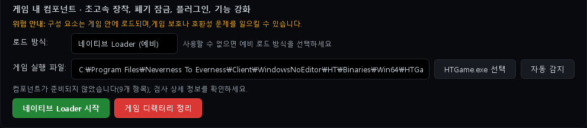
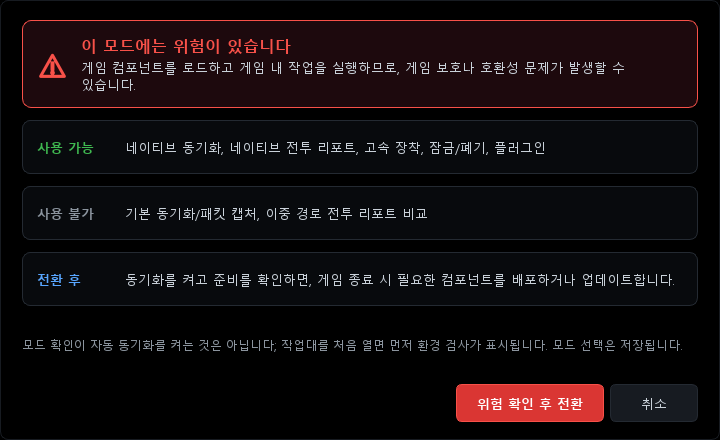
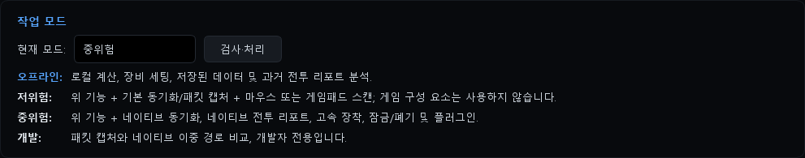
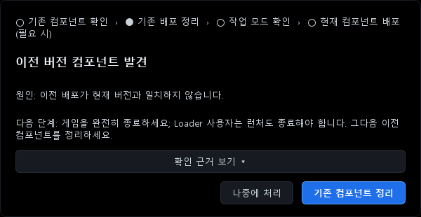

# ReShade・DLSS5 と併用する（Loader 方式）

[한국어](COEXIST_RESHADE_DLSS.ko.md) | [English](COEXIST_RESHADE_DLSS.en.md) | **日本語** | [中文](COEXIST_RESHADE_DLSS.zh.md)

NTE Drive Calc 2.3.1 のネイティブ機能（ネイティブ同期、ネイティブ戦闘レポート、高速装備、プラグイン）を、ReShade や DLSS5（ニューラルレンダリングのアドオン）と一緒に使う方法です。
公式 2.3.1、韓国語パッチ v2.3.1-ko、Global 2.3.1 のすべてに当てはまります。ビルドによって動作が異なる部分は、その都度記載しています。

> [!IMPORTANT]
> **2026-10-14、実際のゲームで一緒に使ってもゲームが落ちずに動くことを確認しました。**
> 確認した構成：計算機 2.3.1 の Loader + ReShade 6.8（アドオン対応版、ゲームフォルダーの `d3d12.dll`）+ DLSS5 アドオン（最新版）+ RTSS（Detours を使用）。2.3.1 から Loader がゲームに読み込む計算機のホストも `d3d12.dll` という名前ですが、この構成では ReShade と一緒に同じゲームに読み込まれても、ゲームは落ちずに動作しました。この構成で計算機の接続（ネイティブ機能）が使えるかは、まだ画面で確認できていません（[手順 5](#手順-5動作確認)）。
> ただし、次の 2 つが必要でした。作者の環境では、どちらか 1 つでも欠けるとゲームが起動直後に落ちました。
> 1. **DLSS5 アドオンを最新版にする** — 古い DLSS5 オーバーレイアドオンが原因の 1 つでした。→ [DLSS5 アドオンは最新版に](#dlss5-アドオンは最新版に)
> 2. **RTSS（MSI Afterburner）を使うなら、HTGame.exe のプロファイルで Detours をオンにする** — RTSS の既定の設定が計算機のホストと競合しました。→ [RTSS と併用する](#rtssrivatunermsi-afterburnerと併用する)
>
> 確認範囲：作者の PC 1 台（NVIDIA RTX のグラフィックカード、Windows 11）で確認した結果です。ほかの環境でも同じように動く保証はありません。原作者は、この Loader ビルドを実際のゲームで検証していないと明記しています。この確認はプログラム同士が競合するかどうかについてのもので、ACE がどう反応するかとは関係ありません（[最初に必ずお読みください](#最初に必ずお読みください)）。
> 使い始めたら、必ず[手順 5](#手順-5動作確認)で確認してください。

## こんな方向け

- ReShade と DLSS5 アドオンを使いながら、計算機のネイティブ機能も使いたい方
- 計算機の D3D 方式と ReShade がどちらも `d3d12.dll` という名前を使うため、両方を置けなかった方
- 2.3.0 から 2.3.1 に更新して「旧バージョンのコンポーネントを検出」画面が表示された方
- RTSS（MSI Afterburner）を起動したまま Loader を使うと、ゲームが起動直後に落ちる方

## 概要

Loader 方式では、計算機は**ゲームフォルダーにファイルを 1 つも置きません。** 必要なファイル（計算機のホスト `d3d12.dll` と `plugins\` 以下のプラグイン）は `計算機のインストールフォルダー\config\native-loader` に用意します（インストールフォルダーに書き込めない場合は `%LOCALAPPDATA%\NTE Drive Calc\config\native-loader`）。公式ランチャーがゲームを起動するときに、Loader がこれらのファイルをゲームに読み込みます。そのため、ゲームフォルダーの `d3d12.dll` の位置は ReShade がそのまま使えます。
一方、D3D 方式では計算機がゲームフォルダーに `d3d12.dll` を直接置きます。そのため、同じ名前を使う ReShade とは共存できません。

| | D3D キャプチャプロキシ | ネイティブ Loader（予備） |
|---|---|---|
| 計算機のファイルを置く場所 | ゲームフォルダー `Win64` | 計算機フォルダー `config\native-loader` |
| ゲームフォルダーの `d3d12.dll` | 計算機が使用 | ReShade が使用 |
| ReShade（`d3d12.dll`）との併用 | 不可 | ゲームは落ちずに動作（2026-10-14 に実際のゲームで確認、PC 1 台。計算機の接続はまだ画面で未確認）。ただし [DLSS5 アドオンの最新版](#dlss5-アドオンは最新版に)と、RTSS を使う場合は [Detours の設定](#rtssrivatunermsi-afterburnerと併用する)が必要 |
| 起動順序 | ゲームを終了した状態で事前に配置 | 毎回 計算機（Loader）→ ランチャー → ゲーム |

## 最初に必ずお読みください

- ReShade、DLSS5 アドオン、計算機のネイティブ機能は、いずれもゲームに外部のコードを読み込む仕組みです。ゲームの運営方針によってはアカウントに不利益が生じる可能性があり、使用は自己責任です。
- 作者の環境では、ReShade を `dxgi.dll` として置いたときに ACE が「不正モジュール (dxgi.dll)」という警告を何度か表示し、アカウントに不利益が生じる可能性の案内も表示されました。このガイドは検出を回避する方法を扱いません。ファイル名を変えることは検出を回避する方法ではなく、別の名前で警告が出なかったからといって許可されているわけでもありません。
- Loader 方式は、ゲームフォルダーにファイルを置かないというだけです。Loader は管理者権限で公式ランチャーのプロセスにコードを注入し、ゲームに計算機の DLL を読み込みます（実行ファイルの解析による推定）。ゲームフォルダーにファイルがないからといって、検出リスクが低いわけではありません。**Loader 方式で ACE がどう反応するかは、まだ確認されていません。** 計算機自体も、コンポーネントはゲームに読み込まれるため、ゲームの保護機能や互換性の問題を引き起こす可能性があると案内しています。
- ゲームに DLL をまったく入れたくない場合は、計算機を**低リスク**モードで使ってください。パケットキャプチャ（Npcap）でバッグ同期と基本的な戦闘レポートが使えます。ゲームフォルダーにもゲームのプロセスにも何も入れません。この場合、このガイドの Loader の設定は不要です（公式版で古い D3D の記録が残っている可能性がある場合は、モードを変える前に[手順 0](#手順-0公式版のみ計算機を起動する前に)を先に行ってください）。なお、低リスクモードでもパケットキャプチャと入力シミュレーションがゲームの保護機能や互換性の問題を引き起こす可能性があると、アプリは案内しています。

> [!CAUTION]
> **`dwmapi.dll` も削除されることがあります。** 以前のバージョンの計算機が使っていたファイル名だからです。
> 公式版は、**ネイティブ Loader を起動**（自分で押したとき）、**ゲームディレクトリをクリーンアップ**、アップグレード画面の**旧コンポーネントのクリーンアップ**、D3D の**手動配置**のときに、ゲームフォルダーの `dwmapi.dll` を**どんなファイルでも**削除します。ゲームフォルダーに `dwmapi.dll` があると、起動するたびに「旧バージョンのコンポーネントを検出」画面も表示されます。
> 韓国語パッチと Global は計算機の古いファイルだけを削除し、ほかの `dwmapi.dll` が原因でこの画面を表示することはありません。自動起動のときは、どのビルドも削除しません。ほかのモッドを `dwmapi.dll` という名前で使っている場合は、事前にバックアップしてください。

## 必要なもの

| 項目 | 内容 |
|---|---|
| 計算機 | 公式 2.3.1、[韓国語パッチ v2.3.1-ko](https://github.com/LuinDe/NTE-Drive-Calc-KO/releases/tag/v2.3.1-ko)（韓国語 UI）、[Global 2.3.1](https://github.com/LuinDe/NTE-Drive-Calc-Global/releases/latest) のいずれか。**ReShade を使うなら、韓国語パッチか Global をおすすめします。** 理由は[ビルドごとの違い](#ビルドごとの違い)にあります。計算機は管理者権限で実行されます（UAC の確認画面が表示されます）。 |
| 動作モード | **中リスク**（または開発）。リスクの確認まで済ませる必要があります。 |
| ランタイム | Microsoft Visual C++ 2015–2022 再頒布可能パッケージ（x64）。Loader を起動する前に計算機が確認します。 |
| ゲームのパス | 計算機に `HTGame.exe` のパスが設定されている必要があります。ゲームは公式のフォルダー構成（`ゲームのインストールフォルダー\Client\WindowsNoEditor\HT\Binaries\Win64\HTGame.exe`）のままである必要があります。また、インストールルート（`Client` フォルダーがあるフォルダー）に公式ランチャー `NTELauncher.exe` または `NTEGlobalLauncher.exe` がある必要があります（`NTELauncher\` フォルダーの中でも構いません）。 |
| ゲームの起動 | **公式ランチャーから**起動します。Loader はランチャーを経由してゲームに接続します。 |
| グラフィック系モッド | ReShade（アドオン対応版）と DLSS5 アドオン。DLSS5 アドオンは**最新版**である必要があります（[理由](#dlss5-アドオンは最新版に)）。インストールは[手順 3](#手順-3reshade-と-dlss5-のインストール)の外部ガイドを参照してください。 |
| RTSS | RivaTuner Statistics Server（MSI Afterburner に同梱）を使う場合は、HTGame.exe のプロファイルで **Use Microsoft Detours API hooking** をオンにする必要があります。[RTSS と併用する](#rtssrivatunermsi-afterburnerと併用する)を参照してください。使っていなければ不要です。 |

## 始める前に：バックアップ

ゲームフォルダー `ゲームのインストールフォルダー\Client\WindowsNoEditor\HT\Binaries\Win64` から、次のファイルを別の場所にコピーしておいてください。

| 種類 | ファイル |
|---|---|
| ReShade 本体 | `d3d12.dll`（プロパティ → 詳細で製品名が `ReShade` のファイル） |
| ReShade の設定 | `ReShade.ini`、使用中のプリセット（例：`ReShadePreset.ini`）、`reshade-shaders\` フォルダー |
| アドオン | `*.addon64` すべて。名前を変えて無効にしたアドオン（例：`*.addon64x`）も一緒に |
| DLSS のファイル | `nvngx_dlss.dll`、`nvngx_dlssnr.dll` など、DLSS5 のインストールで追加・置き換えたファイル。ほかのフォルダー（例：`Client\WindowsNoEditor\Engine\Plugins\Runtime\Nvidia\…\Binaries\ThirdParty\Win64`）に置いたファイルがあれば、それも |
| ほかのモッド | `dwmapi.dll`、OptiScaler など、同じフォルダーに置いたほかのモッドのファイル |
| その他 | `D3D12\` フォルダーなど、インストール時に作られたり変更されたりしたファイル |

DLSS5 を初めてインストールする場合は、インストールの**前に**、置き換えられる元のファイル（`nvngx_dlss.dll` など）を先にバックアップしてください。
ゲームフォルダー全体をコピーすると、容量が非常に大きくなることがあります。最低でも `Win64` フォルダーと、DLSS のファイルを置いたフォルダーは必ずバックアップしてください。

**バックアップが必要な理由**

1. ReShade のインストーラーで**アンインストール（Uninstall）**を実行すると、そのフォルダーの `*.addon64` がすべて削除されます（作者の環境で実際に起きたことです）。
2. 公式 2.3.1 の計算機は、クリーンアップ時にゲームフォルダーの `d3d12.dll` を**ファイル名だけで判断して**削除します。D3D 方式の自動配置は、そのファイルを**バックアップなしで上書きします。**[手順 0](#手順-0公式版のみ計算機を起動する前に)を守れば避けられますが、万一に備えてバックアップしておいてください。

> [!NOTE]
> ゲームが `C:\Program Files` の下にインストールされている場合、そのフォルダーにファイルをコピーしたり名前を変えたりするときに、管理者権限の確認画面が表示されます。

## 手順 0（公式版のみ）：計算機を起動する前に

公式版を使っていて、以前に **D3D キャプチャプロキシ**方式を使ったことがあり、今 `Win64\d3d12.dll` が ReShade である場合は、計算機を起動する**前に**このファイルの名前を `d3d12.dll.reshade-hold` に変えておいてください。D3D 方式を使ったことがあるかはっきりしない場合も、やっておくと安全です。

- 自動同期をオンにしたことがある場合、公式版は起動した直後に D3D のファイルを再配置することがあります。このとき ReShade の `d3d12.dll` はバックアップなしで上書きされます。
- 読み込み方式や動作モード（低リスク・オフラインを含む）を変えた直後に、古い配置記録にあるファイルを名前だけで判断して削除することもあります。
- 手順 1・2 を終えて、`Win64` に計算機の `d3d12.dll` がないことを確認してから、元の名前に戻してください。
- ほかのモッドの `dwmapi.dll` がある場合は、同じ方法で名前を変えておいてください（[上の CAUTION](#最初に必ずお読みください) を参照）。公式版は**ネイティブ Loader を起動**を自分で押すたびに `dwmapi.dll` を削除するため、名前を戻したあとは自動起動だけを使うか、韓国語パッチか Global に切り替えてください。

いちばん簡単なのは、公式版を起動する前に韓国語パッチか Global をインストールすることです。韓国語パッチと Global は、計算機のファイルではない `d3d12.dll` を上書きしたり削除したりしません。

## 手順 1：計算機を Loader 方式に切り替える

**順序が大切です。** 先に読み込み方式を Loader に変え、そのあとで動作モードを変えてください。自動同期は、Loader を一度起動してからオンにします（[手順 4](#手順-4毎回の起動順序)）。
既定の D3D 方式のまま中リスクを選ぶと、公式版は ReShade の `d3d12.dll` を古い計算機のファイルとみなし、「旧バージョンのコンポーネントを検出」画面を表示します。さらに自動同期もオンなら、ゲームが終了しているときにそのファイルを計算機のファイルで上書きします。

> 下の画面は Global 2.3.1 の韓国語画面です（テスト用環境、アカウントデータなし）。日本語の表記は各手順に書いています。公式版の中国語表記は[表記対応表](#表記対応表)を参照してください。

1. サイドバーの **🔧 設定** → **環境構成**カード → **ゲーム内コンポーネント · クイック装備、破棄・ロック、プラグイン、機能強化**の欄に移動します。
2. **読み込み方式:** で **ネイティブ Loader（予備）** を選びます。確認画面なしですぐに保存されます。オフラインモードでも変更できます。
3. **ゲーム本体:** の欄が空なら、**自動検出**を押すか、**HTGame.exe を選択**で直接指定します。
   Loader を選ぶと、下の緑のボタンの名前が **ネイティブ Loader を起動** に変わります。最初は「コンポーネントの準備ができていません（N 件）」と表示されますが、Loader を一度起動すれば準備が整います。

   

4. 同じページのいちばん上の **動作モード**カード → **現在のモード：** で **中リスク** を選びます。確認画面で **リスクを確認して切り替え** を押します。開発モードでも動きますが、アプリは開発者専用と案内しています。

   

   

## 手順 2：D3D 方式を使っていた方のみ — 計算機ファイルの整理

以前に **D3D キャプチャプロキシ**方式を使っていた場合、ゲームフォルダーに計算機のファイルが残っていることがあります。最初から Loader 方式だった場合は、この手順は飛ばしてください。

**残っているかの確認** — `Win64` フォルダーに次のどれか 1 つでもあれば、残っています。
- `plugins\NTE_Plugin*.dll`（2.3.1）または `NTE_Capture.dll`（以前のバージョン）
- `d3d12.dll` のプロパティ → 詳細 → 製品名が `ReShade` ではない（2.3.1 の計算機ホストは `NTE Combat Debug Tools`、2.3.0 のホストは製品名が空欄）

**整理のしかた**

1. ゲームとランチャーを完全に終了します。
2. 手順 1 を終えた状態で **ネイティブ Loader を起動** を押します。計算機は、記録している古い D3D のファイルを先に整理してから Loader を起動します。
3. それでもファイルが残っている場合は、赤い **ゲームディレクトリをクリーンアップ** ボタンを押します。
   このボタンは実行中の Loader を止め、`config\native-loader` に用意したファイルも削除し、同期を一時停止します（自動起動も止まります）。クリーンアップが終わったら、① 動作モードで **中リスク** → **リスクを確認して切り替え** をもう一度行い、② **ネイティブ Loader を起動** をもう一度押し、③ 自動同期がオフに見える場合は、Loader を起動してからもう一度オンにしてください（一時停止中はオフと表示されます）。

**ビルドごとの注意**

- **韓国語パッチ・Global**：ゲームフォルダーの `d3d12.dll` が計算機のファイルでなければ（ReShade など）、削除せずに残します。上の手順どおりに進めて構いません。
- **公式版**：クリーンアップ時に `d3d12.dll` を**名前だけで判断して削除します。** その時点で ReShade が `d3d12.dll` なら、ReShade が削除されます。
  - ReShade がすでに `d3d12.dll` の場合：[手順 0](#手順-0公式版のみ計算機を起動する前に)のとおり、計算機を起動する前に名前を変えておく必要があります。名前を戻す前に `Win64` に計算機の `d3d12.dll` が新しくできていたら、上書きせずに、読み込み方式が Loader であることを確認してから **ネイティブ Loader を起動** で先に整理してください。
  - ReShade がまだ `d3d12.dll` ではない場合（例：`dxgi.dll` として使っていた）：先に整理を終えてから、[手順 3](#手順-3reshade-と-dlss5-のインストール)に進みます。

## 手順 3：ReShade と DLSS5 のインストール

このガイドでは、ReShade と DLSS5 のインストール方法そのものは扱いません。次の案内に従ってください。

- **ReShade 公式サイト**：<https://reshade.me> — 「with full add-on support」（アドオン対応版）をダウンロードします。作者は ReShade 6.8 のアドオン対応版を使いました。
- **コミュニティガイド**（韓国語）：[이환 DLSS 5 적용 방법 A to Z](https://arca.live/b/nevernesstoeverness/181463229)（arca.live の異環チャンネル）— 必要なファイルの入手、ReShade のインストール、DLSS ファイルの差し替え、ゲーム内での適用確認までを扱っています。
- **RenoDX**：<https://github.com/clshortfuse/renodx>

外部の案内にあるファイルは、このリポジトリでは検証していません。入手元をご自身で確認してからダウンロードしてください。

このガイドと一緒に使うために守ることは、次の点だけです。

- このガイドは、ReShade が `Win64\d3d12.dll` である構成を前提にしています。インストーラーが `dxgi.dll` を作った場合は、名前を `d3d12.dll` に変えてください。
- すでに ReShade を `d3d12.dll` として使っているなら、そのままにしてください。Loader 方式はこのファイルに触れません（公式版は手順 0・2 を終えたあとに限ります）。
- ReShade のインストーラーでアンインストールや再インストールをするときは、先にアドオンをバックアップしてください。
- DLSS5 アドオンは最新版を使ってください。下の[DLSS5 アドオンは最新版に](#dlss5-アドオンは最新版に)を参照してください。
- RTSS（MSI Afterburner）を使っている場合は、ゲームを起動する前に[RTSS と併用する](#rtssrivatunermsi-afterburnerと併用する)の設定をしておいてください。

### DLSS5 アドオンは最新版に

作者の環境では、**古い DLSS5 オーバーレイアドオン**も、ゲームが起動直後に落ちる原因でした。クラッシュレポーターのエラーは [RTSS との競合](#rtssrivatunermsi-afterburnerと併用する)のときと同じでした（`D3D12Viewport.cpp` … `80004004` `E_ABORT`）。DLSS5 アドオンを最新版に替えたところ解決しました。

- 作者が最新版に替えたアドオン：DLSS5 オーバーレイアドオン（`dlss5-lab-overlay`、新しいビルド）、`renodx-dlss5.addon64`、`renodx-neural-interposer`。名前は入手元によって異なる場合があります。
- アドオンは最初に入手した場所（例：[コミュニティガイド](https://arca.live/b/nevernesstoeverness/181463229)、[RenoDX](https://github.com/clshortfuse/renodx)）から最新版を入手してください。このリポジトリはアドオンのファイルを配布・検証していません。
- 替える前に、今使っている `*.addon64` を[バックアップ](#始める前にバックアップ)しておいてください。
- 替えたあとは、[手順 5](#手順-5動作確認)のとおり `ReShade.log` にアドオンごとの `Registered add-on "…"` の行があるか確認してください。

## 手順 4：毎回の起動順序

1. ランチャーとゲームが終了している状態で、**計算機を先に**起動します（UAC を許可）。
2. Loader を起動します。
   - 自動同期をオンにしていれば、計算機が自動で起動します。
   - そうでなければ **🔧 設定 → 環境構成 → ネイティブ Loader を起動** を押します。「**ネイティブ Loader を起動しました**」画面が出れば成功です。
3. （任意・最初の 1 回）**ネイティブ Loader を起動しました**が出たら計算機を閉じずに、Loader が実行中の状態で（ゲーム中でも構いません）**ワークベンチ** → **ゲームデータ同期** → **自動同期** をオンにします。最初にオンにするときは、先に環境検出の画面が表示されます。
   - Loader を起動する前にオンにすると、「現在のコンポーネントは未デプロイです。先にデプロイしてから戻って同期をオンにしてください。」と表示され、オンになりません。
   - 一度オンにしておけば、次回からはゲームとランチャーが終了しているときに計算機が Loader を自動で起動します。ランチャーやゲームが起動中なら、終了するまで待ってから（15 秒間隔で）再試行します。それ以外の理由で失敗した場合は自動再試行を止め、**検出詳細**に原因を表示します。
   - オンにしない場合は、遊ぶたびに **ネイティブ Loader を起動** を自分で押せば大丈夫です。
4. **公式ランチャー**を起動し、いつもどおりゲームを始めます。
5. [手順 5](#手順-5動作確認)で接続を確認します。

> [!IMPORTANT]
> - ランチャーやゲームを先に起動した場合、今回は Loader が接続されません。「Loader がプログラムの終了を待機中」画面が出たら、ランチャーとゲームを完全に終了して、**ネイティブ Loader を起動** をもう一度押してください。
> - 自動同期で Loader がすでに起動したあと、ランチャーを起動した状態でボタンをもう一度押すと、この画面が出ることがあります。このとき Loader はそのまま待機しているので、無視して構いません。
> - 計算機はゲームを終えてから閉じてください。計算機を閉じると Loader が止まり、Loader が接続していた公式ランチャーも終了します。このときゲームが動き続けるかは確認できていません。ランチャーがゲームを更新している間は、計算機を閉じないでください。

## 手順 5：動作確認

| 確認すること | 場所 | 正常なとき |
|---|---|---|
| 計算機の接続 | **ワークベンチ** → **ゲームデータ同期** → **検出詳細** | 上部の概要に赤い「要対応」がなく、「DLL 戦闘レポート」「DLL キャラクター状態」などの DLL 項目が「準備完了」（緑）にあると見込まれます（ゲーム実行中の画面ではまだ確認できていません）。ログイン前は黄色の「ログイン待ち」になることがあります。 |
| ReShade | ゲーム内の ReShade オーバーレイ（既定のキー：Home） | オーバーレイが表示され、アドオン一覧に DLSS5 アドオンがあります。 |
| ReShade のログ | `Win64\ReShade.log`（更新日時が今起動した時刻か確認） | `Initializing crosire's ReShade version '…' (64-bit) loaded from '…\d3d12.dll' into '…\HTGame.exe'` の行と、アドオンごとの `Registered add-on "…"` の行があります。 |
| DLSS5 | ReShade オーバーレイの DLSS5（ニューラルレンダリング）パネル | 状態が有効（ACTIVE）と表示されます。 |

1 つでもおかしい場合は、下の[トラブルシューティング](#トラブルシューティング)を見てください。ゲームが起動直後に落ちる場合は、まず [RTSS の設定](#rtssrivatunermsi-afterburnerと併用する)と [DLSS5 アドオンのバージョン](#dlss5-アドオンは最新版に)を確認してください。それでも **Loader を使うときだけ ReShade が表示されない、またはゲームが不安定になる**場合は、ぜひお知らせください。作者の環境（PC 1 台）ではゲームが落ちずに動作しましたが、ほかの環境や、ほかのツールと一緒に使う場合は異なることがあります。

## RTSS（RivaTuner/MSI Afterburner）と併用する

RTSS（RivaTuner Statistics Server）は、FPS などの情報をゲーム画面に表示するプログラムです。MSI Afterburner と一緒にインストールされていることが多く、Afterburner を起動しているとバックグラウンドで一緒に動いていることもあります。RTSS がインストールされている場合や、通知領域（タスクバーの右端。^ の中に隠れていることがあります）に RTSS のアイコンがある場合は、この節を読んでください。

**症状**

- Loader で計算機を接続した状態でゲームを起動すると、ゲームが起動直後に落ちます。
- Unreal Engine のクラッシュレポーターが表示され、エラー内容に `D3D12Util.cpp:1019`、`D3D12Viewport.cpp:554`、エラーコード `80004004`（`E_ABORT`）が出ます。ゲームが画面出力（スワップチェーン）を作る段階で失敗しています。行番号はゲームのバージョンによって変わることがあります。
- 作者の環境では、計算機の Loader と RTSS（既定の設定）が両方動いているときに毎回起きました。

**原因**

RTSS はオーバーレイを描くために、ゲームに自分の DLL（`RTSSHooks64.dll`）を読み込み、グラフィックの関数を横取りします（フック）。作者の環境では、この RTSS の既定のフックエンジンが 2.3.1 の計算機ホストと競合し、RTSS のフックエンジンを Microsoft Detours に切り替えると落ちなくなりました。

**対処：HTGame.exe のプロファイルで Detours をオンにする**

HTGame.exe にだけ適用される設定です。ほかのゲームの RTSS の設定は変わりません。計算機は RTSS の設定を変更しないので、ご自身で行ってください。

1. ゲームを終了します。
2. 通知領域の RTSS のアイコンから RTSS の画面を開きます（アイコンは ^ の中に隠れていることがあります）。
3. **Add** を押し、`HTGame.exe`（`ゲームのインストールフォルダー\Client\WindowsNoEditor\HT\Binaries\Win64\HTGame.exe`）を選びます。一覧に **HTGame.exe** が追加され、選択された状態になります。すでにある場合は、それを選べば大丈夫です。
4. 一覧で **HTGame.exe** を選んだ状態で **Setup** を押します。**Global** を選んだまま変更すると、ほかのゲームにも適用されるので注意してください。
5. **General** タブで **Use Microsoft Detours API hooking** にチェックを入れ、**OK** を押して保存し、設定画面を閉じます（× で閉じると変更が保存されないことがあります）。
6. [手順 4](#手順-4毎回の起動順序)の順序（計算機 → Loader → 公式ランチャー → ゲーム）でもう一度起動します。

RTSS 自身のヘルプによると、このオプションは RTSS のフック方式を独自の hook-chaining エンジンから Microsoft Detours に切り替え、ほかのフック系ツールとの互換性を高めるためのものです。作者の環境で HTGame.exe のプロファイルで変えたのは、このオプション 1 つだけです。RTSS 7.3.7 で確認しました。このオプションが見当たらない場合は、RTSS を更新するか、下の別の方法（Application detection level を None）を使ってください。

**設定の確認（任意）**：RTSS のインストールフォルダー（既定は `C:\Program Files (x86)\RivaTuner Statistics Server`）の `Profiles\HTGame.exe.cfg` をメモ帳で開くと、`[Hooking]` の下に `UseDetours=1` の行があります。見るだけにして、ファイルを直接編集しないでください（設定は RTSS の画面で変えます）。

**元に戻す**：一覧で **HTGame.exe** を選び、**Setup** を押して **General** タブの **Use Microsoft Detours API hooking** のチェックを外し、**OK** を押します。HTGame.exe のプロファイルをこの設定のためだけに作った場合は、代わりに **HTGame.exe** を選んだ状態で **Remove** を押してもかまいません（そのプロファイルの設定がすべて削除され、このゲームにも再び Global の設定が適用されます）。その後 Loader を使うと、また落ちることがあります。

**別の方法：HTGame.exe で RTSS をオフにする**：RTSS の画面で **Global** ではなく **HTGame.exe** を選んだ状態で **Application detection level** を **None** にしても、競合を避けられます。**Global** を選んだまま変えると、すべてのゲームで RTSS がオフになります。その代わり、このゲームでは RTSS のオーバーレイ（FPS 表示など）が表示されません。

**計算機の案内**：Global 2.3.2 以降では、**ネイティブ Loader を起動** を自分で押したときにこの設定を確認して案内を表示し、**検出詳細** にも黄色の項目として表示します。自動同期が Loader を自動で起動したときは案内の画面は出ず、**検出詳細** にだけ表示されます。計算機は RTSS の設定を読むだけで、変更はしません。この RTSS の対処は、公式版・韓国語パッチ・Global のすべてに当てはまります（3 つのビルドの Loader コンポーネントは同じです）。

> [!NOTE]
> 同じエラーは、古い DLSS5 オーバーレイアドオンが原因でも起きます。RTSS を使っていないのに落ちる場合や、RTSS の設定を変えたあとも落ちる場合は、[DLSS5 アドオンは最新版に](#dlss5-アドオンは最新版に)を参照してください。

## 元に戻す

1. ゲームとランチャーを終了します。
2. ネイティブ機能の使用をやめるなら、動作モードを**低リスク**か**オフライン**に変えます。公式版で古い D3D の記録が残っている可能性がある場合は、先に[手順 0](#手順-0公式版のみ計算機を起動する前に)を行ってください。
   計算機は Loader を止め、`config\native-loader` に用意したファイルを整理します。Loader 方式の記録だけなら、ゲームフォルダーには触れません（コード解析に基づく）。
3. 計算機を閉じます。
4. ReShade やアドオンのファイルを戻す必要がある場合は、[トラブルシューティング](#トラブルシューティング)の「`d3d12.dll` が計算機のファイルに置き換わった、または消えた」の順序で戻します。
5. ReShade を削除するなら、先にアドオンをバックアップしてからアンインストールします。DLSS5 のインストールで置き換わったファイルは、バックアップしておいた元のファイルに戻します。

## アップグレード画面が表示されたら

2.3.0 で Loader 方式を使っていた方は、2.3.1 を初めて起動すると下の画面が**必ず** 1 回表示されます。2.3.0 の Loader のファイル（`NTE_Capture.dll`）が 2.3.1 のファイル構成と合わないためです。

| ボタン | 動作 | 公式版 | 韓国語パッチ・Global |
|---|---|---|---|
| **後で処理**（稍后处理） | 画面を閉じるだけです。ファイルには触れません。 | **こちらを押してください** | こちらをおすすめします |
| **旧コンポーネントのクリーンアップ**（清理旧组件） | 自動同期をオフにして同期を一時停止したあと、「ゲームディレクトリをクリーンアップ」と同じ整理を行います。 | **ReShade の `d3d12.dll` が削除されます。** `dwmapi.dll` も削除されます。押さないでください。 | ReShade のファイルは残ります。その代わり、動作モードをもう一度確認し、Loader を起動し直す必要があります。自動起動を使うには、Loader を起動したあとで自動同期をもう一度オンにする必要があります。 |

**後で処理**を押したあとは、次のようになります。
- 自動同期をオンにしていれば、ゲームとランチャーが終了しているときに、計算機が新しい Loader のファイルを用意して Loader を起動します。ゲームフォルダーには触れません。
- 自動同期をオフにしていれば、**ネイティブ Loader を起動** を 1 回押してください。
- 一度準備ができれば、次回の起動からこの画面は表示されません。それまでは、ワークベンチに「旧コンポーネントのアップグレード：…」の案内が残ります。

> [!TIP]
> 公式版でどうしても**旧コンポーネントのクリーンアップ**を行う必要がある場合は、先にゲームフォルダーの ReShade の `d3d12.dll` の名前を `d3d12.dll.reshade-hold` に変えてください。ほかのモッドの `dwmapi.dll` も一緒に名前を変えておいてください。整理が終わったら元の名前に戻せば大丈夫です。

> [!NOTE]
> 韓国語パッチは、公式 2.3.1 がインストールされた状態でインストールします。韓国語パッチをインストールする前に公式 2.3.1 を起動してしまった場合は、この画面で **稍后处理**（後で処理）を押してください。
> 韓国語パッチ・Global で**旧コンポーネントのクリーンアップ**を押すと、「d3d12.dll は本アプリのファイルではないため…そのまま残しました」という案内が別のメッセージに隠れて見えないことがあります。ファイルは残っています。

## トラブルシューティング

| 症状 | 原因 | 対処 |
|---|---|---|
| 「Loader がプログラムの終了を待機中」画面が出る、または「公式ランチャーがまだ実行中です」 | ランチャーかゲームが起動しています。 | タスクマネージャーでランチャーとゲームを完全に終了し、**ネイティブ Loader を起動** をもう一度押します。画面の「原因：」の行が「公式ランチャーが見つかりません」や「公式 Client ディレクトリ構成に合致しない」なら、ゲーム本体を公式インストールの `HTGame.exe` に指定し直してください。 |
| 「機能制限」画面が出る | 動作モードがオフラインか低リスクです。 | [手順 1](#手順-1計算機を-loader-方式に切り替える)のとおり**中リスク**に変えます。 |
| 手動で起動したときに「機能は一時的に利用不可 — コンポーネントの処理が完了していません…」 | Visual C++ x64 ランタイムがない、インストールが壊れているなど、さまざまな原因があります（この画面には詳しい原因が表示されません）。 | [Microsoft の公式ページ](https://learn.microsoft.com/cpp/windows/latest-supported-vc-redist)から x64 版をインストールしてから、もう一度起動します。 |
| **検出詳細**に「自動 Loader の起動に失敗しました：…；自動再試行を停止しました」 | 自動起動が失敗すると、原因を直すまで自動再試行が止まります（計算機を再起動しても続きます）。例：「Microsoft Visual C++ 2015–2022 Redistributable x64 がありません：…」。韓国語パッチ・Global で D3D 方式だった方は、ReShade のファイルを守るために自動配置が止まった場合（「ネイティブコンポーネントの自動デプロイに失敗しました：ゲームフォルダーの d3d12.dll は…」）にもこうなります。 | 原因を直してから（読み込み方式を Loader に変えることを含む）、**🔧 設定** → **動作モード**カードの **検出・処理** を押します。 |
| Loader は起動したのに「検出詳細」で接続されない | 公式ランチャーを経由せずにゲームを起動した、まだログイン前（黄色の「ログイン待ち」）、または、ゲームに計算機の DLL が読み込まれなかった可能性があります。 | ゲームとランチャーを終了し、[手順 4](#手順-4毎回の起動順序)の順序でやり直します。 |
| RTSS（MSI Afterburner）を起動した状態でゲームが起動直後に落ち、クラッシュレポーターに `D3D12Viewport.cpp` … `80004004`（`E_ABORT`）が出る | RTSS の既定のフックエンジンが 2.3.1 の計算機ホストと競合している可能性が高いです（作者の環境で確認）。 | RTSS で HTGame.exe のプロファイルを作り、**Setup** → **General** → **Use Microsoft Detours API hooking** をオンにします。詳しい順序は[RTSS と併用する](#rtssrivatunermsi-afterburnerと併用する)を参照してください。 |
| RTSS がない、または Detours をオンにしたあとも同じエラー（`80004004`）で落ちる | 古い DLSS5 オーバーレイアドオン | DLSS5 アドオンを入手元から最新版に替えます。[DLSS5 アドオンは最新版に](#dlss5-アドオンは最新版に)を参照してください。 |
| そのほか、ゲームが起動直後に落ちる・固まる、画面が真っ黒になる | 上の 2 つに当てはまらなければ、ReShade やほかのオーバーレイ・フック系ツール・モッドと計算機の DLL が競合した可能性があります（作者の環境では Loader + ReShade + DLSS5 + RTSS（Detours）を一緒に使ってもゲームが落ちないことを確認）。 | 計算機を閉じて、ランチャーからゲームだけを起動してみます。Loader なしで正常なら、一緒に使っているツールを書き添えてリポジトリにお知らせください。それまでは計算機を低リスクかオフラインモードで使ってください。 |
| ReShade のオーバーレイが表示されない | ① `d3d12.dll` が ReShade ではない ② Loader と一緒に使うと ReShade が読み込まれない（作者の環境では一緒に使ってもゲームが落ちないことを確認） | ① `d3d12.dll` のプロパティで製品名を確認し、`ReShade` でなければ下の「`d3d12.dll` が計算機のファイルに置き換わった、または消えた」の順序で戻します。② `ReShade.log` が今回の起動時刻で更新されていなければ、計算機を閉じてランチャーからゲームだけを起動してみます。Loader なしでは表示され、Loader と一緒だと表示されない場合は、リポジトリにお知らせください。それまでは計算機を低リスクかオフラインモードで使えば大丈夫です。 |
| 計算機を起動するたびに「旧バージョンのコンポーネントを検出」画面が出る | （公式版）D3D 方式でゲームフォルダーに ReShade の `d3d12.dll` があると、計算機はそれを古い計算機のファイルと判断します。ゲームフォルダーに `dwmapi.dll` がある場合も（ほかのモッドのファイルでも）表示されます。または、Loader のファイルがまだ 2.3.1 用に準備されていません。 | **後で処理**を押し、読み込み方式を **ネイティブ Loader（予備）** に変えてから **ネイティブ Loader を起動** を 1 回押します（公式版はこのとき `dwmapi.dll` を削除するので、ほかのモッドのファイルなら先にバックアップしてください）。韓国語パッチ・Global は、ReShade やほかのモッドのファイルが原因でこの画面を表示しません。 |
| `d3d12.dll` が計算機のファイルに置き換わった、または消えた | 公式版で D3D の配置・自動配置・クリーンアップが実行されました。 | ① 読み込み方式を **ネイティブ Loader（予備）** に変えます。② ゲームとランチャーを終了した状態で **ネイティブ Loader を起動** を 1 回押し、古い D3D の記録を整理します（公式版はこのとき `Win64\d3d12.dll` を名前だけで判断して削除します）。③ `Win64` に計算機の `d3d12.dll` が残っていないことを確認した**あとで**、バックアップした ReShade の `d3d12.dll` を戻します。公式版では、そのあと**ゲームディレクトリをクリーンアップ**を押さないでください。韓国語パッチと Global は、計算機のファイルではない `d3d12.dll` を上書きしたり削除したりしません。 |
| アドオン（`*.addon64`）が消えた | ReShade のインストーラーでアンインストールを実行するとこうなります。 | バックアップから戻します。 |
| DLSS5 の状態が「Waiting」から進まない | アドオンの設定の問題 | RenoDX DLSS パネルで **Require DLSS** をオフにすると解決したことがあります（作者の環境での例で、アドオンのバージョンによって項目名が違う場合があります）。ゲームのグラフィック設定で DLSS をオンにしているかも確認してください。 |
| ACE の「不正モジュール」警告 | 括弧内のファイルが検出されました。 | ゲームを終了し、括弧内のファイルをゲームフォルダーから取り除くことをおすすめします。名前を変えて使い続けることはおすすめしません。使い続けるとアカウントに不利益が生じる可能性があります。 |

## よくある質問

**D3D 方式では ReShade と一緒に使えないのですか？**
使えません。どちらもゲームフォルダーの同じファイル名 `d3d12.dll` が必要です。計算機のホストは Windows 標準の `d3d12.dll` に直接つなぎ、計算機自身の署名付きプラグインだけを読み込みます。そのため、ReShade を続けて読み込むことはできません。この状況では、韓国語パッチと Global は ReShade のファイルを上書きせずに配置を止め、Loader に切り替えるよう案内します。

**ReShade を `dxgi.dll` にすれば D3D 方式と一緒に使えるのでは？**
ファイル名が重ならないので、両方を置くことはできます。しかし作者の環境では、その状態で ACE の警告が何度か表示されました。警告が出た構成は使わないでください。

**Loader 方式なら ACE に検出されませんか？**
わかりません。Loader 方式はゲームフォルダーにファイルを置かないだけで、ゲームに計算機の DLL を読み込むことは同じです。この方式で ACE がどう反応するかは、まだ確認されていません。

**ランチャーを使わずにゲームを直接起動したら？**
Loader は公式ランチャーに入り込んだあと、ランチャーが起動するゲームに接続します。この動作は Loader の実行ファイルを解析して推定したものです。そのため、ほかの方法で起動したゲームには接続しません。必ず公式ランチャーから起動してください。

**ゲームフォルダーにファイルを置かないのに、なぜ管理者権限が必要なのですか？**
計算機自体が管理者権限で動くように作られています。Loader もほかのプログラム（公式ランチャー）に入り込む必要があるため、管理者権限が必要です。

**計算機のファイルはどこにありますか？**
`計算機のインストールフォルダー\config\native-loader` にあります（インストールフォルダーに書き込めない場合は `%LOCALAPPDATA%\NTE Drive Calc\config\native-loader`）。ホストの `d3d12.dll` と `plugins\NTE_Plugin{User,Combat,HUD,Performance}.dll`、それぞれの `.sig` ファイルです。この `d3d12.dll` は、ゲームフォルダーにある ReShade の `d3d12.dll` とは別のファイルです。削除したり移動したりしないでください。

**OptiScaler と一緒に使えますか？**
確認していません。作者は OptiScaler をオフにして ReShade だけを使いました。なお、公式版は `d3d12.dll`（クリーンアップ時）と `dwmapi.dll`（クリーンアップ時、Loader を手動で起動したとき、D3D の手動配置時）を名前だけで判断して削除します。ほかのモッドがこれらの名前を使っている場合も、同じ注意が必要です。

**RTSS の Detours の設定は、ほかのゲームにも影響しますか？**
HTGame.exe のプロファイルでだけオンにしたなら、このゲームにだけ適用されます。**Global** のプロファイルで変えると、ほかのゲームにも適用されるので注意してください。計算機は RTSS の設定を変更しません（Global の新しいバージョンは、読み取って案内を表示するだけです）。

## ビルドごとの違い

ゲームフォルダーにほかのプログラムの `d3d12.dll`（ReShade など）や `dwmapi.dll` があるときの動作です。Loader 方式そのもの（ゲームフォルダーにファイルを置かない）は、3 つのビルドで同じです。

| 状況 | 公式 2.3.1 | 韓国語パッチ v2.3.1-ko | Global 2.3.1 |
|---|---|---|---|
| 画面の言語 | 中国語 | 韓国語 | 韓国語・English・日本語・中文 |
| **ゲームディレクトリをクリーンアップ**、アップグレード画面の**旧コンポーネントのクリーンアップ** | `d3d12.dll`、`dwmapi.dll` を**削除** | 残す | 残す |
| Loader 起動時の古い D3D の記録の整理 | 名前だけで判断して削除 | 計算機のファイルと確認できたものだけ削除 | 計算機のファイルと確認できたものだけ削除 |
| D3D の自動配置 | **バックアップなしで上書き** | 止めて Loader への切り替えを案内 | 止めて Loader への切り替えを案内 |
| D3D の手動配置 | 上書きし、`dwmapi.dll` も削除 | 止める | 止める |
| Loader の手動起動時の `dwmapi.dll` | どんなファイルでも削除 | 計算機の古いファイルだけ削除 | 計算機の古いファイルだけ削除 |
| ゲームディレクトリのクリーンアップ・旧コンポーネントのクリーンアップ時の `dwmapi.dll` | どんなファイルでも削除 | 計算機の古いファイルだけ削除 | 計算機の古いファイルだけ削除 |
| D3D 方式 + ReShade の `d3d12.dll` のときのアップグレード画面 | 毎回表示 | 表示しない | 表示しない |
| ゲームフォルダーにほかのモッドの `dwmapi.dll` があるときのアップグレード画面 | 毎回表示 | 表示しない | 表示しない |

## 表記対応表

各手順では Global の日本語表記を使っています。公式版は中国語、スクリーンショットは韓国語で表示されます。

| このガイド（Global・日本語） | 公式版（中国語） | スクリーンショット（韓国語） |
|---|---|---|
| 🔧 設定 | 🔧 设置 | 🔧 설정 |
| ワークベンチ | 工作台 | 작업 공간 |
| 動作モード / 現在のモード： | 工作模式 / 当前模式： | 작업 모드 / 현재 모드: |
| オフライン / 低リスク / 中リスク / 開発 | 离线 / 低风险 / 中风险 / 开发 | 오프라인 / 저위험 / 중위험 / 개발 |
| リスクを確認して切り替え | 确认风险并切换 | 위험 확인 후 전환 |
| 検出・処理 | 检测并处理 | 검사·처리 |
| 環境構成 | 环境配置 | 환경 설정 |
| 読み込み方式: | 加载方式: | 로드 방식: |
| D3D キャプチャプロキシ | D3D 采集代理 | D3D 수집 프록시 |
| ネイティブ Loader（予備） | 原生 Loader（备用） | 네이티브 Loader (예비) |
| ゲーム本体: / 自動検出 / HTGame.exe を選択 | 游戏主程序: / 自动检测 / 选择 HTGame.exe | 게임 실행 파일: / 자동 감지 / HTGame.exe 선택 |
| ネイティブ Loader を起動 | 启动原生 Loader | 네이티브 Loader 시작 |
| ネイティブ Loader を起動しました | 原生 Loader 已启动 | 네이티브 Loader 시작됨 |
| Loader がプログラムの終了を待機中 | Loader 等待关闭程序 | Loader가 프로그램 종료를 기다리는 중 |
| ゲームディレクトリをクリーンアップ | 清理游戏目录 | 게임 디렉터리 정리 |
| ゲームデータ同期 / 自動同期 / 検出詳細 | 游戏数据同步 / 自动同步 / 检测详情 | 게임 데이터 동기화 / 자동 동기화 / 검사 상세 |
| 要対応 / ログイン待ち / 準備完了 | 需处理 / 等待登录 / 已就绪 | 처리 필요 / 로그인 대기 / 준비 완료 |
| 旧バージョンのコンポーネントを検出 | 发现旧版组件 | 이전 버전 컴포넌트 발견 |
| 後で処理 / 旧コンポーネントのクリーンアップ | 稍后处理 / 清理旧组件 | 나중에 처리 / 기존 컴포넌트 정리 |
| 機能制限 | 功能受限 | 기능 제한됨 |
| 機能は一時的に利用不可 | 功能暂不可用 | 기능 일시 사용 불가 |
| 現在のコンポーネントは未デプロイです… | 当前组件尚未部署… | 현재 컴포넌트가 아직 배포되지 않았습니다… |
| 自動 Loader の起動に失敗しました / 自動再試行を停止しました | 自动 Loader 启动失败 / 已停止自动重试 | 자동 Loader 시작 실패 / 자동 재시도를 중지했습니다 |

## 参考リンク

- 元の計算機（上流）：<https://github.com/hxwd94666/NTE-Drive-Calculator>
- 韓国語パッチ：<https://github.com/LuinDe/NTE-Drive-Calc-KO>
- Global（多言語版）：<https://github.com/LuinDe/NTE-Drive-Calc-Global>
- ReShade：<https://reshade.me>
- RenoDX：<https://github.com/clshortfuse/renodx>
- コミュニティガイド「이환 DLSS 5 적용 방법 A to Z」（韓国語）：<https://arca.live/b/nevernesstoeverness/181463229>
- Microsoft Visual C++ 再頒布可能パッケージ：<https://learn.microsoft.com/cpp/windows/latest-supported-vc-redist>

---

この文書は非公式の文書です。原作者、ゲーム会社、ReShade、RenoDX、NVIDIA、RTSS（RivaTuner Statistics Server）、MSI とは関係ありません。2026-10-11、計算機 2.3.1 を基準に作成し、2026-10-14 に実際のゲームでの確認結果と RTSS の案内を追加しました。2026-10-20：計算機内の RTSS の案内が Global 2.3.2 に入りました。
