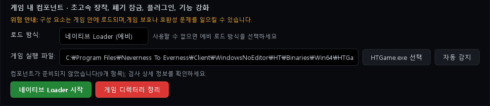
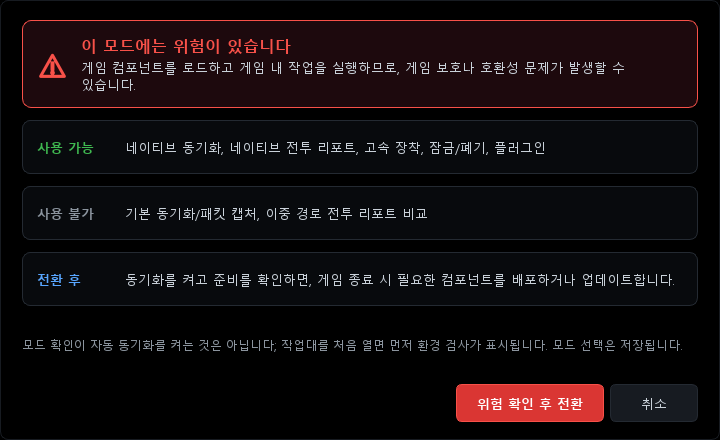
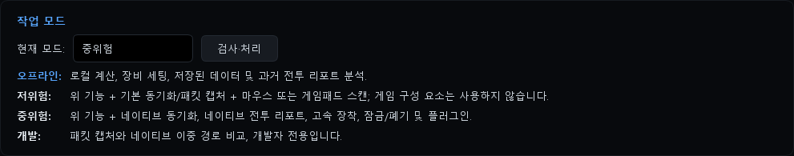
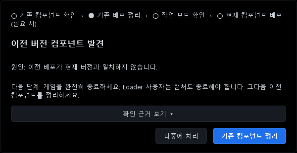

# ReShade·DLSS5와 함께 쓰기 (Loader 방식)

**한국어** | [English](COEXIST_RESHADE_DLSS.en.md) | [日本語](COEXIST_RESHADE_DLSS.ja.md) | [中文](COEXIST_RESHADE_DLSS.zh.md)

NTE Drive Calc 2.3.1의 네이티브 기능(네이티브 동기화, 네이티브 전투 리포트, 초고속 장착, 플러그인)을 ReShade, DLSS5(신경 렌더링 애드온)와 같이 쓰는 방법입니다.
공식 2.3.1, 한글패치 v2.3.1-ko, Global 2.3.1에 모두 해당합니다. 빌드마다 다르게 동작하는 부분은 따로 표시했습니다.

> [!WARNING]
> **2.3.1에서 아직 실제 게임으로 확인하지 못한 부분이 있습니다.**
> 2.3.1부터 Loader가 게임에 불러오는 계산기 파일도 이름이 `d3d12.dll`입니다. 이 파일은 계산기 폴더에 있어서 게임 폴더의 ReShade 파일과 겹치지는 않습니다. 하지만 같은 이름의 DLL 두 개가 한 게임 안에 함께 올라갈 때 ReShade가 정상적으로 로드되는지, 둘이 충돌하지 않는지는 아직 확인하지 못했습니다. 원작자도 이 Loader 빌드는 실제 게임 검증을 하지 않았다고 표시해 두었습니다.
> 사용하신 뒤 [5단계](#5단계-잘-되는지-확인하기)로 꼭 점검해 주세요.

## 이런 분께 맞습니다

- ReShade와 DLSS5 애드온을 쓰면서 계산기의 네이티브 기능도 쓰고 싶은 분
- 계산기 D3D 방식과 ReShade가 둘 다 `d3d12.dll` 이름을 써서 함께 둘 수 없었던 분
- 2.3.0에서 2.3.1로 올리면서 "이전 버전 컴포넌트 발견" 창을 본 분

## 한눈에 보기

Loader 방식에서는 계산기가 **게임 폴더에 파일을 하나도 두지 않습니다.** 필요한 파일(계산기 호스트 `d3d12.dll`과 `plugins\` 아래 플러그인)은 `계산기 설치 폴더\config\native-loader`에 준비해 둡니다(설치 폴더에 쓸 수 없으면 `%LOCALAPPDATA%\NTE Drive Calc\config\native-loader`). 공식 런처가 게임을 실행할 때 Loader가 이 파일을 게임에 불러옵니다. 그래서 게임 폴더의 `d3d12.dll` 자리는 ReShade가 그대로 쓸 수 있습니다.
반대로 D3D 방식은 계산기가 게임 폴더에 `d3d12.dll`을 직접 둡니다. 그래서 같은 이름을 쓰는 ReShade와 함께 둘 수 없습니다.

| | D3D 수집 프록시 | 네이티브 Loader (예비) |
|---|---|---|
| 계산기 파일을 두는 곳 | 게임 폴더 `Win64` | 계산기 폴더 `config\native-loader` |
| 게임 폴더의 `d3d12.dll` | 계산기가 사용 | ReShade가 사용 |
| ReShade(`d3d12.dll`)와 함께 쓰기 | 불가 | 파일은 겹치지 않음. 2.3.1에서 실제로 함께 동작하는지는 미확인(확인 대기) |
| 실행 순서 | 게임을 끈 상태에서 미리 배포 | 매번 계산기(Loader) → 런처 → 게임 |

## 먼저 꼭 읽어 주세요

- ReShade, DLSS5 애드온, 계산기의 네이티브 기능은 모두 게임에 외부 코드를 불러오는 방식입니다. 게임 운영 정책에 따라 계정에 불이익이 있을 수 있고, 사용 책임은 본인에게 있습니다.
- 작성자 환경에서는 ReShade를 `dxgi.dll`로 두었을 때 ACE가 "불법 모듈 (dxgi.dll)" 경고를 여러 번 띄웠고, 계정 불이익 가능성 안내도 함께 나왔습니다. 이 가이드는 감지를 피하는 방법을 다루지 않습니다. 파일 이름을 바꾸는 것은 감지를 피하는 방법이 아니며, 다른 이름으로 경고를 보지 못했다고 해서 허용된다는 뜻도 아닙니다.
- Loader 방식은 게임 폴더에 파일을 두지 않을 뿐입니다. Loader는 관리자 권한으로 공식 런처 프로세스에 코드를 주입해 게임에 계산기 DLL을 불러옵니다(실행 파일 분석으로 추정). 게임 폴더에 파일이 없다고 해서 감지 위험이 낮다는 뜻은 아닙니다. **Loader 방식에서 ACE가 어떻게 반응하는지는 아직 확인되지 않았습니다.** 계산기도 "구성 요소는 게임 안에 로드되며, 게임 보호나 호환성 문제를 일으킬 수 있습니다."라고 안내합니다.
- 게임에 DLL을 전혀 넣고 싶지 않다면 계산기를 **저위험** 모드로 쓰세요. 패킷 캡처(Npcap)로 가방 동기화와 기본 전투 리포트를 쓸 수 있습니다. 게임 폴더와 게임 프로세스에는 아무것도 넣지 않습니다. 이 경우 이 가이드의 Loader 설정은 필요 없습니다(공식판에서 예전 D3D 기록이 남아 있을 수 있다면 모드를 바꾸기 전에 [0단계](#0단계-공식판만-계산기를-켜기-전에)를 먼저 하세요). 단, 저위험 모드도 패킷 캡처와 입력 시뮬레이션이 게임 보호나 호환성 문제를 일으킬 수 있다고 앱이 안내합니다.

> [!CAUTION]
> **`dwmapi.dll`도 지워질 수 있습니다.** 이전 버전 계산기가 쓰던 파일 이름이기 때문입니다.
> 공식판은 **네이티브 Loader 시작**(직접 누를 때), **게임 디렉터리 정리**, 업그레이드 창의 **기존 컴포넌트 정리**, D3D **수동 배포** 때 게임 폴더의 `dwmapi.dll`을 **무엇이든** 지웁니다. 게임 폴더에 `dwmapi.dll`이 있으면 켤 때마다 "이전 버전 컴포넌트 발견" 창도 뜹니다.
> 한글패치·Global은 계산기의 옛 파일만 지우고, 다른 `dwmapi.dll` 때문에 창을 띄우지 않습니다. 자동 시작일 때는 어느 빌드도 지우지 않습니다. 다른 모드를 `dwmapi.dll` 이름으로 쓰고 있다면 미리 백업하세요.

## 준비물

| 항목 | 내용 |
|---|---|
| 계산기 | 2.3.1 공식판, [한글패치 v2.3.1-ko](https://github.com/LuinDe/NTE-Drive-Calc-KO/releases/tag/v2.3.1-ko), [Global 2.3.1](https://github.com/LuinDe/NTE-Drive-Calc-Global/releases/tag/v2.3.1-global.1) 중 하나. **ReShade를 쓴다면 한글패치나 Global을 권합니다.** 이유는 [빌드별 차이](#빌드별-차이)에 있습니다. 계산기는 관리자 권한으로 실행됩니다(UAC 창이 뜹니다). |
| 작업 모드 | **중위험**(또는 개발). 위험 확인까지 마쳐야 합니다. |
| 런타임 | Microsoft Visual C++ 2015–2022 재배포 패키지(x64). Loader를 시작하기 전에 계산기가 확인합니다. |
| 게임 경로 | 계산기에 `HTGame.exe` 경로가 지정되어 있어야 합니다. 게임은 공식 폴더 구조(`게임 설치 폴더\Client\WindowsNoEditor\HT\Binaries\Win64\HTGame.exe`) 그대로여야 합니다. 그리고 설치 루트(`Client` 폴더가 있는 폴더)에 공식 런처 `NTELauncher.exe` 또는 `NTEGlobalLauncher.exe`가 있어야 합니다(`NTELauncher\` 폴더 안에 있어도 됩니다). |
| 게임 실행 | **공식 런처로** 실행합니다. Loader는 런처를 거쳐 게임에 붙습니다. |
| 그래픽 모드 | ReShade(애드온 지원판)와 DLSS5 애드온. 설치는 [3단계](#3단계-reshade와-dlss5-설치)의 외부 안내를 참고하세요. |

## 시작하기 전에: 백업

게임 폴더 `게임 설치 폴더\Client\WindowsNoEditor\HT\Binaries\Win64`에서 아래 파일을 다른 곳에 복사해 두세요.

| 구분 | 파일 |
|---|---|
| ReShade 본체 | `d3d12.dll` (파일 속성 → 자세히에서 제품 이름이 `ReShade`인 파일) |
| ReShade 설정 | `ReShade.ini`, 사용 중인 프리셋(예: `ReShadePreset.ini`), `reshade-shaders\` 폴더 |
| 애드온 | `*.addon64` 전부. 이름을 바꿔 꺼 둔 애드온(예: `*.addon64x`)도 함께 |
| DLSS 파일 | `nvngx_dlss.dll`, `nvngx_dlssnr.dll` 등 DLSS5를 설치하면서 넣거나 바꾼 파일. 다른 폴더(예: `Client\WindowsNoEditor\Engine\Plugins\Runtime\Nvidia\…\Binaries\ThirdParty\Win64`)에 넣은 파일이 있다면 그것도 |
| 다른 모드 | `dwmapi.dll`, OptiScaler 등 같은 폴더에 둔 다른 모드 파일 |
| 그 밖 | `D3D12\` 폴더 등 설치하면서 함께 생기거나 바뀐 파일 |

DLSS5를 처음 설치한다면, 설치 **전에** 바뀔 원본 파일(`nvngx_dlss.dll` 등)을 먼저 백업하세요.
게임 폴더 전체를 복사하면 용량이 매우 클 수 있습니다. 최소한 `Win64` 폴더와 DLSS 파일을 넣은 폴더는 꼭 백업하세요.

**백업이 필요한 이유**

1. ReShade 설치 프로그램에서 **제거(Uninstall)** 를 실행하면 그 폴더의 `*.addon64`가 모두 지워집니다(작성자 환경에서 겪은 일).
2. 공식 2.3.1 계산기는 정리할 때 게임 폴더의 `d3d12.dll`을 **파일 이름만 보고** 지웁니다. D3D 방식의 자동 배포는 그 파일을 **백업 없이 덮어씁니다.** [0단계](#0단계-공식판만-계산기를-켜기-전에)를 지키면 피할 수 있지만, 실수에 대비해 백업해 두세요.

> [!NOTE]
> 게임이 `C:\Program Files` 아래에 설치되어 있으면, 그 폴더의 파일을 복사해 넣거나 이름을 바꿀 때 관리자 권한 확인 창이 뜹니다.

## 0단계 (공식판만): 계산기를 켜기 전에

공식판을 쓰고, 예전에 **D3D 수집 프록시** 방식을 쓴 적이 있고, 지금 `Win64\d3d12.dll`이 ReShade라면, 계산기를 켜기 **전에** 이 파일 이름을 `d3d12.dll.reshade-hold`로 바꿔 두세요. D3D 방식을 쓴 적이 있는지 확실하지 않아도 해 두는 것이 안전합니다.

- 자동 동기화를 켠 적이 있으면 공식판은 켜지자마자 D3D 파일을 다시 배포할 수 있습니다. 이때 ReShade `d3d12.dll`은 백업 없이 덮어써집니다.
- 로드 방식이나 작업 모드(저위험·오프라인 포함)를 바꾸는 즉시, 예전 배포 기록에 있는 파일을 이름만 보고 지울 수도 있습니다.
- 1·2단계를 마치고 `Win64`에 계산기 `d3d12.dll`이 없는 것을 확인한 뒤 원래 이름으로 되돌리세요.
- 다른 모드의 `dwmapi.dll`이 있다면 같은 방법으로 이름을 바꿔 두세요([위 CAUTION](#먼저-꼭-읽어-주세요) 참고). 공식판은 **네이티브 Loader 시작**을 직접 누를 때마다 `dwmapi.dll`을 지우므로, 되돌린 뒤에는 자동 시작만 쓰거나 한글패치·Global로 바꾸세요.

가장 간단한 방법은 공식판을 켜기 전에 한글패치나 Global을 설치하는 것입니다. 한글패치·Global은 계산기 파일이 아닌 `d3d12.dll`을 덮어쓰거나 지우지 않습니다.

## 1단계: 계산기를 Loader 방식으로 바꾸기

**순서가 중요합니다.** 로드 방식을 먼저 Loader로 바꾸고, 그다음에 작업 모드를 바꾸세요. 자동 동기화는 Loader를 한 번 시작한 뒤에 켭니다([4단계](#4단계-매번-실행하는-순서)).
기본값인 D3D 방식인 채로 중위험을 고르면, 공식판은 ReShade `d3d12.dll`을 예전 계산기 파일로 보고 "이전 버전 컴포넌트 발견" 창을 띄웁니다. 자동 동기화까지 켜져 있으면 게임이 꺼져 있을 때 그 파일을 계산기 파일로 덮어씁니다.

> 아래 화면은 Global 2.3.1 한국어 화면입니다(시험용 환경, 계정 데이터 없음). 한글패치 v2.3.1-ko도 문구가 같습니다. 공식판의 중국어 문구는 [문구 대응표](#문구-대응표-공식판-중국어)를 보세요.

1. 사이드바 **🔧 설정** → **환경 설정** 카드 → **게임 내 컴포넌트 · 초고속 장착, 폐기 잠금, 플러그인, 기능 강화** 구역으로 갑니다.
2. **로드 방식:** 에서 **네이티브 Loader (예비)** 를 고릅니다. 확인 창 없이 바로 저장됩니다. 오프라인 모드에서도 바꿀 수 있습니다.
3. **게임 실행 파일:** 칸이 비어 있으면 **자동 감지**를 누르거나 **HTGame.exe 선택**으로 직접 지정합니다.
   Loader를 고르면 아래쪽 초록 버튼 이름이 **네이티브 Loader 시작**으로 바뀝니다. 처음에는 "컴포넌트가 준비되지 않았습니다(N개 항목)"라고 나오는데, Loader를 한 번 시작하면 준비됩니다.

   

4. 같은 페이지 맨 위 **작업 모드** 카드 → **현재 모드:** 에서 **중위험**을 고릅니다. 확인 창에서 **위험 확인 후 전환**을 누릅니다. 개발 모드도 되지만, 앱은 개발자 전용이라고 안내합니다.

   

   

## 2단계: D3D 방식을 쓰던 분만 — 계산기 파일 정리

이전에 **D3D 수집 프록시** 방식을 썼다면 게임 폴더에 계산기 파일이 남아 있을 수 있습니다. 처음부터 Loader 방식이었다면 이 단계는 건너뛰세요.

**남아 있는지 확인하기** — `Win64` 폴더에서 다음 중 하나라도 보이면 남아 있는 것입니다.
- `plugins\NTE_Plugin*.dll`(2.3.1) 또는 `NTE_Capture.dll`(이전 버전)
- `d3d12.dll`의 속성 → 자세히 → 제품 이름이 `ReShade`가 아님 (2.3.1 계산기 호스트는 `NTE Combat Debug Tools`, 2.3.0 호스트는 제품 이름이 비어 있음)

**정리하기**

1. 게임과 런처를 완전히 끕니다.
2. 1단계를 마친 상태에서 **네이티브 Loader 시작**을 누릅니다. 계산기가 기록해 둔 예전 D3D 파일을 먼저 정리한 뒤 Loader를 시작합니다.
3. 그래도 파일이 남아 있으면 빨간 **게임 디렉터리 정리** 버튼을 누릅니다.
   이 버튼은 실행 중인 Loader를 멈추고 `config\native-loader`에 준비된 파일도 지우며, 동기화를 일시 중지합니다(자동 시작도 멈춤). 정리가 끝나면 ① 작업 모드에서 **중위험** → **위험 확인 후 전환**을 다시 하고, ② **네이티브 Loader 시작**을 다시 누르고, ③ 자동 동기화가 꺼진 것으로 보이면 Loader를 시작한 뒤 다시 켜세요(일시 중지 중에는 꺼진 것으로 표시됩니다).

**빌드별 주의**

- **한글패치·Global**: 게임 폴더의 `d3d12.dll`이 계산기 파일이 아니면(ReShade 등) 지우지 않고 남겨 둡니다. 위 순서대로 진행하시면 됩니다.
- **공식판**: 정리할 때 `d3d12.dll`을 **이름만 보고 지웁니다.** 그 순간 ReShade가 `d3d12.dll`이면 ReShade가 지워집니다.
  - ReShade가 이미 `d3d12.dll`이라면: [0단계](#0단계-공식판만-계산기를-켜기-전에)대로 계산기를 켜기 전에 이름을 바꿔 두었어야 합니다. 이름을 되돌리기 전에 `Win64`에 계산기 `d3d12.dll`이 새로 생겼다면 덮어쓰지 말고, 로드 방식이 Loader인지 확인한 뒤 **네이티브 Loader 시작**으로 먼저 정리하세요.
  - ReShade가 아직 `d3d12.dll`이 아니라면(예: `dxgi.dll`로 쓰던 중): 정리를 먼저 끝냅니다. 그다음 [3단계](#3단계-reshade와-dlss5-설치)로 넘어갑니다.

## 3단계: ReShade와 DLSS5 설치

이 가이드는 ReShade와 DLSS5 설치 방법 자체는 다루지 않습니다. 아래 안내를 따라 주세요.

- **ReShade 공식 사이트**: <https://reshade.me> — "with full add-on support"(애드온 지원판)를 받습니다. 작성자는 ReShade 6.8 애드온 지원판을 사용했습니다.
- **커뮤니티 가이드**: [이환 DLSS 5 적용 방법 A to Z](https://arca.live/b/nevernesstoeverness/181463229) (아카라이브 이환 채널) — 필요한 파일 받기, ReShade 설치, DLSS 파일 교체, 게임 안에서 적용 확인까지 다룹니다.
- **RenoDX**: <https://github.com/clshortfuse/renodx>

외부 안내에 있는 파일은 이 저장소에서 검증하지 않았습니다. 출처를 직접 확인하고 받으세요.

이 가이드와 함께 쓰려면 다음만 지키면 됩니다.

- 이 가이드는 ReShade가 `Win64\d3d12.dll`인 구성을 기준으로 합니다. 설치 도구가 `dxgi.dll`을 만들었다면 이름을 `d3d12.dll`로 바꾸세요.
- 이미 ReShade를 `d3d12.dll`로 쓰고 있다면 그대로 두세요. Loader 방식은 이 파일을 건드리지 않습니다(공식판은 0·2단계를 마친 뒤에만).
- ReShade 설치 프로그램으로 제거하거나 다시 설치할 때는 애드온부터 백업하세요.

## 4단계: 매번 실행하는 순서

1. 런처와 게임이 꺼진 상태에서 **계산기를 먼저** 실행합니다(UAC 허용).
2. Loader를 시작합니다.
   - 자동 동기화를 켜 두었다면 계산기가 알아서 시작합니다.
   - 아니라면 **🔧 설정 → 환경 설정 → 네이티브 Loader 시작**을 누릅니다. "**네이티브 Loader 시작됨**" 창이 뜨면 성공입니다.
3. (선택, 처음 한 번) **네이티브 Loader 시작됨**이 뜬 뒤 계산기를 끄지 말고, Loader가 실행 중인 상태(게임 중이어도 됨)에서 **작업 공간** → **게임 데이터 동기화** → **자동 동기화**를 켭니다. 처음 켤 때는 환경 검사 화면이 먼저 나옵니다.
   - Loader를 시작하기 전에 켜면 "현재 컴포넌트가 아직 배포되지 않았습니다; 먼저 배포한 후 돌아와 동기화를 켜 주세요."가 뜨고 켜지지 않습니다.
   - 한 번 켜 두면 다음부터는 게임과 런처가 꺼져 있을 때 계산기가 Loader를 알아서 시작합니다. 런처나 게임이 켜져 있으면 꺼질 때까지 기다렸다가(15초 간격) 다시 시도합니다. 다른 이유로 실패하면 자동 재시도를 멈추고 **검사 상세**에 원인을 표시합니다.
   - 켜지 않으면 게임을 할 때마다 **네이티브 Loader 시작**을 직접 누르면 됩니다.
4. **공식 런처**를 실행하고, 평소처럼 게임을 시작합니다.
5. [5단계](#5단계-잘-되는지-확인하기)로 연결을 확인합니다.

> [!IMPORTANT]
> - 런처나 게임을 먼저 켰다면 이번에는 Loader가 붙지 않습니다. "Loader가 프로그램 종료를 기다리는 중" 창이 뜨면 런처와 게임을 완전히 끄고, **네이티브 Loader 시작**을 다시 누르세요.
> - 자동 동기화로 Loader가 이미 시작된 뒤 런처를 켠 상태에서 버튼을 다시 누르면 이 창이 뜰 수 있습니다. 이때 Loader는 그대로 대기 중이니 무시하세요.
> - 게임을 끝낸 뒤 계산기를 닫으세요. 계산기를 닫으면 Loader가 멈추고, Loader가 붙어 있던 공식 런처도 종료됩니다. 이때 게임이 계속 실행되는지는 확인하지 못했습니다. 런처가 게임을 업데이트하는 동안에는 계산기를 닫지 마세요.

## 5단계: 잘 되는지 확인하기

| 무엇을 | 어디서 | 정상일 때 |
|---|---|---|
| 계산기 연결 | **작업 공간** → **게임 데이터 동기화** → **검사 상세** | 위쪽 요약에 빨간 "처리 필요"가 없고, "DLL 전투 리포트", "DLL 캐릭터 상태" 같은 DLL 항목이 "준비 완료"(초록)에 있을 것으로 예상됩니다(게임 실행 중 화면으로는 아직 확인하지 못함). 로그인 전에는 노란색 "로그인 대기"일 수 있습니다. |
| ReShade | 게임 안 ReShade 오버레이(기본 키 Home) | 오버레이가 뜨고, 애드온 목록에 DLSS5 애드온이 보입니다. |
| ReShade 로그 | `Win64\ReShade.log` (수정한 날짜가 방금 실행한 시각인지 확인) | `Initializing crosire's ReShade version '…' (64-bit) loaded from '…\d3d12.dll' into '…\HTGame.exe'` 줄과, 애드온마다 `Registered add-on "…"` 줄이 있습니다. |
| DLSS5 | ReShade 오버레이의 DLSS5(신경 렌더링) 패널 | 상태가 활성(ACTIVE)으로 표시됩니다. |

하나라도 이상하면 아래 [문제 해결](#문제-해결)을 보세요. 특히 **Loader를 쓸 때만 ReShade가 안 뜨거나 게임이 불안정하다면** 꼭 알려 주세요. 위 WARNING에 적은, 아직 확인하지 못한 부분과 관련 있을 수 있습니다.

## 되돌리기

1. 게임과 런처를 끕니다.
2. 네이티브 기능을 그만 쓰려면 작업 모드를 **저위험**이나 **오프라인**으로 바꿉니다. 공식판에서 예전 D3D 기록이 남아 있을 수 있다면 먼저 [0단계](#0단계-공식판만-계산기를-켜기-전에)를 하세요.
   계산기는 Loader를 멈추고 `config\native-loader`에 준비한 파일을 정리합니다. Loader 방식 기록만 있다면 게임 폴더는 건드리지 않습니다(코드 분석 기준).
3. 계산기를 닫습니다.
4. ReShade나 애드온 파일을 되살려야 한다면 [문제 해결](#문제-해결)의 "`d3d12.dll`이 계산기 파일로 바뀌었거나 사라짐" 순서대로 넣습니다.
5. ReShade를 지우려면 애드온부터 백업한 뒤 제거합니다. DLSS5 설치로 바뀐 파일은 백업해 둔 원본으로 되돌립니다.

## 업그레이드 창이 뜰 때

2.3.0에서 Loader 방식을 쓰던 분은 2.3.1을 처음 실행하면 아래 창이 **반드시** 한 번 뜹니다. 2.3.0의 Loader 파일(`NTE_Capture.dll`)이 2.3.1 파일 구성과 맞지 않기 때문입니다.

| 버튼 | 하는 일 | 공식판 | 한글패치·Global |
|---|---|---|---|
| **나중에 처리** (稍后处理) | 창만 닫습니다. 파일은 건드리지 않습니다. | **이쪽을 누르세요** | 이쪽을 권합니다 |
| **기존 컴포넌트 정리** (清理旧组件) | 자동 동기화를 끄고 동기화를 일시 중지한 뒤, "게임 디렉터리 정리"와 같은 정리를 합니다. | **ReShade의 `d3d12.dll`이 지워집니다.** `dwmapi.dll`도 지워집니다. 누르지 마세요. | ReShade 파일은 남습니다. 대신 작업 모드를 다시 확인하고 Loader를 다시 시작해야 합니다. 자동 시작을 쓰려면 Loader를 시작한 뒤 자동 동기화를 다시 켜야 합니다. |

**나중에 처리**를 누른 다음에는 이렇게 됩니다.
- 자동 동기화를 켜 두었다면 게임과 런처가 꺼져 있을 때 계산기가 새 Loader 파일을 준비하고 Loader를 시작합니다. 게임 폴더는 건드리지 않습니다.
- 자동 동기화를 꺼 두었다면 **네이티브 Loader 시작**을 한 번 누르세요.
- 이렇게 한 번 준비되면 다음 실행부터는 이 창이 뜨지 않습니다. 그때까지는 작업 공간에 "구버전 컴포넌트 업그레이드…" 안내가 남아 있습니다.

> [!TIP]
> 공식판에서 꼭 **기존 컴포넌트 정리**를 해야 한다면, 먼저 게임 폴더의 ReShade `d3d12.dll` 이름을 `d3d12.dll.reshade-hold`로 바꿔 두세요. 다른 모드의 `dwmapi.dll`도 함께 이름을 바꿔 두세요. 정리가 끝나면 원래 이름으로 되돌리면 됩니다.

> [!NOTE]
> 한글패치는 공식 2.3.1이 설치된 상태에서 설치합니다. 한글패치를 설치하기 전에 공식 2.3.1을 실행하게 되었다면, 이 창에서 **稍后处理**(나중에 처리)를 누르세요.
> 한글패치·Global에서 **기존 컴포넌트 정리**를 누르면 "d3d12.dll은 이 프로그램의 파일이 아니어서 그대로 두었습니다"라는 안내가 다른 문구에 가려 보이지 않을 수 있습니다. 파일은 남아 있습니다.

## 문제 해결

| 증상 | 원인 | 해결 |
|---|---|---|
| "Loader가 프로그램 종료를 기다리는 중" 창이 뜸, 또는 "공식 런처가 아직 실행 중입니다" | 런처나 게임이 켜져 있습니다. | 작업 관리자에서 런처와 게임을 완전히 끄고 **네이티브 Loader 시작**을 다시 누릅니다. 창의 "원인:" 줄이 "공식 런처를 찾을 수 없습니다"나 "공식 Client 디렉터리 구조와 맞지 않아"라면, 게임 실행 파일을 공식 설치의 `HTGame.exe`로 다시 지정하세요. |
| "기능 제한됨" 창이 뜸 | 작업 모드가 오프라인 또는 저위험입니다. | [1단계](#1단계-계산기를-loader-방식으로-바꾸기)대로 **중위험**으로 바꿉니다. |
| 직접 시작했을 때 "기능 일시 사용 불가 — 컴포넌트 처리가 완료되지 않았습니다…" | Visual C++ x64 런타임이 없거나 설치가 손상되는 등 여러 원인이 있습니다(이 창에는 자세한 원인이 나오지 않음). | [Microsoft 공식 페이지](https://learn.microsoft.com/cpp/windows/latest-supported-vc-redist)에서 x64 버전을 설치한 뒤 다시 시작합니다. |
| **검사 상세**에 "자동 Loader 시작 실패: …; 자동 재시도를 중지했습니다" | 자동 시작이 실패하면 원인을 고칠 때까지 자동 재시도가 멈춥니다(계산기를 다시 켜도 유지). 예: "…Redistributable x64가 없습니다:…". 한글패치·Global에서 D3D 방식이던 분은 ReShade 파일을 지키려고 자동 배포를 멈춘 경우("자동 네이티브 컴포넌트 배포 실패: 게임 폴더의 d3d12.dll은(는)…")에도 이렇게 됩니다. | 원인을 고친 뒤(로드 방식을 Loader로 바꾸는 것 포함) **🔧 설정** → **작업 모드** 카드의 **검사·처리**를 누릅니다. |
| Loader는 시작됐는데 "검사 상세"에서 연결이 안 됨 | 공식 런처를 거치지 않고 게임을 실행했거나, 아직 로그인 전(노란 "로그인 대기")이거나, (2.3.1 확인 대기) 게임에 계산기 DLL이 올라가지 않았을 수 있습니다. | 게임과 런처를 끄고 [4단계](#4단계-매번-실행하는-순서) 순서대로 다시 합니다. |
| 게임이 시작 직후 꺼지거나 멈춤, 검은 화면 | (2.3.1 확인 대기) ReShade와 계산기 DLL이 함께 올라가며 충돌했을 수 있습니다. | 계산기를 닫고 런처로 게임만 실행해 봅니다. Loader 없이 정상이면 저장소에 알려 주시고, 그동안 계산기는 저위험 또는 오프라인 모드로 쓰세요. |
| ReShade 오버레이가 안 뜸 | ① `d3d12.dll`이 ReShade가 아님 ② (2.3.1 확인 대기) Loader와 함께 쓸 때 ReShade가 로드되지 않음 | ① `d3d12.dll` 속성의 제품 이름을 확인하고, `ReShade`가 아니면 아래 "`d3d12.dll`이 계산기 파일로 바뀌었거나 사라짐" 순서대로 복원합니다. ② `ReShade.log`가 이번 실행 시각으로 갱신되지 않았다면, 계산기를 닫고 런처로 게임만 실행해 봅니다. Loader 없이는 뜨고 Loader와 함께면 안 뜬다면 저장소에 알려 주세요. 그동안에는 계산기를 저위험 또는 오프라인 모드로 쓰면 됩니다. |
| 계산기를 켤 때마다 "이전 버전 컴포넌트 발견" 창이 뜸 | (공식판) D3D 방식인데 게임 폴더에 ReShade `d3d12.dll`이 있으면, 계산기가 이를 예전 계산기 파일로 판단합니다. 게임 폴더에 `dwmapi.dll`이 있어도(다른 모드 파일이어도) 뜹니다. 또는 Loader 파일이 아직 2.3.1용으로 준비되지 않았습니다. | **나중에 처리**를 누르고, 로드 방식을 **네이티브 Loader (예비)** 로 바꾼 뒤 **네이티브 Loader 시작**을 한 번 누릅니다(공식판은 이때 `dwmapi.dll`을 지우니, 다른 모드 파일이면 먼저 백업하세요). 한글패치·Global은 ReShade나 다른 모드 파일 때문에 이 창을 띄우지 않습니다. |
| `d3d12.dll`이 계산기 파일로 바뀌었거나 사라짐 | 공식판에서 D3D 배포·자동 배포·정리가 실행되었습니다. | ① 로드 방식을 **네이티브 Loader (예비)** 로 바꿉니다. ② 게임과 런처를 끈 채 **네이티브 Loader 시작**을 한 번 눌러 예전 D3D 기록을 정리합니다(공식판은 이때 `Win64\d3d12.dll`을 이름만 보고 지웁니다). ③ `Win64`에 계산기 `d3d12.dll`이 남아 있지 않은지 확인한 **뒤에** 백업한 ReShade `d3d12.dll`을 넣습니다. 공식판은 이후 **게임 디렉터리 정리**를 누르지 마세요. 한글패치와 Global은 계산기 파일이 아닌 `d3d12.dll`을 덮어쓰거나 지우지 않습니다. |
| 애드온(`*.addon64`)이 사라짐 | ReShade 설치 프로그램에서 제거를 실행하면 이렇게 됩니다. | 백업에서 복원합니다. |
| DLSS5 상태가 "Waiting"에서 넘어가지 않음 | 애드온 설정 문제 | RenoDX DLSS 패널에서 **Require DLSS**를 끄면 해결된 경우가 있습니다(작성자 환경 기준이며, 애드온 버전에 따라 항목 이름이 다를 수 있습니다). 게임 그래픽 설정에서 DLSS를 켜 두었는지도 확인하세요. |
| ACE "불법 모듈" 경고 창 | 괄호 안의 파일이 감지되었습니다. | 게임을 끄고, 괄호 안 파일을 게임 폴더에서 치우는 것을 권합니다. 이름을 바꿔 계속 쓰는 것은 권하지 않습니다. 계속 사용하면 계정에 불이익이 있을 수 있습니다. |

## 자주 묻는 질문

**D3D 방식으로는 ReShade와 같이 쓸 수 없나요?**
없습니다. 두 프로그램 모두 게임 폴더의 같은 파일 이름 `d3d12.dll`이 필요합니다. 계산기 호스트는 Windows 기본 `d3d12.dll`로 곧바로 연결하고, 계산기 자체 서명 플러그인만 불러옵니다. 그래서 ReShade를 이어서 불러올 수 없습니다. 한글패치·Global은 이 상황에서 ReShade 파일을 덮어쓰지 않고 배포를 멈춘 뒤 Loader로 바꾸라고 안내합니다.

**ReShade를 `dxgi.dll`로 두면 D3D 방식과 같이 쓸 수 있지 않나요?**
파일 이름이 겹치지 않으니 함께 둘 수는 있습니다. 하지만 작성자 환경에서 이 상태일 때 ACE 경고가 여러 번 나왔습니다. 경고가 나온 구성은 쓰지 마세요.

**Loader 방식이면 ACE에 안 걸리나요?**
알 수 없습니다. Loader 방식은 게임 폴더에 파일을 두지 않을 뿐, 게임에 계산기 DLL을 불러오는 것은 같습니다. 이 방식에서 ACE가 어떻게 반응하는지는 아직 확인되지 않았습니다.

**런처 없이 게임을 직접 실행하면요?**
Loader는 공식 런처에 들어간 뒤, 런처가 띄우는 게임에 붙습니다. 이 동작은 Loader 실행 파일을 분석해 추정한 것입니다. 그래서 다른 방법으로 실행한 게임에는 붙지 않습니다. 항상 공식 런처로 실행하세요.

**게임 폴더에 파일을 안 둔다면서 관리자 권한은 왜 필요한가요?**
계산기 자체가 관리자 권한으로 실행되도록 만들어져 있습니다. Loader도 다른 프로그램(공식 런처)에 들어가야 해서 관리자 권한이 필요합니다.

**계산기 파일은 어디에 있나요?**
`계산기 설치 폴더\config\native-loader`에 있습니다(설치 폴더에 쓸 수 없으면 `%LOCALAPPDATA%\NTE Drive Calc\config\native-loader`). 호스트 `d3d12.dll`과 `plugins\NTE_Plugin{User,Combat,HUD,Performance}.dll`, 각각의 `.sig` 파일입니다. 이 `d3d12.dll`은 게임 폴더의 ReShade `d3d12.dll`과 다른 파일입니다. 지우거나 옮기지 마세요.

**OptiScaler와 같이 쓸 수 있나요?**
확인하지 않았습니다. 작성자는 OptiScaler를 끄고 ReShade만 사용했습니다. 참고로 공식판은 `d3d12.dll`(정리할 때)과 `dwmapi.dll`(정리할 때, Loader를 직접 시작할 때, D3D 수동 배포 때)을 이름만 보고 지웁니다. 다른 모드가 이 이름을 쓰고 있다면 같은 주의가 필요합니다.

## 빌드별 차이

게임 폴더에 다른 프로그램의 `d3d12.dll`(ReShade 등)이나 `dwmapi.dll`이 있을 때의 동작입니다. Loader 방식 자체(게임 폴더에 파일을 두지 않음)는 세 빌드가 같습니다.

| 상황 | 공식 2.3.1 | 한글패치 v2.3.1-ko | Global 2.3.1 |
|---|---|---|---|
| 화면 언어 | 중국어 | 한국어 | 한국어·English·日本語·中文 |
| **게임 디렉터리 정리**, 업그레이드 창의 **기존 컴포넌트 정리** | `d3d12.dll`, `dwmapi.dll` **삭제** | 남김 | 남김 |
| Loader를 시작할 때 예전 D3D 기록 정리 | 이름만 보고 삭제 | 계산기 파일로 확인된 것만 삭제 | 계산기 파일로 확인된 것만 삭제 |
| D3D 자동 배포 | **백업 없이 덮어씀** | 멈추고 Loader로 바꾸라고 안내 | 멈추고 Loader로 바꾸라고 안내 |
| D3D 수동 배포 | 덮어씀, `dwmapi.dll`도 삭제 | 멈춤 | 멈춤 |
| Loader 수동 시작 때 `dwmapi.dll` | 어떤 파일이든 삭제 | 계산기의 옛 파일만 삭제 | 계산기의 옛 파일만 삭제 |
| 게임 디렉터리 정리·기존 컴포넌트 정리 때 `dwmapi.dll` | 어떤 파일이든 삭제 | 계산기의 옛 파일만 삭제 | 계산기의 옛 파일만 삭제 |
| D3D 방식 + ReShade `d3d12.dll`일 때 업그레이드 창 | 매번 뜸 | 뜨지 않음 | 뜨지 않음 |
| 게임 폴더에 다른 모드의 `dwmapi.dll`이 있을 때 업그레이드 창 | 매번 뜸 | 뜨지 않음 | 뜨지 않음 |

## 문구 대응표 (공식판 중국어)

| 한국어(한글패치·Global) | 공식판(중국어) |
|---|---|
| 🔧 설정 | 🔧 设置 |
| 작업 공간 | 工作台 |
| 작업 모드 / 현재 모드: | 工作模式 / 当前模式： |
| 오프라인 / 저위험 / 중위험 / 개발 | 离线 / 低风险 / 中风险 / 开发 |
| 위험 확인 후 전환 | 确认风险并切换 |
| 검사·처리 | 检测并处理 |
| 환경 설정 | 环境配置 |
| 로드 방식: | 加载方式: |
| D3D 수집 프록시 | D3D 采集代理 |
| 네이티브 Loader (예비) | 原生 Loader（备用） |
| 게임 실행 파일: / 자동 감지 / HTGame.exe 선택 | 游戏主程序: / 自动检测 / 选择 HTGame.exe |
| 네이티브 Loader 시작 | 启动原生 Loader |
| 네이티브 Loader 시작됨 | 原生 Loader 已启动 |
| Loader가 프로그램 종료를 기다리는 중 | Loader 等待关闭程序 |
| 게임 디렉터리 정리 | 清理游戏目录 |
| 게임 데이터 동기화 / 자동 동기화 / 검사 상세 | 游戏数据同步 / 自动同步 / 检测详情 |
| 처리 필요 / 로그인 대기 / 준비 완료 | 需处理 / 等待登录 / 已就绪 |
| 이전 버전 컴포넌트 발견 | 发现旧版组件 |
| 나중에 처리 / 기존 컴포넌트 정리 | 稍后处理 / 清理旧组件 |
| 기능 제한됨 | 功能受限 |
| 기능 일시 사용 불가 | 功能暂不可用 |
| 현재 컴포넌트가 아직 배포되지 않았습니다… | 当前组件尚未部署… |
| 자동 Loader 시작 실패 / 자동 재시도를 중지했습니다 | 自动 Loader 启动失败 / 已停止自动重试 |

## 참고 링크

- 원본 계산기(상류): <https://github.com/hxwd94666/NTE-Drive-Calculator>
- 한글패치: <https://github.com/LuinDe/NTE-Drive-Calc-KO>
- Global(다국어판): <https://github.com/LuinDe/NTE-Drive-Calc-Global>
- ReShade: <https://reshade.me>
- RenoDX: <https://github.com/clshortfuse/renodx>
- 커뮤니티 가이드 "이환 DLSS 5 적용 방법 A to Z": <https://arca.live/b/nevernesstoeverness/181463229>
- Microsoft Visual C++ 재배포 패키지: <https://learn.microsoft.com/cpp/windows/latest-supported-vc-redist>

---

이 문서는 비공식 문서입니다. 원작자, 게임사, ReShade, RenoDX, NVIDIA와 관계가 없습니다. 2026-10-11, 계산기 2.3.1 기준으로 작성했습니다.
