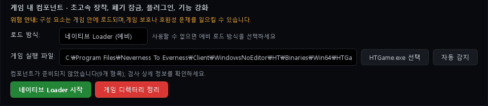
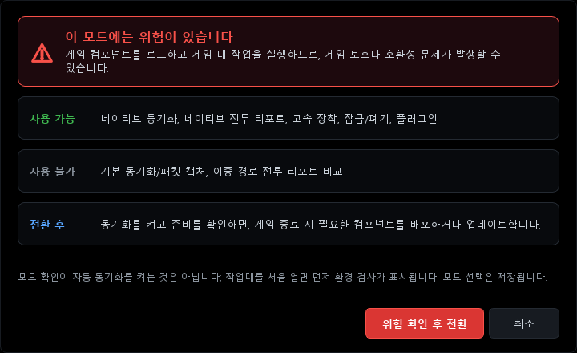
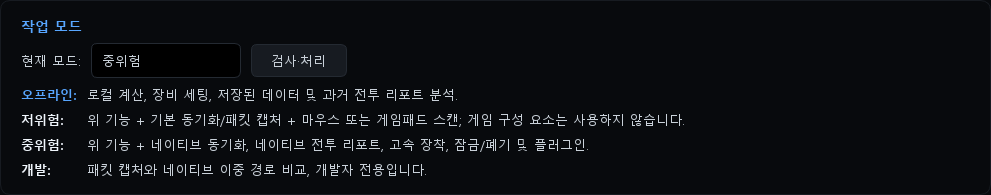
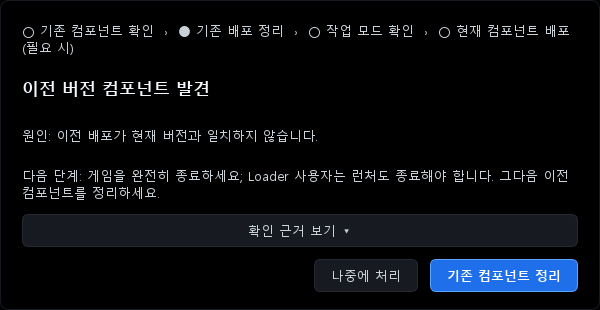

# 与 ReShade、DLSS5 一起使用（Loader 方式）

[한국어](COEXIST_RESHADE_DLSS.ko.md) | [English](COEXIST_RESHADE_DLSS.en.md) | [日本語](COEXIST_RESHADE_DLSS.ja.md) | **中文**

本文介绍如何把 NTE Drive Calc 2.3.1 的原生功能（原生同步、原生战报、极速装配、插件）与 ReShade、DLSS5（神经渲染插件）一起使用。
适用于官方 2.3.1、韩文补丁 v2.3.1-ko 和 Global 2.3.1。各构建行为不同的地方会单独注明。

> [!IMPORTANT]
> **2026-10-14 已在实际游戏中确认：一起使用时游戏可以正常启动和运行，不会崩溃退出。**
> 确认的配置：计算器 2.3.1 的 Loader + ReShade 6.8（插件支持版，游戏目录中的 `d3d12.dll`）+ DLSS5 插件（最新版）+ RTSS（使用 Detours）。从 2.3.1 开始，Loader 加载到游戏中的计算器宿主也叫 `d3d12.dll`，但在这个配置下，即使它与 ReShade 一起加载到同一个游戏进程中，游戏也能正常运行，没有退出。在这个配置下计算器连接（原生功能）能否正常工作，尚未在画面上确认（见[第 5 步](#第-5-步确认是否正常)）。
> 不过，下面两个条件是必需的。在作者的环境中，只要缺少其中任何一个，游戏都会在启动后立即退出。
> 1. **DLSS5 插件要用最新版** —— 旧版 DLSS5 叠加界面插件是原因之一。→ [DLSS5 插件请更新到最新版本](#dlss5-插件请更新到最新版本)
> 2. **如果使用 RTSS（MSI Afterburner），请在 HTGame.exe 的配置文件中开启 Detours** —— RTSS 的默认设置与计算器宿主发生了冲突。→ [与 RTSS 一起使用](#与-rtssrivatunermsi-afterburner一起使用)
>
> 确认范围：这是在作者的一台电脑（NVIDIA RTX 显卡、Windows 11）上确认的结果，不保证在其他环境中也一样。原作者注明这个 Loader 构建没有在实际游戏中验证过。这次确认只涉及程序之间是否冲突，与 ACE 会有什么反应无关（见[请先阅读](#请先阅读)）。
> 开始使用后，请务必按[第 5 步](#第-5-步确认是否正常)检查。

## 适合哪些人

- 使用 ReShade 和 DLSS5 插件，同时也想使用计算器原生功能的用户
- 因为计算器的 D3D 方式和 ReShade 都要用 `d3d12.dll` 这个文件名，所以无法同时放置两者的用户
- 从 2.3.0 升级到 2.3.1 后看到“发现旧版组件”窗口的用户
- 开着 RTSS（MSI Afterburner）使用 Loader 时，游戏启动后立即退出的用户

## 概览

在 Loader 方式下，计算器**不会在游戏目录中放置任何文件。** 需要的文件（计算器宿主 `d3d12.dll` 和 `plugins\` 下的插件）会准备在 `计算器安装目录\config\native-loader` 中（安装目录不可写时为 `%LOCALAPPDATA%\NTE Drive Calc\config\native-loader`）。官方启动器启动游戏时，Loader 会把这些文件加载到游戏中。因此，游戏目录中 `d3d12.dll` 的位置可以继续留给 ReShade 使用。
相反，D3D 方式会由计算器直接在游戏目录中放置 `d3d12.dll`，所以无法与使用同一文件名的 ReShade 共存。

| | D3D 采集代理 | 原生 Loader（备用） |
|---|---|---|
| 计算器文件的位置 | 游戏目录 `Win64` | 计算器目录 `config\native-loader` |
| 游戏目录中的 `d3d12.dll` | 由计算器使用 | 由 ReShade 使用 |
| 与 ReShade（`d3d12.dll`）一起使用 | 不可以 | 游戏不会崩溃退出（2026-10-14 已在实际游戏中确认，一台电脑；计算器连接尚未在画面上确认）。但需要[最新版 DLSS5 插件](#dlss5-插件请更新到最新版本)，使用 RTSS 时还需要 [Detours 设置](#与-rtssrivatunermsi-afterburner一起使用) |
| 启动顺序 | 在游戏关闭时提前部署 | 每次 计算器（Loader）→ 启动器 → 游戏 |

## 请先阅读

- ReShade、DLSS5 插件和计算器的原生功能，都是把外部代码加载到游戏中的方式。根据游戏的运营政策，账号可能受到处罚，使用风险由你自行承担。
- 在作者的环境中，把 ReShade 放成 `dxgi.dll` 时，ACE 多次弹出“非法模块 (dxgi.dll)”警告，并同时提示账号可能受到处罚。本文不涉及规避检测的方法。修改文件名不是规避检测的方法；换个文件名后没看到警告，也不代表被允许。
- Loader 方式只是不在游戏目录中放文件。Loader 以管理员权限向官方启动器进程注入代码，再把计算器 DLL 加载到游戏中（根据可执行文件分析推测）。游戏目录中没有文件，并不代表被检测的风险更低。**Loader 方式下 ACE 会有什么反应，目前还没有确认。** 计算器本身也提示：“组件会加载到游戏中，可能触发游戏保护或兼容问题。”
- 如果完全不想往游戏里加载 DLL，请以**低风险**模式使用计算器。可以通过抓包（Npcap）使用背包同步和基础战报，不会往游戏目录或游戏进程中放任何东西。这种情况下不需要本文的 Loader 设置（如果官方版可能还留有旧的 D3D 记录，请在切换模式前先做[第 0 步](#第-0-步仅官方版启动计算器之前)）。不过，应用也提示低风险模式下“抓包与模拟输入可能触发游戏保护或兼容问题”。

> [!CAUTION]
> **`dwmapi.dll` 也可能被删除。** 因为这是旧版计算器使用过的文件名。
> 官方版在**启动原生 Loader**（手动点击时）、**清理游戏目录**、升级引导窗口中的**清理旧组件**以及 D3D **手动部署**时，会删除游戏目录中**任何** `dwmapi.dll`。只要游戏目录中有 `dwmapi.dll`，每次启动还会弹出“发现旧版组件”窗口。
> 韩文补丁和 Global 只删除计算器自己的旧文件，也不会因为其他 `dwmapi.dll` 弹出这个窗口。自动启动时，任何构建都不会删除它。如果有其他模组以 `dwmapi.dll` 这个名字使用，请提前备份。

## 准备

| 项目 | 内容 |
|---|---|
| 计算器 | 官方 2.3.1、[韩文补丁 v2.3.1-ko](https://github.com/LuinDe/NTE-Drive-Calc-KO/releases/tag/v2.3.1-ko)（韩语界面）、[Global 2.3.1](https://github.com/LuinDe/NTE-Drive-Calc-Global/releases/latest) 三者之一。**如果使用 ReShade，推荐韩文补丁或 Global。** 原因见[各构建的差异](#各构建的差异)。计算器以管理员权限运行（会弹出 UAC 提示）。 |
| 工作模式 | **中风险**（或开发），并且必须完成风险确认。 |
| 运行库 | Microsoft Visual C++ 2015–2022 可再发行组件包（x64）。启动 Loader 前计算器会检查。 |
| 游戏路径 | 计算器中必须设置好 `HTGame.exe` 的路径。游戏必须保持官方目录结构（`游戏安装目录\Client\WindowsNoEditor\HT\Binaries\Win64\HTGame.exe`）。另外，安装根目录（包含 `Client` 文件夹的目录）中必须有官方启动器 `NTELauncher.exe` 或 `NTEGlobalLauncher.exe`（放在 `NTELauncher\` 文件夹内也可以）。 |
| 启动游戏 | **通过官方启动器**启动。Loader 经由启动器接入游戏。 |
| 画面模组 | ReShade（插件支持版）和 DLSS5 插件。DLSS5 插件必须是**最新版**（[原因](#dlss5-插件请更新到最新版本)）。安装方法请参考[第 3 步](#第-3-步安装-reshade-与-dlss5)中的外部指南。 |
| RTSS | 如果使用 RivaTuner Statistics Server（随 MSI Afterburner 一起安装），必须在 HTGame.exe 的配置文件中开启 **Use Microsoft Detours API hooking**。请参阅[与 RTSS 一起使用](#与-rtssrivatunermsi-afterburner一起使用)。不使用则不需要。 |

## 开始之前：备份

请把游戏目录 `游戏安装目录\Client\WindowsNoEditor\HT\Binaries\Win64` 中的以下文件复制到其他位置。

| 类别 | 文件 |
|---|---|
| ReShade 本体 | `d3d12.dll`（属性 → 详细信息中产品名称为 `ReShade` 的文件） |
| ReShade 设置 | `ReShade.ini`、正在使用的预设（例如 `ReShadePreset.ini`）、`reshade-shaders\` 文件夹 |
| 插件 | 全部 `*.addon64`，以及通过改名停用的插件（例如 `*.addon64x`） |
| DLSS 文件 | 安装 DLSS5 时新增或替换的 `nvngx_dlss.dll`、`nvngx_dlssnr.dll` 等文件。如果有放在其他文件夹（例如 `Client\WindowsNoEditor\Engine\Plugins\Runtime\Nvidia\…\Binaries\ThirdParty\Win64`）中的文件，也一起备份 |
| 其他模组 | `dwmapi.dll`、OptiScaler 等放在同一文件夹中的其他模组文件 |
| 其他 | `D3D12\` 文件夹等安装时新建或修改的文件 |

如果是第一次安装 DLSS5，请在安装**之前**先备份将被替换的原始文件（`nvngx_dlss.dll` 等）。
复制整个游戏目录可能占用非常大的空间。至少请备份 `Win64` 文件夹以及放了 DLSS 文件的文件夹。

**为什么需要备份**

1. 在 ReShade 安装程序中执行**卸载（Uninstall）**，会删除该文件夹中的所有 `*.addon64`（作者的环境中实际发生过）。
2. 官方 2.3.1 计算器在清理时**只按文件名**删除游戏目录中的 `d3d12.dll`；D3D 方式的自动部署会**不做备份直接覆盖**这个文件。遵守[第 0 步](#第-0-步仅官方版启动计算器之前)就能避免，但为防失误，请做好备份。

> [!NOTE]
> 如果游戏安装在 `C:\Program Files` 下，向该文件夹复制文件或重命名文件时会弹出管理员权限确认窗口。

## 第 0 步（仅官方版）：启动计算器之前

如果你使用官方版，以前用过 **D3D 采集代理**方式，并且现在 `Win64\d3d12.dll` 是 ReShade，请在启动计算器**之前**把这个文件改名为 `d3d12.dll.reshade-hold`。不确定以前是否用过 D3D 方式时，也建议这样做。

- 如果曾经开启过自动同步，官方版可能一启动就重新部署 D3D 文件，此时 ReShade 的 `d3d12.dll` 会被直接覆盖，没有备份。
- 一旦更改加载方式或工作模式（包括低风险、离线），它也可能只按文件名删除旧部署记录中的文件。
- 完成第 1、2 步并确认 `Win64` 中没有计算器的 `d3d12.dll` 后，再把文件名改回来。
- 如果有其他模组的 `dwmapi.dll`，也请用同样的方法改名（见[上面的 CAUTION](#请先阅读)）。官方版每次手动点击**启动原生 Loader**都会删除 `dwmapi.dll`，所以改回原名后，请只使用自动启动，或改用韩文补丁或 Global。

最简单的办法是在启动官方版之前先安装韩文补丁或 Global。韩文补丁和 Global 不会覆盖或删除不属于计算器的 `d3d12.dll`。

## 第 1 步：把计算器切换为 Loader 方式

**顺序很重要。** 先把加载方式改为 Loader，再更改工作模式。自动同步要在启动过一次 Loader 之后再开启（[第 4 步](#第-4-步每次的启动顺序)）。
如果在默认的 D3D 方式下直接选择中风险，官方版会把 ReShade 的 `d3d12.dll` 当作旧版计算器文件，弹出“发现旧版组件”窗口。如果自动同步也已开启，它会在游戏关闭时用计算器文件覆盖这个文件。

> 下面的截图是 Global 2.3.1 的韩语界面（测试环境，无账号数据）。中文界面的文字写在各步骤中，截图中的韩语文字可对照[界面文字对照](#界面文字对照)。

1. 在侧边栏进入 **🔧 设置** → **环境配置** 卡片 → **游戏内组件 · 极速装配、弃置锁定、插件、功能强化** 区域。
2. 在 **加载方式:** 中选择 **原生 Loader（备用）**。不会弹出确认窗口，立即保存。离线模式下也可以更改。
3. 如果 **游戏主程序:** 栏为空，请点击 **自动检测**，或用 **选择 HTGame.exe** 手动指定。
   选择 Loader 后，下方绿色按钮的名称会变成 **启动原生 Loader**。一开始会显示“组件未准备好（N 项）”，启动过一次 Loader 后就会准备好。

   

4. 在同一页面顶部的 **工作模式** 卡片 → **当前模式：** 中选择 **中风险**，在确认窗口中点击 **确认风险并切换**。开发模式也可以，但应用标注其“仅供开发人员使用”。

   

   

## 第 2 步：仅限曾用 D3D 方式的用户——清理计算器文件

如果以前使用过 **D3D 采集代理** 方式，游戏目录中可能还留有计算器文件。如果从一开始就是 Loader 方式，请跳过这一步。

**如何确认是否有残留** —— `Win64` 文件夹中只要有以下任意一项，就说明有残留。
- `plugins\NTE_Plugin*.dll`（2.3.1）或 `NTE_Capture.dll`（旧版）
- `d3d12.dll` 的属性 → 详细信息 → 产品名称不是 `ReShade`（2.3.1 计算器宿主为 `NTE Combat Debug Tools`，2.3.0 宿主的产品名称为空）

**清理方法**

1. 完全关闭游戏和启动器。
2. 在完成第 1 步的状态下点击 **启动原生 Loader**。计算器会先清理记录中的旧 D3D 文件，然后再启动 Loader。
3. 如果仍有文件残留，点击红色的 **清理游戏目录** 按钮。
   这个按钮会停止正在运行的 Loader，删除 `config\native-loader` 中准备好的文件，并暂停同步（自动启动也会停止）。清理完成后，请 ① 在工作模式中再次选择 **中风险** → **确认风险并切换**，② 再次点击 **启动原生 Loader**，③ 如果自动同步显示为关闭，请在启动 Loader 后重新开启（暂停期间会显示为关闭）。

**各构建的注意事项**

- **韩文补丁、Global**：如果游戏目录中的 `d3d12.dll` 不是计算器文件（例如 ReShade），会保留不删。按上面的步骤操作即可。
- **官方版**：清理时**只按文件名删除** `d3d12.dll`。如果此时 ReShade 就是 `d3d12.dll`，ReShade 会被删除。
  - 如果 ReShade 已经是 `d3d12.dll`：应按[第 0 步](#第-0-步仅官方版启动计算器之前)在启动计算器之前先改名。改回原名之前，如果 `Win64` 中新出现了计算器的 `d3d12.dll`，不要覆盖它；先确认加载方式是 Loader，再用 **启动原生 Loader** 把它清理掉。
  - 如果 ReShade 还不是 `d3d12.dll`（例如一直以 `dxgi.dll` 使用）：先完成清理，再进入[第 3 步](#第-3-步安装-reshade-与-dlss5)。

## 第 3 步：安装 ReShade 与 DLSS5

本文不介绍 ReShade 和 DLSS5 本身的安装方法，请参考以下指南。

- **ReShade 官网**：<https://reshade.me> —— 下载 “with full add-on support”（插件支持版）。作者使用的是 ReShade 6.8 插件支持版。
- **社区指南**（韩语）：[이환 DLSS 5 적용 방법 A to Z](https://arca.live/b/nevernesstoeverness/181463229)（arca.live 异环频道）—— 涵盖获取所需文件、安装 ReShade、替换 DLSS 文件，以及在游戏中确认生效。
- **RenoDX**：<https://github.com/clshortfuse/renodx>

外部指南中提到的文件未经本仓库验证。请自行确认来源后再下载。

要与本文一起使用，只需注意以下几点。

- 本文以 ReShade 为 `Win64\d3d12.dll` 的配置为前提。如果安装工具生成的是 `dxgi.dll`，请改名为 `d3d12.dll`。
- 如果已经以 `d3d12.dll` 使用 ReShade，保持不变即可。Loader 方式不会动这个文件（官方版仅限完成第 0、2 步之后）。
- 用 ReShade 安装程序卸载或重新安装时，请先备份插件。
- DLSS5 插件请使用最新版，见下面的[DLSS5 插件请更新到最新版本](#dlss5-插件请更新到最新版本)。
- 如果使用 RTSS（MSI Afterburner），请在启动游戏前先按[与 RTSS 一起使用](#与-rtssrivatunermsi-afterburner一起使用)完成设置。

### DLSS5 插件请更新到最新版本

在作者的环境中，**旧版 DLSS5 叠加界面插件**也会导致游戏启动后立即退出。崩溃报告器中的错误与 [RTSS 冲突](#与-rtssrivatunermsi-afterburner一起使用)时相同（`D3D12Viewport.cpp` … `80004004` `E_ABORT`）。把 DLSS5 插件更新到最新版后问题解决。

- 作者更新过的插件：DLSS5 叠加界面插件（`dlss5-lab-overlay`，新构建）、`renodx-dlss5.addon64`、`renodx-neural-interposer`。名称可能因获取来源而不同。
- 请从最初获取插件的地方（例如[社区指南](https://arca.live/b/nevernesstoeverness/181463229)、[RenoDX](https://github.com/clshortfuse/renodx)）下载最新版。本仓库不分发、也不验证插件文件。
- 替换前，请先[备份](#开始之前备份)当前使用的 `*.addon64`。
- 替换后，请按[第 5 步](#第-5-步确认是否正常)确认 `ReShade.log` 中每个插件都有一行 `Registered add-on "…"`。

## 第 4 步：每次的启动顺序

1. 在启动器和游戏都关闭的状态下，**先启动计算器**（允许 UAC 提示）。
2. 启动 Loader。
   - 如果已开启自动同步，计算器会自动启动它。
   - 否则请点击 **🔧 设置 → 环境配置 → 启动原生 Loader**。出现“**原生 Loader 已启动**”窗口即表示成功。
3. （可选，仅首次）出现 **原生 Loader 已启动** 后不要关闭计算器，在 Loader 运行期间（游戏已在运行也可以）进入 **工作台** → **游戏数据同步**，开启 **自动同步**。首次开启时会先显示环境检测画面。
   - 如果在启动 Loader 之前开启，会提示“当前组件尚未部署；请先部署，再返回开启同步。”，无法开启。
   - 开启一次后，以后只要游戏和启动器处于关闭状态，计算器就会自动启动 Loader。如果启动器或游戏正在运行，会等它们关闭后（每隔 15 秒）重试。如果因其他原因失败，会停止自动重试，并在 **检测详情** 中显示原因。
   - 如果不开启，每次玩之前手动点击 **启动原生 Loader** 即可。
4. 启动**官方启动器**，像平时一样开始游戏。
5. 按[第 5 步](#第-5-步确认是否正常)确认连接。

> [!IMPORTANT]
> - 如果先启动了启动器或游戏，这一次 Loader 不会接入。出现“Loader 等待关闭程序”窗口时，请完全关闭启动器和游戏，再点击一次 **启动原生 Loader**。
> - 如果自动同步已经启动了 Loader，之后在启动器已打开的状态下再次点击按钮，也可能出现这个窗口。此时 Loader 仍在等待，可以忽略。
> - 请在结束游戏后再关闭计算器。关闭计算器会停止 Loader，Loader 所接入的官方启动器也会一起退出。此时游戏是否会继续运行尚未确认。启动器正在更新游戏时，请不要关闭计算器。

## 第 5 步：确认是否正常

| 检查什么 | 在哪里 | 正常时 |
|---|---|---|
| 计算器连接 | **工作台** → **游戏数据同步** → **检测详情** | 预计顶部摘要中没有红色的“需处理”，“DLL 战报”“DLL 角色状态”等 DLL 项目位于“已就绪”（绿色）中（尚未在游戏运行时的画面中确认）。登录前可能显示黄色的“等待登录”。 |
| ReShade | 游戏内 ReShade 叠加界面（默认按键 Home） | 叠加界面出现，插件列表中有 DLSS5 插件。 |
| ReShade 日志 | `Win64\ReShade.log`（确认修改时间是刚才启动的时间） | 有 `Initializing crosire's ReShade version '…' (64-bit) loaded from '…\d3d12.dll' into '…\HTGame.exe'` 这一行，并且每个插件都有一行 `Registered add-on "…"`。 |
| DLSS5 | ReShade 叠加界面中的 DLSS5（神经渲染）面板 | 状态显示为启用（ACTIVE）。 |

只要有一项异常，请查看下面的[故障排除](#故障排除)。如果游戏启动后立即退出，请先检查 [RTSS 设置](#与-rtssrivatunermsi-afterburner一起使用)和 [DLSS5 插件版本](#dlss5-插件请更新到最新版本)。如果仍然**只有在使用 Loader 时 ReShade 才不出现或游戏不稳定**，请一定告诉我们。在作者的环境（一台电脑）中游戏没有崩溃退出，但在其他环境中或与其他工具一起使用时可能不同。

## 与 RTSS（RivaTuner/MSI Afterburner）一起使用

RTSS（RivaTuner Statistics Server）是在游戏画面上显示 FPS 等信息的程序。它常常随 MSI Afterburner 一起安装，打开 Afterburner 时也可能在后台一起运行。如果安装了 RTSS，或通知区域（任务栏右端，可能收在 ^ 里）有 RTSS 图标，请阅读本节。

**症状**

- 用 Loader 接入计算器后启动游戏，游戏启动后立即退出。
- 出现虚幻引擎（Unreal Engine）崩溃报告器窗口，错误内容中有 `D3D12Util.cpp:1019`、`D3D12Viewport.cpp:554` 和错误代码 `80004004`（`E_ABORT`）。这表示游戏在创建画面输出（交换链）时失败。行号可能因游戏版本而不同。
- 在作者的环境中，每次计算器的 Loader 与 RTSS（默认设置）同时运行时都会出现。

**原因**

RTSS 为了绘制叠加界面，会把自己的 DLL（`RTSSHooks64.dll`）加载到游戏中并拦截图形函数（挂钩，hook）。在作者的环境中，RTSS 默认的挂钩引擎与 2.3.1 的计算器宿主发生冲突；把 RTSS 的挂钩引擎改为 Microsoft Detours 后，游戏不再退出。

**解决：在 HTGame.exe 的配置文件中开启 Detours**

这个设置只作用于 HTGame.exe，其他游戏的 RTSS 设置不会改变。计算器不会修改 RTSS 设置，请自行操作。

1. 关闭游戏。
2. 从通知区域中的 RTSS 图标打开 RTSS 窗口（图标可能收在 ^ 里）。
3. 点击 **Add**，选择 `HTGame.exe`（`游戏安装目录\Client\WindowsNoEditor\HT\Binaries\Win64\HTGame.exe`）。列表中会添加并选中 **HTGame.exe**。如果已经有了，直接选中即可。
4. 在列表中选中 **HTGame.exe** 后点击 **Setup**。如果在选中 **Global** 的状态下修改，其他游戏也会受影响，请注意。
5. 在 **General** 选项卡中勾选 **Use Microsoft Detours API hooking**，然后点击 **OK** 保存并关闭设置窗口（用 × 关闭窗口可能不会保存更改）。
6. 按[第 4 步](#第-4-步每次的启动顺序)的顺序（计算器 → Loader → 官方启动器 → 游戏）重新启动。

根据 RTSS 自带的帮助说明，这个选项会把 RTSS 的挂钩方式从其自有的 hook-chaining 引擎切换为 Microsoft Detours，以提高与其他挂钩工具的兼容性。在作者的环境中，HTGame.exe 配置文件里只改了这一个选项。已在 RTSS 7.3.7 中确认。如果看不到这个选项，请更新 RTSS，或使用下面的另一种方法（把 Application detection level 设为 None）。

**确认设置（可选）**：用记事本打开 RTSS 安装目录（默认为 `C:\Program Files (x86)\RivaTuner Statistics Server`）中的 `Profiles\HTGame.exe.cfg`，`[Hooking]` 下会有 `UseDetours=1` 这一行。只查看即可，请不要直接编辑这个文件（设置请在 RTSS 窗口中修改）。

**还原**：在列表中选中 **HTGame.exe**，点击 **Setup**，在 **General** 选项卡中取消勾选 **Use Microsoft Detours API hooking**，然后点击 **OK**。如果 HTGame.exe 配置文件只是为此新建的，也可以改为在选中 **HTGame.exe** 的状态下点击 **Remove**（该配置文件中的所有设置都会被删除，这个游戏会重新使用 Global 设置）。之后使用 Loader 时，游戏可能再次退出。

**另一种方法：对 HTGame.exe 关闭 RTSS**：在 RTSS 窗口中选中 **HTGame.exe**（不要选 **Global**），把 **Application detection level** 设为 **None**，也可以避免冲突。如果在选中 **Global** 时修改，所有游戏的 RTSS 都会关闭。但这样在这个游戏中不会显示 RTSS 叠加界面（FPS 显示等）。

**计算器中的提示**：Global 2.3.1-global.2 及以后的版本会在你亲自点击 **启动原生 Loader** 时检查这个设置并弹出提醒，同时在 **检测详情** 中显示为黄色项目。由自动同步自动启动 Loader 时不会弹出提醒窗口，只在 **检测详情** 中显示。计算器只读取 RTSS 设置，不会修改。这个 RTSS 解决办法同样适用于官方版、韩文补丁和 Global（三个构建的 Loader 组件相同）。

> [!NOTE]
> 旧版 DLSS5 叠加界面插件也会导致同样的错误。如果没有使用 RTSS 也会退出，或者修改 RTSS 设置后仍然退出，请参阅[DLSS5 插件请更新到最新版本](#dlss5-插件请更新到最新版本)。

## 还原

1. 关闭游戏和启动器。
2. 如果不再使用原生功能，把工作模式改为**低风险**或**离线**。如果官方版可能还留有旧的 D3D 记录，请先做[第 0 步](#第-0-步仅官方版启动计算器之前)。
   计算器会停止 Loader，并清理在 `config\native-loader` 中准备的文件。如果只有 Loader 方式的记录，不会动游戏目录（基于代码分析）。
3. 关闭计算器。
4. 如需恢复 ReShade 或插件文件，请按[故障排除](#故障排除)中“`d3d12.dll` 被换成计算器文件或消失”的顺序放回。
5. 如果要删除 ReShade，请先备份插件再卸载。DLSS5 安装时被替换的文件，请用之前备份的原始文件还原。

## 出现升级引导窗口时

在 2.3.0 中使用 Loader 方式的用户，首次启动 2.3.1 时**一定**会出现一次下面的窗口。这是因为 2.3.0 的 Loader 文件（`NTE_Capture.dll`）与 2.3.1 的文件构成不一致。

| 按钮 | 作用 | 官方版 | 韩文补丁、Global |
|---|---|---|---|
| **稍后处理** | 只关闭窗口，不动任何文件。 | **请点这个** | 推荐点这个 |
| **清理旧组件** | 关闭自动同步并暂停同步，然后执行与“清理游戏目录”相同的清理。 | **ReShade 的 `d3d12.dll` 会被删除。** `dwmapi.dll` 也会被删除。请不要点击。 | ReShade 文件会保留。但需要重新确认工作模式并重新启动 Loader。如需使用自动启动，要在启动 Loader 后重新开启自动同步。 |

点击**稍后处理**之后：
- 如果已开启自动同步，计算器会在游戏和启动器关闭时准备新的 Loader 文件并启动 Loader，不会动游戏目录。
- 如果自动同步是关闭的，请点击一次 **启动原生 Loader**。
- 准备好一次之后，以后启动时就不会再出现这个窗口。在那之前，工作台上会一直显示“旧组件升级：……”提示。

> [!TIP]
> 如果在官方版中一定要执行**清理旧组件**，请先把游戏目录中 ReShade 的 `d3d12.dll` 改名为 `d3d12.dll.reshade-hold`。其他模组的 `dwmapi.dll` 也请一起改名。清理完成后再改回原名即可。

> [!NOTE]
> 韩文补丁需要在已安装官方 2.3.1 的状态下安装。如果在安装韩文补丁之前运行了官方 2.3.1，请在这个窗口中点击 **稍后处理**。
> 在韩文补丁、Global 中点击**清理旧组件**时，“游戏目录中的 d3d12.dll 不是本程序的组件……已原样保留”这条提示可能被其他文字覆盖而看不到。文件仍然保留着。

## 故障排除

| 症状 | 原因 | 解决办法 |
|---|---|---|
| 出现“Loader 等待关闭程序”窗口，或提示“官方启动器仍在运行” | 启动器或游戏正在运行。 | 在任务管理器中完全关闭启动器和游戏，再点击一次 **启动原生 Loader**。如果窗口中“原因：”一行是“所选 HTGame.exe 的安装根中未找到官方启动器”或“所选 HTGame.exe 不符合官方 Client 目录结构”，请把游戏主程序重新指定为官方安装中的 `HTGame.exe`。 |
| 出现“功能受限”窗口 | 工作模式是离线或低风险。 | 按[第 1 步](#第-1-步把计算器切换为-loader-方式)改为**中风险**。 |
| 手动启动时出现“功能暂不可用 —— 组件处理未完成……” | 可能有多种原因，例如缺少 Visual C++ x64 运行库或安装损坏（这个窗口不显示具体原因）。 | 从 [Microsoft 官方页面](https://learn.microsoft.com/cpp/windows/latest-supported-vc-redist)安装 x64 版本后再试。 |
| **检测详情** 中显示“自动 Loader 启动失败：……；已停止自动重试” | 自动启动失败后，在原因解决之前会停止自动重试（重启计算器后依然如此）。例如：“缺少 Microsoft Visual C++ 2015–2022 Redistributable x64：……”。在韩文补丁、Global 中，曾用 D3D 方式的用户如果因保护 ReShade 文件而停止了自动部署（“自动原生组件部署失败：游戏目录中的 d3d12.dll 无法确认是本程序部署的组件……”），也会出现这种情况。 | 解决原因后（包括把加载方式改为 Loader），点击 **🔧 设置** → **工作模式** 卡片中的 **检测并处理**。 |
| Loader 已启动，但“检测详情”中没有连接 | 可能没有通过官方启动器启动游戏，或者还没登录（黄色的“等待登录”），或者计算器 DLL 没有加载到游戏中。 | 关闭游戏和启动器，按[第 4 步](#第-4-步每次的启动顺序)的顺序重新操作。 |
| 开着 RTSS（MSI Afterburner）时游戏启动后立即退出，崩溃报告器中显示 `D3D12Viewport.cpp` … `80004004`（`E_ABORT`） | 很可能是 RTSS 默认的挂钩引擎与 2.3.1 的计算器宿主冲突（在作者的环境中确认）。 | 在 RTSS 中为 HTGame.exe 创建配置文件，开启 **Setup** → **General** → **Use Microsoft Detours API hooking**。详细步骤见[与 RTSS 一起使用](#与-rtssrivatunermsi-afterburner一起使用)。 |
| 没有 RTSS，或开启 Detours 后仍因同样的错误（`80004004`）退出 | 旧版 DLSS5 叠加界面插件 | 从获取来源把 DLSS5 插件更新到最新版。见[DLSS5 插件请更新到最新版本](#dlss5-插件请更新到最新版本)。 |
| 其他情况下游戏启动后立即退出、卡死或黑屏 | 如果不属于上面两种情况，可能是计算器 DLL 与 ReShade 或其他叠加界面、挂钩工具、模组发生冲突（在作者的环境中，已确认 Loader + ReShade + DLSS5 + RTSS（Detours）一起使用时游戏不会崩溃退出）。 | 关闭计算器，只用启动器启动游戏试试。如果不用 Loader 时正常，请附上你正在使用的工具告诉仓库，在此期间请以低风险或离线模式使用计算器。 |
| ReShade 叠加界面不出现 | ① `d3d12.dll` 不是 ReShade ② 与 Loader 一起使用时 ReShade 没有加载（在作者的环境中已确认一起使用时游戏不会崩溃退出） | ① 查看 `d3d12.dll` 属性中的产品名称，如果不是 `ReShade`，请按下面“`d3d12.dll` 被换成计算器文件或消失”的顺序还原。② 如果 `ReShade.log` 没有按本次启动的时间更新，请关闭计算器，只用启动器启动游戏试试。如果不用 Loader 时出现、与 Loader 一起时不出现，请告诉仓库。在此期间以低风险或离线模式使用计算器即可。 |
| 每次启动计算器都出现“发现旧版组件”窗口 | （官方版）在 D3D 方式下，如果游戏目录中有 ReShade 的 `d3d12.dll`，计算器会把它判断为旧版计算器文件。游戏目录中有 `dwmapi.dll`（即使是其他模组的文件）时也会出现。或者 Loader 文件还没有为 2.3.1 准备好。 | 点击**稍后处理**，把加载方式改为 **原生 Loader（备用）**，然后点击一次 **启动原生 Loader**（官方版此时会删除 `dwmapi.dll`，如果它属于其他模组，请先备份）。韩文补丁和 Global 不会因为 ReShade 或其他模组的文件弹出这个窗口。 |
| `d3d12.dll` 被换成计算器文件或消失 | 官方版执行了 D3D 部署、自动部署或清理。 | ① 把加载方式改为 **原生 Loader（备用）**。② 在关闭游戏和启动器的状态下点击一次 **启动原生 Loader**，清理旧的 D3D 记录（官方版此时会只按文件名删除 `Win64\d3d12.dll`）。③ 确认 `Win64` 中没有残留计算器的 `d3d12.dll` **之后**，再放回备份的 ReShade `d3d12.dll`。官方版之后请不要点击**清理游戏目录**。韩文补丁和 Global 不会覆盖或删除不属于计算器的 `d3d12.dll`。 |
| 插件（`*.addon64`）消失 | 在 ReShade 安装程序中执行卸载就会这样。 | 从备份中还原。 |
| DLSS5 状态一直停在“Waiting” | 插件设置问题 | 在 RenoDX DLSS 面板中关闭 **Require DLSS** 后解决过（作者环境中的情况，不同插件版本的选项名称可能不同）。也请确认游戏画面设置中已开启 DLSS。 |
| ACE“非法模块”警告窗口 | 括号中的文件被检测到了。 | 建议关闭游戏，把括号中的文件从游戏目录中移走。不建议改名后继续使用。继续使用可能导致账号受到处罚。 |

## 常见问题

**D3D 方式不能和 ReShade 一起用吗？**
不能。两者都需要游戏目录中同一个文件名 `d3d12.dll`。计算器宿主会直接连接 Windows 系统自带的 `d3d12.dll`，并且只加载计算器自己签名的插件，所以无法继续加载 ReShade。在这种情况下，韩文补丁和 Global 不会覆盖 ReShade 文件，而是停止部署并提示改用 Loader。

**把 ReShade 放成 `dxgi.dll`，不就能和 D3D 方式一起用了吗？**
文件名不冲突，所以两者可以同时放置。但在作者的环境中，这种状态下多次出现了 ACE 警告。请不要使用出现过警告的配置。

**用 Loader 方式就不会被 ACE 检测到吗？**
不知道。Loader 方式只是不在游戏目录中放文件，把计算器 DLL 加载到游戏中这一点是一样的。这种方式下 ACE 会有什么反应，目前还没有确认。

**不用启动器、直接启动游戏会怎样？**
Loader 先进入官方启动器，再接入启动器所启动的游戏。这一行为是通过分析 Loader 可执行文件推测的。因此，用其他方式启动的游戏不会被接入。请始终通过官方启动器启动。

**既然不在游戏目录放文件，为什么还需要管理员权限？**
计算器本身就被设计为以管理员权限运行。Loader 也需要进入另一个程序（官方启动器），所以需要管理员权限。

**计算器的文件在哪里？**
在 `计算器安装目录\config\native-loader` 中（安装目录不可写时为 `%LOCALAPPDATA%\NTE Drive Calc\config\native-loader`）。包括宿主 `d3d12.dll`、`plugins\NTE_Plugin{User,Combat,HUD,Performance}.dll` 以及各自的 `.sig` 文件。这个 `d3d12.dll` 与游戏目录中 ReShade 的 `d3d12.dll` 是不同的文件。请不要删除或移动。

**能和 OptiScaler 一起用吗？**
没有确认。作者关闭了 OptiScaler，只使用 ReShade。另外，官方版会只按文件名删除 `d3d12.dll`（清理时）和 `dwmapi.dll`（清理时、手动启动 Loader 时、D3D 手动部署时）。如果其他模组使用这些文件名，也需要同样注意。

**RTSS 的 Detours 设置会影响其他游戏吗？**
如果只在 HTGame.exe 的配置文件中开启，就只作用于这个游戏。如果在 **Global** 配置文件中修改，其他游戏也会受影响，请注意。计算器不会修改 RTSS 设置（较新的 Global 版本只读取设置并显示提醒）。

## 各构建的差异

以下是游戏目录中有其他程序的 `d3d12.dll`（例如 ReShade）或 `dwmapi.dll` 时的行为。Loader 方式本身（不在游戏目录中放文件）三个构建都一样。

| 情况 | 官方 2.3.1 | 韩文补丁 v2.3.1-ko | Global 2.3.1 |
|---|---|---|---|
| 界面语言 | 中文 | 韩语 | 韩语、English、日本語、中文 |
| **清理游戏目录**、升级引导窗口中的**清理旧组件** | **删除** `d3d12.dll`、`dwmapi.dll` | 保留 | 保留 |
| 启动 Loader 时清理旧 D3D 记录 | 只按文件名删除 | 只删除确认属于计算器的文件 | 只删除确认属于计算器的文件 |
| D3D 自动部署 | **不做备份直接覆盖** | 停止并提示改用 Loader | 停止并提示改用 Loader |
| D3D 手动部署 | 覆盖，并删除 `dwmapi.dll` | 停止 | 停止 |
| 手动启动 Loader 时的 `dwmapi.dll` | 任何文件都删除 | 只删除计算器的旧文件 | 只删除计算器的旧文件 |
| 清理游戏目录、清理旧组件时的 `dwmapi.dll` | 任何文件都删除 | 只删除计算器的旧文件 | 只删除计算器的旧文件 |
| D3D 方式 + ReShade `d3d12.dll` 时的升级引导窗口 | 每次都出现 | 不出现 | 不出现 |
| 游戏目录中有其他模组的 `dwmapi.dll` 时的升级引导窗口 | 每次都出现 | 不出现 | 不出现 |

## 界面文字对照

各步骤使用的是官方版的中文文字（Global 的中文界面相同）。截图是韩语界面，可按下表对照。

| 本文（官方版、Global 中文） | 截图（韩语） |
|---|---|
| 🔧 设置 | 🔧 설정 |
| 工作台 | 작업 공간 |
| 工作模式 / 当前模式： | 작업 모드 / 현재 모드: |
| 离线 / 低风险 / 中风险 / 开发 | 오프라인 / 저위험 / 중위험 / 개발 |
| 确认风险并切换 | 위험 확인 후 전환 |
| 检测并处理 | 검사·처리 |
| 环境配置 | 환경 설정 |
| 加载方式: | 로드 방식: |
| D3D 采集代理 | D3D 수집 프록시 |
| 原生 Loader（备用） | 네이티브 Loader (예비) |
| 游戏主程序: / 自动检测 / 选择 HTGame.exe | 게임 실행 파일: / 자동 감지 / HTGame.exe 선택 |
| 启动原生 Loader | 네이티브 Loader 시작 |
| 原生 Loader 已启动 | 네이티브 Loader 시작됨 |
| Loader 等待关闭程序 | Loader가 프로그램 종료를 기다리는 중 |
| 清理游戏目录 | 게임 디렉터리 정리 |
| 游戏数据同步 / 自动同步 / 检测详情 | 게임 데이터 동기화 / 자동 동기화 / 검사 상세 |
| 需处理 / 等待登录 / 已就绪 | 처리 필요 / 로그인 대기 / 준비 완료 |
| 发现旧版组件 | 이전 버전 컴포넌트 발견 |
| 稍后处理 / 清理旧组件 | 나중에 처리 / 기존 컴포넌트 정리 |
| 功能受限 | 기능 제한됨 |
| 功能暂不可用 | 기능 일시 사용 불가 |
| 当前组件尚未部署…… | 현재 컴포넌트가 아직 배포되지 않았습니다… |
| 自动 Loader 启动失败 / 已停止自动重试 | 자동 Loader 시작 실패 / 자동 재시도를 중지했습니다 |

## 参考链接

- 原版计算器（上游）：<https://github.com/hxwd94666/NTE-Drive-Calculator>
- 韩文补丁：<https://github.com/LuinDe/NTE-Drive-Calc-KO>
- Global（多语言版）：<https://github.com/LuinDe/NTE-Drive-Calc-Global>
- ReShade：<https://reshade.me>
- RenoDX：<https://github.com/clshortfuse/renodx>
- 社区指南“이환 DLSS 5 적용 방법 A to Z”（韩语）：<https://arca.live/b/nevernesstoeverness/181463229>
- Microsoft Visual C++ 可再发行组件包：<https://learn.microsoft.com/cpp/windows/latest-supported-vc-redist>

---

本文为非官方文档，与原作者、游戏厂商、ReShade、RenoDX、NVIDIA、RTSS（RivaTuner Statistics Server）、MSI 均无关联。2026-10-11 依据计算器 2.3.1 编写，2026-10-14 补充了实际游戏中的确认结果和 RTSS 说明。2026-10-19：计算器内的 RTSS 提醒已随 Global 2.3.1-global.2 发布。
