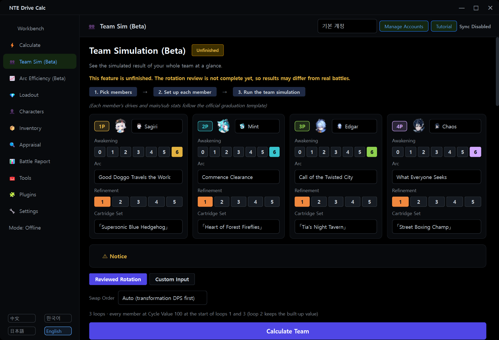

[en README](../README.en.md)

## Usage

### Changing the language

The buttons `中文` `한국어` `日本語` `English` are at the bottom left of the program. Click one and the language changes at once.

### Team Simulation

Open **Team Sim (Beta)** in the left menu, ① pick four members, ② set Awakening, Arc, Refinement and Cartridge Set for each member, then ③ click **Calculate Team**. The default mode is "Reviewed Rotation". The arc list shows the arcs the character can equip; another character's exclusive arc carries its owner's name.

- **Awakening**: the ①–⑥ buttons of a member card turn single effects on and off ("Awakening n/6"). The ⋯ menu selects all, none or the graduation template's effects. Hovering over an effect shows its description and whether it is computed ("Unmeasured", "Not computable", "expected").
- **Resource model**: below the swap order, choose Game data + community cooldowns (default) / Game data / Old rule.
- The explanation below the result lists energy, gauge, cooldown waits and swaps.

### Arc Efficiency and awakening efficiency tables

Open **Arc Efficiency (Beta)** in the left menu and click a character in the list on the left. The buttons at the top switch the loops (3 / 1) and the basis. Select an arc in the table and click **Open in Team Simulation** to try it in a team. The legend below the table and the "Notice" at the top explain the marks. Expand **Character Awakening Efficiency (Beta)** at the bottom of the page for the awakening table. **View at Puka Boot Camp max (Lv.20)** applies to both tables.

### Puka Boot Camp

Enter the Puka Boot Camp level (0–20) on the **Furniture Bonus** card of the character page. There is one level per account, used for every character. **All Boot Camp stats** on the battle report card changes what recalculations include.

### Writing your own rotation

Click **Custom Input** and write `character action` steps in the **Notation** box, joined with `>`.

```text
Zero support > Zero E > Zero basic basic basic > Oneiroi swap > Oneiroi Q > Oneiroi E > Oneiroi basic
```

- **support** enters with the Support Skill. If the outgoing member's element is adjacent, an Esper Cycle reaction triggers. A support on the very first step only plays the skill, because there is no outgoing member.
- **swap** is a normal swap: no Support Skill and no reaction.
- Available actions: `support` `swap` `basic` `heavy` `E` `E-hold` `Q` `counter` `dodge` `plunge` `appear` `special` `wait` (which actions exist depends on the character)
- `basic basic basic` = `basicx3` = `basic 3 times`. Pick a specific hit of a chain with `#N` (for example `basic#4`). `wait 2` waits 2 seconds.
- Remarks in parentheses are ignored. Besides `>`, `→` and line breaks also work as separators.
- You can also build the steps by clicking the member and action buttons. Korean, Japanese and Chinese notation is accepted at any time.
- **▶ Options**: Cycle Value mode (As entered / Check Cycle Value) and Starting Cycle Value; cooldown and energy values and the check mode (No check / Warn only (default) / Insert wait / Strict); turning the team buffs inferred by the engine on or off; manual buffs; repeat count; enemy level, RES, DEF reduction and vulnerability; boss and number of enemies; swap time. Cooldown and energy fields start from the resource model's values and can be edited.
- Rotations can be **saved** under a name and **loaded** again. **Load Reviewed Rotation** imports a built-in rotation (1 loop or 3 loops) so you can edit it.
- The limits are 200 steps and 600 executed actions including repeats.

<details>
<summary>Show the result screen of Custom Input mode (the example above, Korean interface, 2.3.1-global.1)</summary>


</details>

<details>
<summary>Show the Team Simulation screen (2.3.1-global.1)</summary>



</details>
