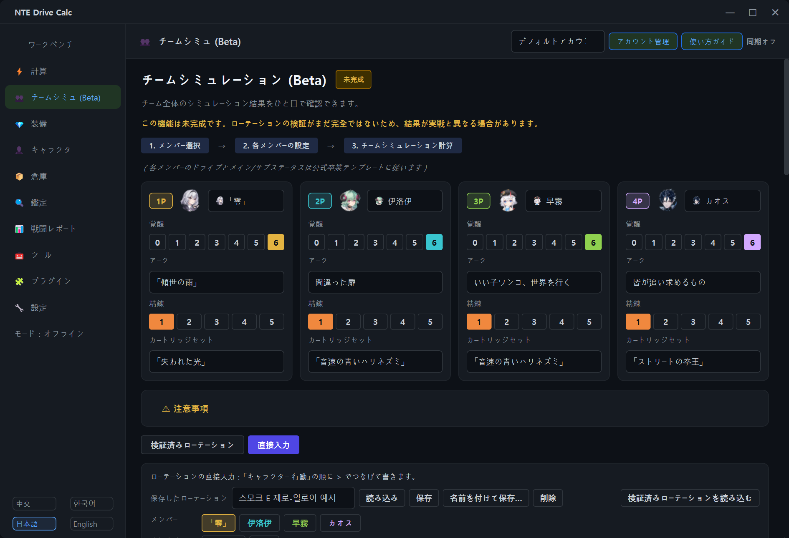

[ja README](../README.ja.md)

## 使い方

### 言語の切り替え

プログラムの左下に `中文` `한국어` `日本語` `English` のボタンがあります。押すとすぐに切り替わります。

### チームシミュレーション

左メニューの **チームシミュ (Beta)** で、① メンバーを 4 人選び、② メンバーごとに覚醒・アーク・精錬・カートリッジセットを決め、③ **チーム計算** を押します。既定のモードは「検証済みローテーション」です。アークの一覧にはそのキャラクターが装備できるアークが出て、他のキャラクターの専用アークには持ち主の名前が付きます。

- **覚醒**：キャラカードの ①〜⑥ ボタンで効果を 1 つずつオン／オフします（「覚醒 n/6」）。⋯ メニューですべて選択・すべて解除・卒業テンプレートどおりの選択ができ、効果にマウスを重ねると説明と計算の扱い（「要実測」「計算不可」「期待値」）が表示されます。
- **リソースモデル**：交代順の下の「リソースモデル」で ゲームデータ + コミュニティのクールタイム（既定）/ ゲームデータ / 旧ルール を選びます。
- 結果の下の説明欄で、エネルギー・サイクル値・クールタイム待ちと交代の内訳を確認できます。

### アーク効率表と覚醒効率表

左メニューの **アーク効率表 (Beta)** で、左の一覧のキャラクターを押します。上のボタンで周回数（3 周 / 1 周）と比較基準を切り替え、表のアークを選んで **チームシミュレーションで開く** を押すと、そのアークでチームシミュレーションを開きます。表の下の記号の説明とページ上部の「注意事項」もあわせてご覧ください。ページ下部の **キャラクター覚醒効率 (Beta)** を開くと覚醒効率表が表示されます。**プカ特訓最大（Lv.20）基準で表示** は両方の表に適用されます。

### プカ特訓

キャラクターページの **家具ボーナス** カードでプカ特訓のレベル（0〜20）を入力します。アカウントごとに 1 つのレベルで、すべてのキャラクターの計算に使われます。戦闘レポートのカードの **特訓をすべて反映** で、再計算のときの反映範囲を切り替えられます。

### ローテーションを自分で入力する

**直接入力** ボタンを押し、**テキスト入力** 欄に `キャラクター 行動` を `>` でつなげて書きます。

```text
零 サポート > 零 E > 零 通常 通常 通常 > 伊洛伊 交代 > 伊洛伊 Q > 伊洛伊 E > 伊洛伊 通常
```

- **サポート**は支援スキルで登場します。退場するメンバーと隣接属性なら、エスパーサイクルの反応が発生します。最初のステップのサポートは、退場するメンバーがいないためスキルだけが出ます。
- **交代**は通常交代です。支援スキルも反応もありません。
- 使える行動：`サポート` `交代` `通常` `強攻撃` `E` `E長押し` `Q` `カウンター` `回避` `落下` `登場攻撃` `特殊` `待機`（使える行動はキャラクターによって異なります）
- `通常 通常 通常` = `通常x3` = `通常 3回`。連続攻撃の特定の段は `#N` で選びます（例：`通常#4`）。`待機 2` は 2 秒の待機です。
- かっこ内に書いたメモは無視されます。区切りは `>` のほかに `→` と改行も使えます。
- メンバーのボタンと行動のボタンを押してステップを作ることもできます。韓国語・英語・中国語の書き方もいつでも認識します。
- **▶ オプション**：サイクル値モード（入力どおり / サイクル値をチェック）と開始時のサイクル値、クールタイム・エネルギーの値とチェック方法（チェックしない / 警告のみ（既定）/ 待機を挿入 / 厳格）、エンジンが推定したチームバフのオン/オフ、手動バフ、繰り返し回数、敵レベル・敵の耐性・敵の防御力ダウン・敵の被ダメージアップ、ボスかどうか・敵の数、交代時間。クールタイム・エネルギーの欄はリソースモデルの値が既定で入り、自分で書き換えられます。
- ローテーションは名前を付けて**保存**し、**読み込む**ことができます。**検証済みローテーションを読み込む**で内蔵のローテーション（1 周または 3 周）を取り込み、書き換えて使うこともできます。
- 上限は 200 ステップ、繰り返しを含めた実行行動 600 個です。

<details>
<summary>直接入力モードの計算結果の画面を見る（上の例、韓国語表示、2.3.1-global.1）</summary>


</details>

<details>
<summary>チームシミュレーションの画面を見る（2.3.1-global.1）</summary>



</details>
