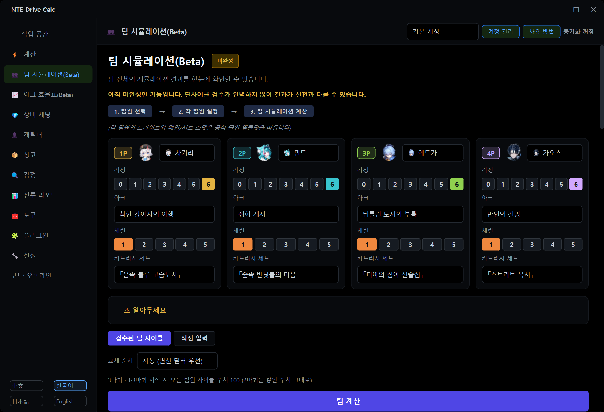

[ko README](../README.md)

## 사용법

### 언어 바꾸기

프로그램 왼쪽 아래에 `中文` `한국어` `日本語` `English` 버튼이 있습니다. 누르면 바로 바뀝니다.

### 팀 시뮬레이션

왼쪽 메뉴의 **팀 시뮬레이션(Beta)** 에서 ① 팀원 4명을 고르고 ② 팀원별 돌파·아크·재련·카트리지 세트를 정한 뒤 ③ **팀 계산**을 누릅니다. 기본 모드는 "검수된 딜 사이클"입니다. 아크 목록에는 그 캐릭터가 낄 수 있는 아크가 나오고, 다른 캐릭터의 전용 아크에는 주인 이름이 붙습니다.

- **돌파**: 캐릭터 카드의 ①~⑥ 버튼으로 효과를 하나씩 켜고 끕니다("돌파 n/6"). ⋯ 메뉴로 전부 켜기·전부 끄기·졸업 템플릿대로 고르기를 할 수 있고, 효과 위에 마우스를 올리면 설명과 계산 여부("측정 필요"·"계산 불가"·"기대값")가 나옵니다.
- **자원 모델**: 교체 순서 아래의 "자원 모델"에서 게임 데이터 + 커뮤니티 쿨타임(기본) / 게임 데이터 / 기존 규칙을 고릅니다.
- 결과 아래 설명란에서 에너지·사이클 수치·쿨타임 대기와 교체 내역을 볼 수 있습니다.

### 아크 효율표와 돌파 효율표

왼쪽 메뉴의 **아크 효율표(Beta)** 에서 왼쪽 목록의 캐릭터를 누릅니다. 위쪽 버튼으로 바퀴 수(3바퀴/1바퀴)와 비교 기준을 바꾸고, 표의 아크를 고른 뒤 **팀 시뮬레이션에서 열기**를 누르면 그 아크로 팀 시뮬레이션을 엽니다. 표 아래의 기호 설명과 페이지 위의 "알아두세요"를 함께 보세요. 페이지 아래의 **캐릭터 돌파 효율(Beta)** 을 펼치면 돌파 효율표가 나옵니다. **푸카 특훈 만렙(20) 기준으로 보기**는 두 표 모두에 적용됩니다.

### 푸카 특훈

캐릭터 페이지의 **가구 보너스** 카드에서 푸카 특훈 레벨(0~20)을 입력합니다. 계정마다 하나의 레벨이며 모든 캐릭터 계산에 쓰입니다. 전투 리포트 카드의 **특훈 전체 반영**으로 다시 계산할 때의 반영 범위를 바꿀 수 있습니다.

### 딜 사이클 직접 입력

**직접 입력** 버튼을 누르고 **표기** 칸에 `캐릭터 동작`을 `>`로 이어 적습니다.

```text
제로 서포트 > 제로 E > 제로 평타 평타 평타 > 일로이 교체 > 일로이 Q > 일로이 E > 일로이 평타
```

- **서포트**는 서포트 스킬로 입장합니다. 나가는 팀원과 인접 속성이면 에스퍼 사이클 반응이 발동합니다. 맨 첫 단계의 서포트는 나가는 팀원이 없어 스킬만 나갑니다.
- **교체**는 일반 교체입니다. 서포트 스킬도 반응도 없습니다.
- 쓸 수 있는 동작: `서포트` `교체` `평타` `강공격` `E` `E홀드` `Q` `반격` `회피` `낙하` `등장공격` `특수` `대기` (캐릭터에 따라 쓸 수 있는 동작이 다릅니다)
- `평타 평타 평타` = `평타x3` = `평타 3번` = `평타 3타`. 연속기의 특정 타는 `#N`으로 고릅니다(예: `평타#4`). `대기 2`는 2초 대기입니다.
- 괄호 안에 적은 메모는 무시됩니다. 구분자는 `>` 외에 `→`와 줄바꿈도 됩니다.
- 팀원 버튼과 동작 버튼을 눌러서 단계를 만들어도 됩니다. 영어·일본어·중국어 표기도 언제나 인식합니다.
- **▶ 옵션**: 사이클 수치 모드(입력대로 / 사이클 수치 검사)와 시작 사이클 수치, 쿨타임·에너지 값과 검사 방식(검사 안 함 / 경고만(기본) / 대기 삽입 / 엄격), 엔진이 추론한 팀 버프 켜기/끄기, 수동 버프, 반복 횟수, 적 레벨·저항·방어력 감소·취약, 보스 여부·적 수, 교체 시간. 쿨타임·에너지 값은 자원 모델의 값이 기본으로 들어가고 직접 고칠 수 있습니다.
- 사이클은 이름을 붙여 **저장**하고 **불러올** 수 있습니다. **검수된 딜 사이클 불러오기**로 내장 사이클(1바퀴 또는 3바퀴)을 가져와 고쳐 쓸 수도 있습니다.
- 한도는 200단계, 반복을 포함해 실행 동작 600개입니다.

<details>
<summary>직접 입력 모드의 계산 결과 화면 보기 (위 예시, 2.3.1-global.1 화면)</summary>


</details>

<details>
<summary>팀 시뮬레이션 화면 보기 (2.3.1-global.1 화면)</summary>



</details>
