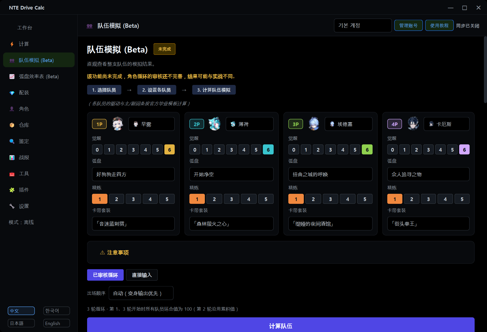

[zh README](../README.zh.md)

## 使用方法

### 切换语言

程序左下角有 `中文` `한국어` `日本語` `English` 四个按钮，点击后立即切换。

### 队伍模拟

在左侧菜单的 **队伍模拟 (Beta)** 中：① 选择 4 名队员，② 为每名队员设置觉醒、弧盘、精炼和卡带套装，③ 点击 **计算队伍**。默认模式是“已审核循环”。弧盘列表中显示该角色可装备的弧盘，其他角色的专属弧盘会标注其所属角色。

- **觉醒**：用角色卡片上的 ①–⑥ 按钮逐个开关效果（“觉醒 n/6”）。⋯ 菜单可以全选、取消全选或按毕业模板选择；把鼠标停在效果上会显示说明和计算情况（“需要实测”“无法计算”“期望值”）。
- **资源模型**：在出场顺序下方的“资源模型”中选择 游戏数据 + 社区冷却（默认）/ 游戏数据 / 旧规则。
- 结果下方的说明栏中可以看到能量、环合值、冷却等待和切换的明细。

### 弧盘效率表与觉醒效率表

在左侧菜单的 **弧盘效率表 (Beta)** 中点击左侧列表里的角色。用上方的按钮切换轮数（3 轮 / 1 轮）和比较基准；在表中选中弧盘后点击 **在队伍模拟中打开**，即可用该弧盘打开队伍模拟。请同时参阅表格下方的符号说明和页面上方的“注意事项”。展开页面下方的 **角色觉醒效率 (Beta)** 即可看到觉醒效率表。**按噗卡特训满级（Lv.20）查看** 对两个表都生效。

### 噗卡特训

在角色页的 **家具加成** 卡片中输入噗卡特训等级（0–20）。每个账号一个等级，所有角色的计算都会使用。战报卡片上的 **全部计入特训** 可以切换重算时的计入范围。

### 直接输入循环

点击 **直接输入** 按钮，在 **文本输入** 框中按 `角色 动作` 的顺序用 `>` 连接：

```text
零 援护 > 零 E > 零 普攻 普攻 普攻 > 伊洛伊 切换 > 伊洛伊 Q > 伊洛伊 E > 伊洛伊 普攻
```

- **援护**表示以援护技登场。与切出队员属性相邻时会触发环合反应。第一步的援护因为没有切出队员，只释放技能。
- **切换**表示普通切换，不放援护技，也不触发反应。
- 可用动作：`援护` `切换` `普攻` `重击` `E` `E长按` `Q` `反击` `闪避` `下落` `登场攻击` `特殊` `等待`（可用的动作因角色而异）
- `普攻 普攻 普攻` = `普攻x3` = `普攻 3次`。连段中的某一段用 `#N` 指定（例如 `普攻#4`）。`等待 2` 表示等待 2 秒。
- 括号里的备注会被忽略。分隔符除了 `>`，也可以用 `→` 或换行。
- 也可以点击队员按钮和动作按钮来添加步骤。韩语、英语、日语的写法随时都能识别。
- **▶ 选项**：环合值模式（按输入执行 / 检查环合值）与开始时环合值；冷却、能量数值及检查方式（不检查 / 仅警告（默认）/ 插入等待 / 严格）；开关引擎推算的队伍 Buff；手动 Buff；重复次数；敌人等级、抗性、防御降低与易伤；是否首领与敌人数量；切换耗时。冷却与能量栏默认填入资源模型的数值，可以自行修改。
- 循环可以命名**保存**并**读取**。也可以用**读取已审核循环**导入内置循环（1 轮或 3 轮）后再修改。
- 上限为 200 步，含重复在内最多执行 600 个动作。

<details>
<summary>查看直接输入模式的计算结果界面（上面的例子，韩语界面，2.3.1-global.1）</summary>


</details>

<details>
<summary>查看队伍模拟界面（2.3.1-global.1）</summary>



</details>
